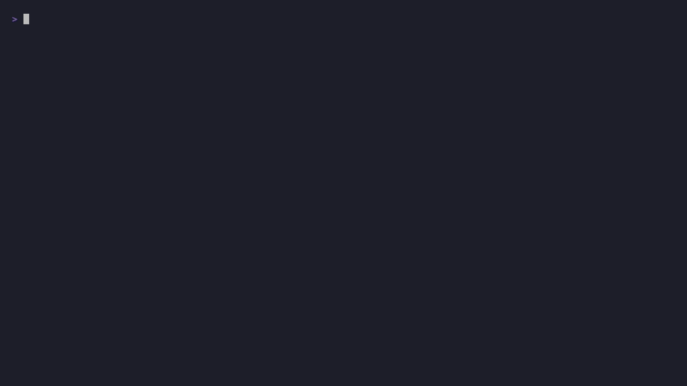

<div align="center">

<h1>Agentty ADE</h1>


[](https://codecov.io/gh/agentty-xyz/agentty)
[](https://github.com/agentty-xyz/agentty/actions/workflows/postsubmit.yml)

[](https://sonarcloud.io/summary/new_code?id=agentty-xyz_agentty)
[](https://sonarcloud.io/summary/new_code?id=agentty-xyz_agentty)
[](https://sonarcloud.io/summary/new_code?id=agentty-xyz_agentty)
[](https://sonarcloud.io/summary/new_code?id=agentty-xyz_agentty)
[](https://sonarcloud.io/summary/new_code?id=agentty-xyz_agentty)

Agentty is an **ADE (Agentic Development Environment) for structured, controllable
AI-assisted software development**. Built with Rust and [Ratatui](https://ratatui.rs),
and refined through its own day-to-day use, it brings agents, review, and iteration into
one focused terminal workflow.

[Installation](#installation) · [Supported CLI Agents](#supported-cli-agents) ·
[Usage](#usage) · [Documentation](#documentation) · [Contributing](#contributing) ·
[License](#license)



</div>

______________________________________________________________________

Codex, Claude, and Antigravity sessions show compact tool status and command previews,
with output previews for failed calls. Explicit Claude skill invocations appear
alongside them, and answers retain saved usage counts.

Press `w` in session view to inspect saved execution graphs, accept exact outputs, retry
work, resume dispatch, or cancel a graph. Questions from graph nodes and proposals open
the same question panel as an ordinary turn's questions.

With `--experimental-graph`, select `/graph`, then describe your task. Regular chat
stays on the left, with the graph preview and live status in a right pane using at most
35% of the width. Reply in chat to approve, revise, or cancel the proposal; `w` shows
its details. Nodes launch only after approval. `/graph` is a mode selector with no
subcommands.

Graph proposals use bundled Markdown agent definitions. Repository overrides live in
`.agents/agents/<id>/agent.md`; see the
[workflow guide](https://agentty.xyz/docs/usage/workflow/) for the supported format.

## Installation

### npm (recommended)

The `npm`, Bun, and `pnpm` packages require Node.js on your `PATH`. Global installs
support automatic updates through the original package manager when Agentty can identify
it.

```sh
npm install -g agentty
```

### Other methods

<details>
<summary>Bun</summary>

```sh
bun add --global agentty
```

</details>

<details>
<summary>pnpm</summary>

```sh
pnpm add --global agentty
```

If `pnpm` reports a global bin-directory error, run `pnpm setup`, reopen your terminal,
and retry.

</details>

<details>
<summary>npx (run without installing)</summary>

```sh
npx agentty
```

</details>

<details>
<summary>Shell</summary>

```sh
curl --proto '=https' --tlsv1.2 -LsSf https://github.com/agentty-xyz/agentty/releases/latest/download/agentty-installer.sh | sh
```

</details>

<details>
<summary>Cargo</summary>

macOS source builds require Xcode Command Line Tools for native process bindings.

```sh
cargo install agentty
```

</details>

## Supported CLI Agents

Agentty currently supports Codex, Claude, and Antigravity. Install and authenticate at
least one provider CLI before starting a session:

- Codex (`codex`, recommended; supports subscription usage): install the
  [Codex CLI](https://github.com/openai/codex) and run `codex login`.

> [!NOTE]
>
> Codex is the recommended CLI agent for Agentty when you want subscription-backed
> usage. Codex supports signing in with ChatGPT for subscription access, including in
> the CLI, and Agentty uses the Codex `app-server` integration surface. Usage remains
> subject to the [OpenAI Terms of Use](https://openai.com/policies/terms-of-use/).
> OpenClaw documents ChatGPT/Codex subscription sign-in as the normal
> [Codex harness](https://docs.openclaw.ai/plugins/codex-harness) path, and opencode
> recommends ChatGPT Plus or Pro authentication for its
> [OpenAI provider](https://opencode.ai/docs/providers/#openai).

- Claude (`claude`): install [Claude Code](https://github.com/anthropics/claude-code)
  and run `claude auth login`.

> [!WARNING]
>
> For Agentty usage through `claude -p`, use API key authentication through Claude
> Console or a supported cloud provider instead of a Claude Free, Pro, or Max
> subscription sign-in. Anthropic's
> [Claude Code legal and compliance docs](https://code.claude.com/docs/en/legal-and-compliance)
> describe subscription OAuth as intended for ordinary use of Claude Code and native
> Anthropic applications, while developer integrations should use API keys or supported
> cloud providers. Theo's
> [explanation video](https://www.youtube.com/watch?v=RIkSlHgQYog) discusses the same
> uncertainty, but commentary does not guarantee that subscription-backed usage is safe
> for third-party tool invocation.

- Antigravity (`agy`): install version 1.1.18 or newer of the
  [Antigravity CLI](https://github.com/google-antigravity/antigravity-cli) and run `agy`
  to sign in when prompted.

> [!WARNING]
>
> For Agentty usage through `agy` headless mode, use authentication backed by a Google
> Cloud project or an API key when available for your Antigravity setup, rather than a
> Google Account subscription sign-in. The
> [Antigravity terms](https://antigravity.google/terms) do not yet clearly describe how
> subscription access applies when `agy` headless mode is invoked by third-party tools.

Agentty uses each provider's official non-interactive CLI or app-server surface
(`claude -p`, `agy --input-format stream-json`, or `codex app-server`) after you
authenticate with that provider's CLI. It does not implement OAuth flows, read provider
OAuth tokens directly, or call private provider APIs. You are responsible for choosing
an authentication method that is permitted for your account, plan, and usage pattern.

## Usage

Launch Agentty from the repository you want to work in:

```sh
agentty              # Launch with auto-update enabled (default)
agentty --no-update  # Launch without automatic updates
agentty --otlp-endpoint http://localhost:4318/v1/traces  # Export session traces
agentty --experimental-harness  # Offer preview Harness sessions
agentty --experimental-graph  # Enable /graph proposals
agentty --help       # Show supported command-line options
agentty --version    # Show the installed Agentty version
```

- **Projects**: discovery is opt-in. In the **Projects** tab, add a repository by path
  (`a`) or scan a chosen folder (`d`).
- **Instances**: only one Agentty instance can use a given Agentty root at a time.
  Separate `AGENTTY_ROOT` directories can run independently.
- **Graphs**: `--experimental-graph` enables `/graph` proposals you can inspect, revise,
  and approve before any node runs. See the
  [workflow guide](https://agentty.xyz/docs/usage/workflow/).
- **Harness**: `--experimental-harness` adds a preview session type that runs Agentty's
  built-in agent loop against local or hosted models. Its edit mode runs unsandboxed
  shell commands. See
  [Harness sessions](https://agentty.xyz/docs/agents/backends/#backends-harness).
- **Tracing**: disabled unless `--otlp-endpoint` supplies a complete OTLP HTTP/protobuf
  traces URL. A URL ending in `/v1/traces` also sends usage events as OTLP log records
  to the sibling `/v1/logs` URL, even when telemetry is disabled. See
  [session traces](https://agentty.xyz/docs/usage/workflow/#session-traces).
- **Telemetry**: enabled by default; release builds send events to the Agentty PostHog
  project. Set `AGENTTY_TELEMETRY_ENABLED=0` to disable it. See the
  [telemetry details](https://agentty.xyz/docs/usage/workflow/#telemetry).

## Documentation

The programmatic session API supports creating and listing tasks before execution,
submitting attempts, and explicitly accepting outcomes. See the
[task contract](https://agentty.xyz/docs/core-components/durable-components/task/) for
session ownership, concurrency, and current limits.

It also supports explicit static execution graphs with isolated task conversations,
exact output acceptance, and shared execution limits. See
[execution graphs](https://agentty.xyz/docs/architecture/execution-graphs/) for
supported profiles and lifecycle limits.

Documentation for installation and workflows is available at
[agentty.xyz/docs](https://agentty.xyz/docs/).

> [!WARNING]
>
> Agentty is in active development. While releases follow Semantic Versioning, the
> current `0.y.z` series may still introduce breaking changes between releases as
> workflows, integrations, and safeguards evolve. Always review and verify the changes
> Agentty proposes or applies in your repositories before you rely on them.

## Contributing

See [CONTRIBUTING.md](CONTRIBUTING.md) for contribution guidance.

## License

Apache-2.0
