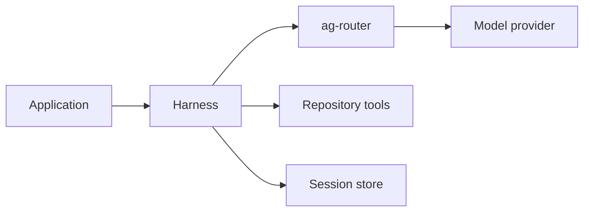
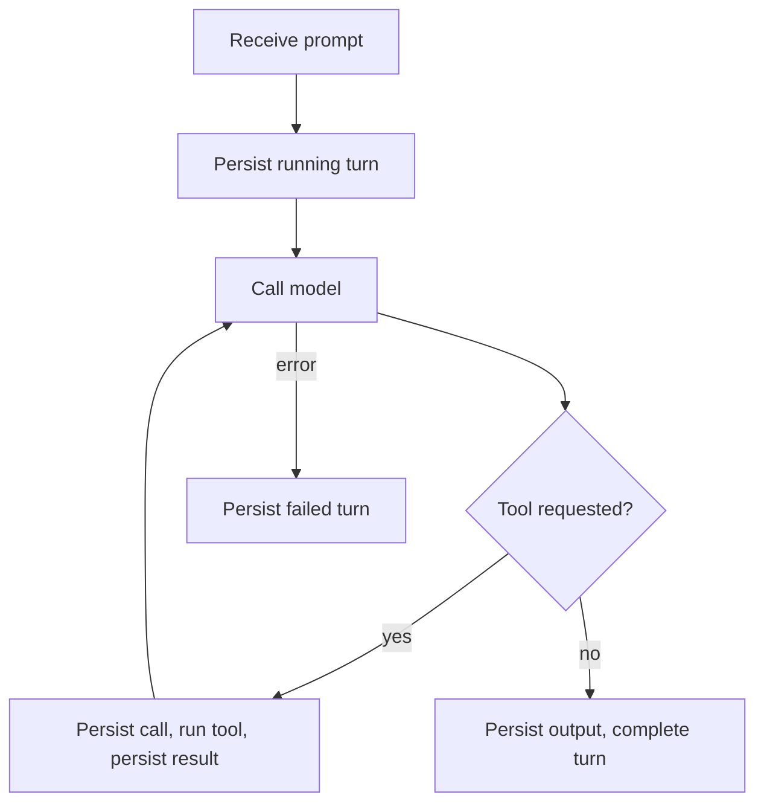

+++
title = "ag-harness Design"
description = "Model loop, durable sessions, and repository policy."
weight = 6
+++

# `ag-harness` — a light LLM harness

`ag-harness` is the base layer between an application and an LLM. It is Rust-native,
app-facing, and lightweight: an agent loop, three policy-checked tools, durable
sessions, and content-free lifecycle events. Product decisions stay in the application.
Agentty runs it as the preview `AgentKind::Harness` backend behind
`--experimental-harness`, following the [Execution](@/docs/core-components/execution.md)
boundary.



## Core features

- **Three built-in tools** — `read`, `write` (git-style patches), and sandboxed `bash`.
- **Deny-by-default permissions** — every tool call passes an explicit per-turn policy.
- **Structured output** — every turn validates against a caller-supplied JSON schema.
- **Durable sessions** — SQLite by default; memory and custom stores share the same
  public contract.
- **Provider-neutral models** — built-in Muse, Kimi, and Qwen clients use `ag-router`
  behind the object-safe `Model` trait.
- **Typed lifecycle events** — content-free turn, model, and tool observations.

## Crates

```text
crates/
├── ag-router        # structured chat routing + provider transports
├── ag-harness       # library + ag-harness-sandbox launcher binary
└── ag-harness-cli   # interactive terminal host
```

## Public boundary

- `Harness` owns the model and its required `ContextBudget`, validated repository,
  configured defaults, lifecycle observers, and the selected session store.
- `Session` is the only multi-turn abstraction; `run_once` executes a stateless turn.
- `Session::turn` is the configurable durable-turn entry point: chain `options` and
  `host_id`, then either await the turn or `start` it for a `TurnControl`.
  `Harness::turn` takes explicit options for a stateless turn and is likewise awaited or
  started; it has no host ID.
- `TurnOptions` fixes the schema, `ToolPolicy`, and optional `ComparisonBase` for one
  execution. Explicit options replace defaults; they are never merged.
- The crate root exports what a typical host needs; extension points and detailed
  records live in the `provider`, `model`, `tool`, `bash`, `turn`, `store`, `recovery`,
  and `lifecycle` modules.
- `Model` is the object-safe provider boundary. `ModelRegistry` resolves built-in or
  injected models by stable host keys with declared `ModelCapabilities`.
- `SessionStore` is the public persistence contract and `BashExecutor` the public
  command-execution contract; both accept host implementations. Stores expose atomic
  record operations; the harness applies admission rules and builds each lease.

## Agent loop

A turn continues until the model responds without requesting a tool, and the terminal
response must satisfy the caller's schema. There is no tool-call limit: cancellation and
the required `ContextBudget` bound a turn.

Before every model request the engine fits the request to the budget without a model
call. Fitting works on a copy, so canonical turn messages, the durable journal, and
replayed history keep the original content. Once a request exceeds the budget, older
tool results that a later call of the request superseded are cleared first, oldest
first, down to 70% of the capacity left after reserved output: a `read` whose target a
later read returned again over at least the same lines (a covering line window for
`file` and `show`, the same or a larger limit otherwise), a `file` read or `diff`
showing a path a later applied `write` changed, or a `bash` result whose exact command
ran again. Their notices name the superseding call. A read answered by the repeated-read
note below supersedes nothing. Staleness is weighed only while a request exceeds the
budget, and a cleared result stays cleared, so the shared prefix changes only when
fitting already changes it. Every remaining tool result above 25% of that capacity is
then cut to a head and tail excerpt of that size, and the latest round's largest results
are cut to one common size while the round's results together exceed 50%, so one
oversized output never pushes earlier rounds out. The request is then reduced to 70% of
its capacity, in order: the other older tool results become tool-aware notices (oldest
first, replayed history before the current turn; a `read` notice names its target), then
older assistant reasoning becomes a non-empty placeholder (providers that replay
reasoning still receive the field), then older `write` patches become a note on their
recorded outcome, then the oldest replayed turns are dropped, then the current turn's
oldest tool rounds are dropped whole, each call message with all its results, behind one
bounded note that counts the removed calls, names the writes they applied and the
commands they ran, and lists their distinct read targets to re-read only if still
needed. Tool calls keep their identifiers, so tool groups stay well-formed, and the
latest tool round is never reduced by these steps. Each step is a watermark into the
append-only canonical messages that later requests replay, so successive requests share
a stable prefix and reduce further only when the budget is exceeded again; each reduced
message is cached, so a request between watermark advances only weighs and appends its
new messages. If the request still does not fit, the latest round's largest results are
cut further to a head and tail excerpt that asks for a narrower read, and as the last
resort its `write` patches are replaced by their recorded outcome; only when even that
fails does the turn fail typed. Each `ModelRequestActivity` reports the reductions its
request carried.

With `ContextSummaryPolicy::Enabled`, a request that still exceeds 70% of its capacity
after superseded results are cleared and oversized results capped first summarizes the
current turn's earlier tool rounds. The latest round and the rounds before it within a
quarter of the capacity stay whole; the rounds before them that no summary or note
covers yet form the source, which carries the task, any earlier summary to carry
forward, and each round as bounded JSON with superseded results as their notices. The
source text is cut at shrinking levels, then its oldest rounds are left out, until the
tool-free summary request fits the budget. A summary is requested only when the rounds
not yet offered to one weigh a fifth of the capacity, so a turn summarizes again only
after enough new rounds aged out. The engine sends that request as one of the turn's
model requests, re-requesting invalid output like a final output, and accepts a summary
that matches the checkpoint summary schema, fits 15% of the capacity, and is smaller
than its source. The covered rounds then become one note carrying the summary as data
beside the dropped-round ledger of their writes, commands, and read targets, and every
reduction watermark moves past them. Like every reduction, the summary exists only in
sent copies: canonical messages, the journal, and replayed history keep the rounds, and
a resumed or later turn never sees it. A failed, rejected, or cancelled summary falls
back to the steps above for that fit, and a turn stops asking after two failures.
Summary requests are reported with `ModelRequestPurpose::ContextSummary`, calibrate
later estimates, and emit `ContextSummaryStarted`/`Completed`/`Failed` lifecycle events
that the trace observer projects as an `agent.compaction` span around their model
requests.

Before running a `read`, the engine compares its canonical arguments with the reads
already run in the turn. When an identical read ran earlier, no `write` or `bash` call
was handled since, the last request carried that result whole (neither reduced, cut, nor
dropped), and the result is larger than the note, the call is answered with a short
`unchanged` result naming the earlier call instead of running. The call and that result
are journaled like any tool exchange, because a durable record describes what the turn
returned, and the turn report lists it as `ToolActivity::ReadRepeated`. `write` and
`bash` always run.

After each response's calls, the engine counts identical calls among the turn's last 12
handled calls: the same tool, the same canonical arguments, and the same result digest.
Keying on the result keeps polling a changing command from counting, and a `read`
answered by the repeated-read note counts with the result it pointed to, so a model that
keeps re-reading still converges on a stop. A `write` or `bash` call unlike any call in
the window may change what later calls return, so it restarts the count; malformed calls
have their own bound and are not counted. The third identical call appends request-only
`[harness]` feedback, never journaled, that asks the model to use what it has, change
approach, or answer, and `TurnReport::repetition_nudges` counts it. The fifth fails the
turn with `TurnError::RepeatedToolCalls` after its results are journaled, so replayed
history stays well-formed. Both emit `LifecycleEventKind::ToolCallsRepeated`, which the
trace projection records as a turn-span event.

The heuristic estimate under-counts some content, so the harness calibrates it from
provider usage, much like Codex combines the last reported usage with an estimate of
newer items. Providers also add a fixed per-request cost the estimate never sees (live
Muse and Qwen runs reported about 1,200–1,300 input tokens for a 581-weight first
request), so one ratio fitted to a small request would roughly halve the usable window.
The calibration is instead an upper envelope over the reports: a line through the first
reported request, its ratio until a request at least 10% of the input capacity larger
measures the slope of token growth, the slope then rising to the steepest growth
measured and the line lifted to cover every report. The slope stays within 1–3: images
are weighed at their encoded size and must not loosen the text budget, and one
inconsistent report must not empty the window. Projection, admission, and fitting
compare estimates with the largest weight whose calibrated tokens fit 95% of the input
capacity, the margin covering denser content such as cleared-result notices, which
under-shot the envelope by up to about 5% live; before any usage, the estimate may fill
90%. Because the calibration only lowers the weight limit while cached message weights
stay in estimator units, a tighter limit only advances the fitting watermarks further
and never reshuffles an already-reduced prefix. Every built-in provider reports
OpenAI-style `prompt_tokens`, whose cached tokens are a subset (live cache hits never
exceeded the reported input), so prompt caching does not skew the calibration. It lives
in memory per harness and the sessions it captures, resets on `switch_model` and
estimator replacement, and needs no schema change. Budget failures still name the
declared budget, with the required weight restated in calibrated tokens, and
`ModelRequestActivity` reports each request's estimated and calibrated weight.

A provider rejection of a request as exceeding its context window reports no usage, so
it instead caps later requests at 75% of the rejected request's estimated weight, the
same shrink Roo Code retries an overflow at; a later rejection only lowers the cap. The
engine then refits the turn's request under the lowered budget and re-sends it, at most
twice per turn, so two rejections reach about 56% of the first rejected weight. A refit
that cannot shrink below the cap fails the turn with the provider's
`ModelErrorType::ContextOverflow` rather than a budget error, as does a third rejection.
The cap lives with the calibration, so later turns stay below a window the provider
proved wrong until `switch_model` or estimator replacement resets it; a budget failure
it causes restates the required weight scaled by how far the cap cut the declared
capacity, so it still exceeds the declared budget. `TurnReport` counts the re-sends, and
`LifecycleEventKind::ContextOverflowRetried` follows each re-sent request's outcome,
traced as a `ag_harness.context_overflow.retried` event on the turn span. Compaction
requests run through the same engine, but their source is mandatory input that a refit
cannot shrink, so a rejected one fails with the provider's error without a second
request and leaves the lowered cap for later requests.



Each finished model response and tool result is persisted before the loop continues, so
a stopped turn keeps everything it already did.

## Sessions

- The selected store is canonical. Every request replays projected history; providers
  never hold conversation state.
- One active turn per session. Renewable leases fence concurrent processes; expired
  leases mark turns `interrupted`.
- Failed and interrupted turns re-enter model context with what they recorded, never as
  completed history: tool calls without a result get a placeholder result in the request
  only, and a closing stop note names the cause and the writes and commands whose
  outcome is unknown. A stopped turn that does not fit replays with its tool traffic
  replaced by notices, or else as only its input and note.
- Reservation and model switching run in one store-owned atomic section that reads the
  admission state and records the harness's decision: recorded host requests first, then
  the model generation, an idle session, and no unresolved command.
- Within one process, a single reservation lifecycle owns admission, lease renewal,
  finalization, and cleanup of abandoned owners. It recovers those owners before every
  turn acquisition or model switch, the same way for every store.
- Each turn records its effective options, comparison identity, and model provenance
  before execution. Write and command intents persist before their effects.
- `host_id`/`recover` bind host-assigned request IDs to a fingerprint of the effective
  request, so matching retries return recorded outcomes instead of executing again.
- `switch_model` selects another registration for an idle session, whose context budget
  bounds every later request. `compact` publishes a schema-validated summary checkpoint
  that request projection replays ahead of the remaining recent turns. Its source is the
  previous summary and the oldest uncovered turns, loaded oldest first within the
  history byte limit and rendered as JSON lines that keep tool-call arguments and bound
  every text. The newest turns are dropped until the source fits the context budget, and
  the checkpoint covers exactly the rendered turns, so the rest stay uncovered for a
  later call. A summary that is no smaller than its source is rejected.
- Every harness has an approximate `ContextBudget`, passed to `Harness::new` or declared
  by its registration: requests keep the most recent turns that fit, each whole, with
  its tool traffic replaced by notices, or as its input and final output (input and stop
  note for a stopped turn), and mandatory content that cannot fit fails with a typed
  error before any provider call.
- The byte-based history limit keeps each turn too large to load whole in its elided or
  brief form, so one oversized turn no longer hides itself and every older turn. Every
  store selects the same forms; SQLite decides whole and brief turns from stored sizes
  and loads a turn's full payload only when its elided form might fit. A turn larger
  than eight times the limit is never elided, so loading one turn stays bounded. Every
  turn acquisition reloads history from the store, so live and resumed sessions replay
  the same turns.
- Each durable turn's `TurnReport` carries a `HistoryActivity` stating how many loaded
  turns were replayed or evicted and whether a checkpoint summary was replayed, so hosts
  observe context projection instead of inferring it from model answers.

## Cancellation and settlement

Started turns (`turn(...).start()`) separate the caller's future from the turn's fate.
`TurnControl` cancels promptly, then one `settled()` waits for persistence cleanup,
filesystem replacements, and command cleanup in that order, reporting the
`SettlementPhase` that failed; one `retry_settlement()` retries persistence and command
cleanup. Retained work survives caller drop, and unresolved effects block new durable
turns rather than being forgotten. Settlement provides neither rollback nor distributed
workspace fencing.

## Permissions and tools

All tools are denied by default; per-turn policy enables them explicitly.

- `read` — bounded file, list, search, and `show(head)` inspection. Line `offset` and
  `limit` also accept canonical decimal strings, though the schema advertises integers.
  A `list` or `search` path that matches no repository file returns a corrective tool
  error instead of an empty result, so an invented path is not mistaken for an empty
  directory.
- `write` — applies one bounded git-style unified diff atomically. Hunk counts are
  recounted from the body. A hunk applies at its header line when it matches there
  exactly or ignoring trailing whitespace; otherwise it is relocated only to a unique
  exact match, or else a unique match ignoring trailing whitespace, in the content as
  changed by earlier hunks. Ambiguous or unmatched hunks reject the patch, and the
  result's `adjusted_hunks` reports every relocated or whitespace-tolerant hunk.
- Comparisons (`diff`, `show(base)`) additionally require a host-pinned `ComparisonBase`
  commit; no base is ever chosen implicitly.
- `bash` — requires an explicit per-turn `BashConfig` naming an executor: the native
  sandbox launcher (Bubblewrap, Landlock, and seccomp on Linux; Seatbelt on macOS), a
  host-supplied `BashExecutor`, or the shipped unsandboxed executor for hosts already
  inside a container or VM. Workspace reads are the default; writes, external reads,
  environment values, and host-information exposure require explicit grants. Git
  metadata stays read-only, networking is denied, and unsupported policy fails closed on
  enforcing executors. Output shares one capture budget: each stream keeps its start and
  end, a short stream cedes its unused share, and the outcome reports the bytes omitted
  from each stream.

Repository tools receive a validated `Repository` with a trusted Git executable outside
the containing worktree; the library never searches `PATH`.

## Provider transport

`ag-router` owns built-in Chat Completions transport, provider wire policies, and local
JSON Schema validation. Its public `Router::execute` request names a `provider/model`
and always includes a `JsonSchemaFormat`; terminal output is validated JSON, while
intermediate function calls return to the caller for execution. The harness converts its
built-in tool requests and responses at this boundary and retains tool permissions,
sessions, lifecycle events, and telemetry. The router currently covers chat completion;
it has no streaming or automatic provider fallback.

Built-in Chat Completions clients bound one provider request to three minutes, because
reasoning models can spend more than a minute on one completion; a timed-out request is
reported as a transport failure without a retry, while a connection failure is retried
once. A `429` response is retried up to five times with exponential backoff capped at
five seconds, and a provider `Retry-After` is honored up to sixty seconds so a
per-minute quota can be waited out. A provider rejection of input beyond the model's
context window is classified as `ErrorClass::ContextOverflow` in `ag-router` and
`ModelErrorType::ContextOverflow` in the harness, so the engine can shrink and retry
instead of failing (see the calibration above): any `413`, or a `400` or `422` whose
body carries a known marker. Shared markers are OpenAI's `context_length_exceeded` code
and "maximum context length" message; each provider policy adds its own, captured live:
Kimi's "exceeded model token limit", Qwen's "Range of input length", and the Meta Model
API's generic "The request contains invalid parameters" message, which it returns only
for an overflow while every other validation failure names its parameter. Model content
is parsed as one JSON object; content that wraps the object in Markdown fences or
surrounding prose is accepted when the embedded object parses, and every accepted value
is still validated against the requested schema. Invalid content is reported with the
parser diagnostic, the leading character, and the length, never the content itself. A
final output rejected as invalid JSON or for violating the schema is re-requested up to
twice in the same turn: the engine appends a request-only feedback message carrying that
bounded diagnostic and asking for a single JSON value, and the follow-up request goes
through the same context fitting. Neither the rejected output nor the feedback is
journaled, because only finished, accepted exchanges belong in replayed history;
`TurnReport::output_corrections` counts the retries, and a third rejection fails the
turn with the original error type.

A tool call whose arguments fail local decoding, such as invalid JSON, an unknown or
misspelled field, or a wrong type beyond the numeric-string coercion, is kept as a
`MalformedArguments` call instead of failing the response. It is journaled with its raw
arguments and answered with a rejected tool result carrying the bounded diagnostic and
the called tool's argument fields; the other calls of the response run normally. Chat
Completions providers reject replayed arguments that are not a JSON object, so such text
is replayed wrapped as `{"malformed_arguments": "<raw>"}`; arguments that are a JSON
object replay verbatim. `TurnReport::malformed_tool_calls` counts these calls; a
response with any decodable call resets the consecutive count, and a third consecutive
response made only of malformed calls fails the turn with `InvalidToolArguments`.

## Input and output

- `TurnInput` carries ordered, bounded text and image blocks; plain strings keep working
  for text-only turns.
- Image support is opt-in per model and validated before any provider request.
- Every turn requires an `OutputSchema`. The harness validates the terminal response
  locally and returns typed errors instead of falling back to unstructured text.

## Observability

Lifecycle observers receive content-free turn, model-request, and tool events; the host
chooses exporters. `LifecycleMetrics` and `LifecycleTraceObserver` project the stream to
OpenTelemetry without storing prompts or tool output in telemetry. Awaited and started
turns alike run under the caller's OpenTelemetry context, so harness spans nest under
the host's span; a started turn keeps the context current at its first poll.

## Agentty integration

Shipped as a preview: `AgentKind::Harness` runs in process through `ag-agent`, offered
only when Agentty starts with `--experimental-harness` and a provider is configured.

- A native transport beside the CLI and app-server transports provides a durable
  `AgentChannel` and the one-shot path. The harness session shares the Agentty session
  ID and is canonical; a missing database restarts from Agentty's replay transcript.
  Follow-up session turns send only the refresh reminder while Agentty passes back the
  turn's versioned instruction key and the harness still replays the turn that carried
  the full contract. Utility and review turns, policy changes, model switches, and
  history eviction re-send the full contract.
- `ReadOnly` maps to `read`. Edit modes add `write` and unsandboxed `bash`, which
  inherits Agentty's environment except the `MODEL_*`, `KIMI_*`, and `DASHSCOPE_*`
  provider key and URL variables. Like Codex full access, and unlike Claude, `bash` does
  not keep the main checkout read-only.
- Each session's database lives under the Agentty data root, outside the session
  worktree, so session commits and worktree cleanup never include it; session deletion
  removes it explicitly.
- A turn returns to Agentty only after `TurnControl::settled`, so Agentty commits a
  settled worktree.
- Deterministic `FeatureTest` coverage uses a scripted provider.

## Next iterations

Planned: a comparison base pinned to the session's base commit, idempotent host request
IDs for Agentty operations, the native Bash sandbox, proactive compaction, and one
correlator shared by `LifecycleTraceObserver` and `LifecycleMetrics`.
