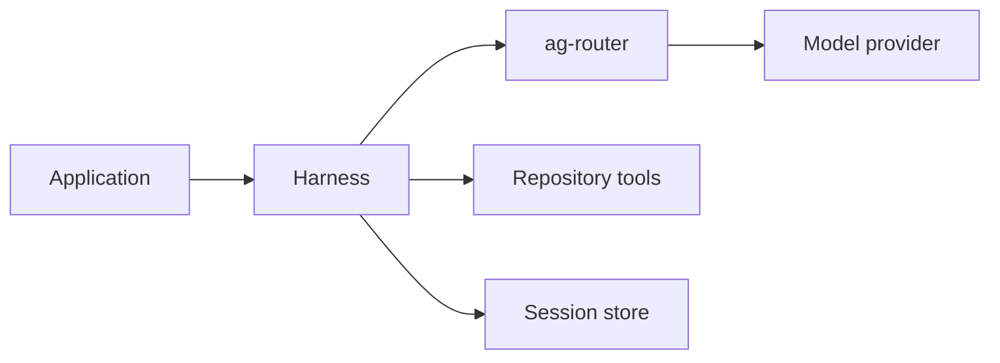
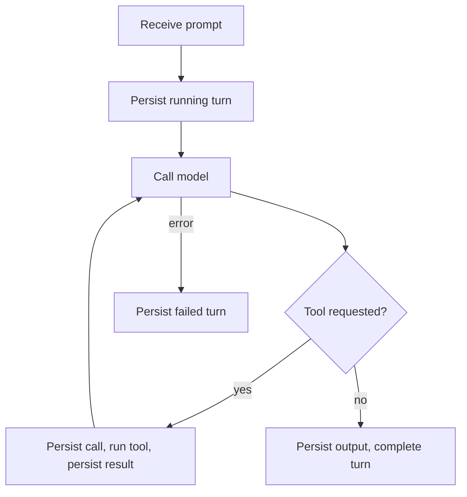

+++
title = "ag-harness Design"
description = "Model loop, durable sessions, and repository policy."
weight = 6
+++

# `ag-harness` — a light LLM harness

`ag-harness` is the base layer between an application and an LLM. It is Rust-native,
app-facing, and lightweight: an agent loop, three policy-checked tools, durable
sessions, and content-free lifecycle events. Product decisions stay in the application.
Agentty runs it as the preview `AgentKind::Harness` backend behind
`--experimental-harness`, following the
[Execution](@/docs/core-components/execution-components/execution-boundary.md) boundary.

This page describes the design and its boundaries. `crates/ag-harness/README.md` covers
construction and usage, and module documentation holds thresholds and algorithms.



## Core features

- **Three built-in tools** — `read`, `write` (git-style patches), and sandboxed `bash`.
- **Deny-by-default permissions** — every tool call passes an explicit per-turn policy.
- **Structured output** — every turn validates against a caller-supplied JSON schema.
- **Durable sessions** — SQLite by default; memory and custom stores share the same
  public contract.
- **Provider-neutral models** — built-in Muse, Kimi, Qwen, OpenAI, ChatGPT-plan, and
  generic OpenAI-compatible clients use `ag-router` behind the object-safe `Model`
  trait.
- **Typed lifecycle events** — content-free turn, model, and tool observations.

## Crates

```text
crates/
├── ag-router        # structured chat routing + provider transports
├── ag-harness       # library + ag-harness-sandbox launcher binary
└── ag-harness-cli   # interactive terminal host
```

`ag-harness` gates its optional backends behind Cargo features that are all on by
default: `sqlite` (the SQLite store and migrations), `native-sandbox` (the native Bash
executor and launcher), `otel` (OpenTelemetry metrics, traces, and context propagation),
`providers-openai`, and `providers-compat`. `providers-anthropic` and
`unstable-protocol` are reserved and empty. The core without default features keeps the
memory store, the `Model` boundary, and host-selected executors; a provider whose family
is off fails before reading credentials. Features are additive, and CI covers the core
and each provider family on their own. Dependents enable the features they use
explicitly. `ag-router` stays unsplit: it compiles every provider transport either way.

## Public boundary

- `Harness` owns the model and its required `ContextBudget`, validated repository,
  configured defaults, lifecycle observers, and the selected session store. It is a
  `Clone + Send + Sync` handle, so clones share one SQLite pool and calibration;
  `Harness::builder` checks the model, the budget, and the repository required by
  allowed tools at `build`; storage still opens on first session use.
- `Session` is the only multi-turn abstraction; `run_once` executes a stateless turn.
  `Session::transcript` reads settled turns in full (all, the newest N, or a span).
  `Harness::fork` copies a session's configuration and settled turns through one index
  into a new session atomically, with their write, command, and host request records,
  and gives it its own prompt-cache key; the source is never changed. Transcripts reuse
  the live `event::Item` shape. Durable and stateless turns can be awaited or started
  for a `TurnControl`.
- `TurnOptions` fixes the schema, `ToolPolicy`, and optional `ComparisonBase` for one
  execution. Explicit options replace defaults; they are never merged.
- `Model` is the object-safe provider boundary. `ModelRegistry` resolves built-in or
  injected models by stable host keys; each registration's `ModelProfile` declares its
  context window and estimator parameters. Hosts own per-model values; the harness holds
  none.
- `SessionStore` (persistence) and `BashExecutor` (command execution) accept host
  implementations. Stores expose atomic record operations; the harness applies admission
  rules.

## Agent loop

A turn continues until the model responds without requesting a tool, and that terminal
response must satisfy the caller's schema. There is no tool-call limit: cancellation and
the required `ContextBudget` bound a turn.

A run's optional `RunLimits` (requests, reported tokens, tool calls, wall clock) are
checked before each request and tool batch, so a stopped turn never starts work beyond
its limit; a refused batch replays as never run. It fails with `TurnError::LimitReached`
and is journaled as failed, or as interrupted when the deadline dropped a running tool
call, so the session continues normally. Limits are never stored in snapshots or session
defaults.



Each finished model response and tool result is persisted before the loop continues, so
a stopped turn keeps everything it already did.

### Context fitting

Before every model request, the engine fits the request to the budget without a model
call. Fitting works on a copy: canonical messages, the journal, and replayed history
keep the original content.

- **Append-only requests.** A request within budget is the previous request plus new
  messages, so provider prompt caches reuse the shared prefix. Only an over-budget
  request is reduced, and then deeply, so several later rounds append again before the
  next reduction. A reduced message is never rewritten twice.
- **Reduction order.** Superseded tool results are cleared first, then the latest
  round's oversized results are cut, then older results become tool-aware notices and
  older assistant messages lose reasoning and patches. Recent rounds and their reasoning
  are kept longest. Only when clearing is not enough are the oldest replayed turns and
  tool rounds dropped whole, with a bounded note listing the files, commands, and reads
  they covered. If nothing fits, the turn fails with a typed error.
- **Optional round summaries.** With `ContextSummaryPolicy::Enabled`, earlier tool
  rounds can instead be summarized by a model request that becomes a note in sent copies
  only. Summaries are disabled by default.
- **Bounded reads.** Every `read` result is bounded as it runs against the request it
  joins, and states the window it shows and how to fetch the next page. Reads that would
  overflow one response's share are deferred with their exact arguments.
- **Repetition guards.** An identical `read` whose result is still shown whole is
  answered with a short `unchanged` note. Repeated identical calls first receive
  request-only feedback and eventually fail the turn with
  `TurnError::RepeatedToolCalls`. Calls to tools the turn does not make available share
  one repetition key, so a model that keeps calling invented or denied tools still
  reaches the stop.

### Estimation and overflow

Request weight is estimated from payload bytes with per-model parameters, then
calibrated from provider-reported usage as an upper envelope, so later requests fit the
real window more closely. A model's input budget holds back its maximum output plus a
declared estimate margin. When a provider rejects a request as exceeding its context
window, the engine lowers a persistent cap and refits and resends the request a bounded
number of times before failing with `ModelErrorType::ContextOverflow`. Calibration and
the cap reset on `switch_model` or estimator replacement. `TurnReport` and
`ModelRequestActivity` report reductions, estimates, and resends.

## Sessions

- The selected store is canonical. Every request replays projected history; providers
  never hold conversation state.
- One active turn per session. Renewable leases fence concurrent processes; expired
  leases mark turns `interrupted`.
- Failed and interrupted turns re-enter model context with what they recorded and a
  closing stop note, never as completed history.
- Reservation and model switching run in one store-owned atomic section. Within one
  process, a single reservation lifecycle owns admission, lease renewal, finalization,
  and recovery of abandoned owners.
- A session stores a default output mode: a JSON schema, or none for plain text. A run
  or turn may select another mode without changing it.
- Per-turn host instructions follow the turn's input, after the system prompt and
  replayed history, so they never change the cached prompt prefix. They are journaled
  with the turn and sent with each of its requests, but later turns replay it without
  them, so they never steer another turn.
- Every durable turn records its usage and cost when it starts and after each completed
  model request, so stopped turns keep what they used, and forks copy it.
  `Session::usage` sums settled turns; turns stored before usage was recorded take
  unpriced usage from a stored host-request outcome, or else count as unknown, never as
  zero.
- Each turn records its effective options, comparison identity, and model provenance
  before execution. Write and command intents persist before their effects.
- `host_id`/`recover` bind host-assigned request IDs to a fingerprint of the effective
  request, so matching retries return recorded outcomes instead of executing again.
- `switch_model` selects another registration for an idle session. `compact` publishes a
  schema-validated summary checkpoint that replays ahead of the remaining recent turns.
- History replays through a sticky `HistoryProjection` that omits, abbreviates, or
  elides older turns only when they outgrow the byte or budget limits. Boundaries only
  advance, so the next turn's first request usually repeats the previous request's
  prefix. Each `TurnReport` carries a `HistoryActivity` describing what was replayed.

## Cancellation and settlement

Started turns separate the caller's future from the turn's fate. `TurnControl` cancels
promptly; `settled()` waits for persistence cleanup, filesystem replacements, and
command cleanup, reporting the `SettlementPhase` that failed, and `retry_settlement()`
retries. Retained work survives caller drop, and unresolved effects block new durable
turns. Settlement provides neither rollback nor distributed workspace fencing.

`Session::run` and `Harness::run` wrap the same controlled turn in a `Run`. Its
`RunOutcome` resolves only after settlement, retrying failed cleanup once and reporting
a cleanup that still fails beside the run's own result as a retryable `Unsettled`, so
embedders need no `TurnControl`. The engine records its partial report on the control
when a turn ends without an outcome, so the outcome sums provider usage over every
completed model request, including those of cancelled and interrupted turns. It reads
the run's write and command records from the store by turn position; `Harness::run` uses
a fresh in-memory store for that.

`Run::into_parts` attaches an event sink to the turn's control. The engine sends events
from its existing await points into a bounded channel, numbering an event only once it
has a slot, so a dropped engine leaves no sequence gap. A full channel holds the turn
back, and a dropped stream makes sends no-ops. The outcome future owns the sink, and the
control only holds a weak reference to it, so dropping the run ends the stream. After
settlement the run sends a successful run's committed `Output` item and `Completed`
through slots reserved when the channel was created, so cancellation resolves a run
whose stream is full and unread, and then closes the sink, so no engine event can follow
it. Run events carry content. The content-free `LifecycleObserver` and its OpenTelemetry
projections are unchanged.

## Permissions and tools

All tools are denied by default; per-turn policy enables them explicitly. A call to a
denied or nonexistent tool is answered with a correctable `"status": "unavailable"`
result that lists the available tools, and the turn continues. Such a result is never
cleared to fit the context window, and a dropped-round note never names its call, since
it did not run.

- `read` — bounded file, list, search, and `show(head)` inspection. A `list` or `search`
  path that matches no repository file returns a corrective error instead of an empty
  result.
- `write` — applies one bounded git-style unified diff atomically. Hunks may be
  relocated only to a unique match; ambiguous or unmatched hunks reject the patch, and
  the result reports every adjusted hunk.
- Comparisons (`diff`, `show(base)`) additionally require a host-pinned `ComparisonBase`
  commit; no base is ever chosen implicitly.
- `bash` — requires an explicit per-turn `BashConfig` naming an executor: the native
  sandbox launcher (Bubblewrap, Landlock, and seccomp on Linux; Seatbelt on macOS), a
  host-supplied `BashExecutor`, or the shipped unsandboxed executor for hosts already
  inside a container or VM. Writes, external reads, environment values, and host
  information require explicit grants. Git metadata stays read-only, networking is never
  granted, and unsupported policy fails closed on enforcing executors. Each executor
  reports its `Enforcement` (none, filesystem, or filesystem and network), and the
  model-facing `bash` description states exactly that, so an unsandboxed executor is
  never presented as a sandbox. Output is captured within one bounded budget.

Repository tools receive a validated `Repository` with a trusted Git executable outside
the containing worktree; the library never searches `PATH`.

## Provider transport

`ag-router` owns the built-in Chat Completions and `OpenAI` Responses transports,
provider wire policies, and local JSON Schema validation. Every request names a
`provider/model` and a `JsonSchemaFormat`; terminal output is validated JSON, while
function calls return to the harness for execution. The harness keeps tool permissions,
sessions, lifecycle events, and telemetry. The router has no token streaming to callers
or automatic provider fallback.

- **`openai`** uses the stateless Responses API, so the harness still owns history.
  Encrypted reasoning items are stored with the response and replayed verbatim.
- **`chatgpt`** sends the same requests billed to the user's ChatGPT plan through
  OpenAI's documented "Sign in with ChatGPT" route, with its own sign-in and refreshed
  bearer credential. Plan sessions record a distinct provider, so resuming one never
  moves it to paid API usage.
- **`openai-compatible`** serves local and self-hosted models (Ollama, llama.cpp, LM
  Studio, vLLM) under one conservative Chat Completions policy. Because such servers may
  silently truncate input, the host asks the server for its running context window
  through `LocalServer` before declaring the model's profile.
- The provider catalog declares each hosted model's list prices (micro-USD per million
  tokens) and capabilities, and derives its price class (`ModelProvider::cost_tier`)
  from those prices. Runs price each request in integer micro-USD; a model without
  prices reports no cost rather than a guess. The optional `ModelCatalog` maps open
  roles, such as smart or cheap, to ordered candidate models with replaceable defaults
  and resolves a selector to a model and its request budget. Candidates must have the
  role's required capabilities, and defaults assign only models with a declared context
  profile; choosing a model for a task stays the host's decision.

Durable sessions send a stable prompt-cache key where the provider policy enables it.
Requests have bounded timeouts and limited retries for connection failures and `429`
responses; a spent quota (`402`, or a `429` reporting an exhausted quota) is not
retried. The harness `ErrorKind`, exposed through `RunError` and `HarnessError`, maps
these failures to `RateLimited`, `Overloaded`, `QuotaExceeded`, and `Auth` with a
retryable flag and a `Retry-After` capped at sixty seconds. Provider context-overflow
rejections map to `ErrorClass::ContextOverflow` so the engine can refit. Invalid final
output is re-requested a bounded number of times with request-only feedback, and tool
calls with undecodable arguments are answered with a rejected result instead of failing
the response. Diagnostics never include model content.

## Input and output

- `TurnInput` carries ordered, bounded text and image blocks.
- Image support is opt-in per model and validated before any provider request.
- Every turn requires an `OutputSchema`. The harness validates the terminal response
  locally and returns typed errors instead of falling back to unstructured text.

## Observability

Lifecycle observers receive content-free turn, model-request, and tool events; the host
chooses exporters. `LifecycleMetrics` and `LifecycleTraceObserver` project the stream to
OpenTelemetry without storing prompts or tool output. Turns run under the caller's
OpenTelemetry context, so harness spans nest under the host's span.

## Agentty integration

Shipped as a preview: `AgentKind::Harness` runs in process through `ag-agent`, offered
only when Agentty starts with `--experimental-harness` and a provider is configured.

- A native transport beside the CLI and app-server transports provides a durable
  `AgentChannel` and the one-shot path. The harness session shares the Agentty session
  ID and is canonical; a missing database restarts from Agentty's replay transcript.
- `ReadOnly` maps to `read`. Edit modes add `write` and unsandboxed `bash`, which
  inherits Agentty's environment without provider credential and endpoint variables.
  Like Codex and Claude full access, `bash` does not keep the main checkout read-only.
- Each session's database lives under the Agentty data root, outside the session
  worktree; session deletion removes it.
- A turn returns to Agentty only after `TurnControl::settled`, so Agentty commits a
  settled worktree.
- Deterministic `FeatureTest` coverage uses a scripted provider.

## Next iterations

Planned: a comparison base pinned to the session's base commit, idempotent host request
IDs for Agentty operations, running Agentty's `bash` through the native sandbox,
proactive compaction, and one correlator shared by `LifecycleTraceObserver` and
`LifecycleMetrics`.

### Proposed: Agentty as the meta-harness

Not decided or shipped. Agentty would act as the meta-harness: it picks the worker (a
vendor CLI or `ag-harness`) and model for each task, plans and runs execution graphs,
isolates workspaces, shares budgets, merges and reviews results, and owns telemetry and
evaluation across workers. `ag-harness` stays the lightweight model runtime: one agent
loop for one model, with context fitting, tools, permissions, sandboxing, sessions,
provider transports, model profiles, and structured output. Work that needs more than
one model conversation belongs to Agentty.

Open decisions; **(recommended)** marks the suggested option:

- **Delegation requested by a native turn.**
  - **(recommended)** Host-provided tools: `ag-harness` forwards a delegation call to
    the host, which runs it as a graph node on any worker and returns the result.
  - Built-in subagents inside `ag-harness`.
  - No model-requested delegation; only graphs the host plans.
- **Worker contract.**
  - **(recommended)** One contract for vendor CLIs and `ag-harness`: a task in, a
    schema-validated result out, plus events, usage, and cancellation.
  - Separate adapters per worker, as today.
- **Per-model knowledge.**
  - **(recommended)** How to run a model (window, estimator, prompt variant, edit
    format, reasoning replay, cache hints) lives in `ag-harness` model profiles from one
    source; which model suits a task is Agentty's choice.
  - Both live in Agentty.
- **What passes between graph nodes.**
  - **(recommended)** Schema-validated outputs and artifacts such as diffs.
  - Full transcripts.
- **Evaluation.**
  - **(recommended)** Agentty compares workers and models, offline first; live runs only
    with an approved spend limit.
  - Evaluation stays inside the `ag-harness` benchmark.

### Proposed: testing without paid model calls

Not decided or shipped. Options, cheapest first:

- **(recommended)** Scripted and replayed providers for harness mechanics such as prefix
  stability, reductions, and notices: deterministic, free, and safe for CI.
- **(recommended)** An OpenAI-compatible local provider (Ollama, llama.cpp) for
  live-loop smoke tests on small open models. It checks behavior, not model quality, and
  needs a model that supports tool calls.
- Cheaper API models, such as Muse's contributor tier, with a hard spend limit in the
  benchmark.
- Subscription-backed vendor CLIs, such as Codex signed in with ChatGPT, as benchmark
  workers at the Agentty level. A subscription sign-in is not an API key, so it is not
  an `ag-harness` model backend.
