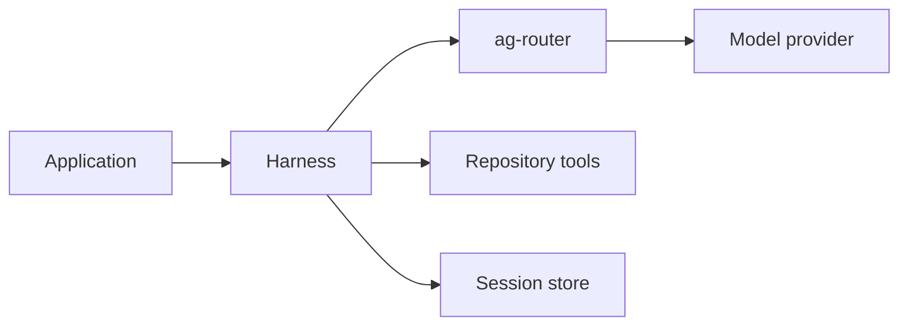
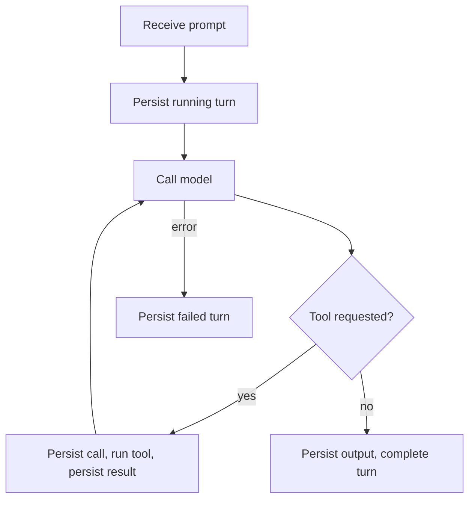

+++
title = "ag-harness Design"
description = "Model loop, durable sessions, and repository policy."
weight = 6
+++

# `ag-harness` — a light LLM harness

`ag-harness` is the base layer between an application and an LLM. It is Rust-native,
app-facing, and lightweight: an agent loop, three policy-checked tools, durable
sessions, and content-free lifecycle events. Product decisions stay in the application.
Agentty runs it as the preview `AgentKind::Harness` backend behind
`--experimental-harness`, following the [Execution](@/docs/core-components/execution.md)
boundary.



## Core features

- **Three built-in tools** — `read`, `write` (git-style patches), and sandboxed `bash`.
- **Deny-by-default permissions** — every tool call passes an explicit per-turn policy.
- **Structured output** — every turn validates against a caller-supplied JSON schema.
- **Durable sessions** — SQLite by default; memory and custom stores share the same
  public contract.
- **Provider-neutral models** — built-in Muse, Kimi, Qwen, OpenAI, and generic
  OpenAI-compatible clients use `ag-router` behind the object-safe `Model` trait.
- **Typed lifecycle events** — content-free turn, model, and tool observations.

## Crates

```text
crates/
├── ag-router        # structured chat routing + provider transports
├── ag-harness       # library + ag-harness-sandbox launcher binary
└── ag-harness-cli   # interactive terminal host
```

## Public boundary

- `Harness` owns the model and its required `ContextBudget`, validated repository,
  configured defaults, lifecycle observers, and the selected session store.
- `Session` is the only multi-turn abstraction; `run_once` executes a stateless turn.
- `Session::turn` is the configurable durable-turn entry point: chain `options` and
  `host_id`, then either await the turn or `start` it for a `TurnControl`.
  `Harness::turn` takes explicit options for a stateless turn and is likewise awaited or
  started; it has no host ID.
- `TurnOptions` fixes the schema, `ToolPolicy`, and optional `ComparisonBase` for one
  execution. Explicit options replace defaults; they are never merged.
- The crate root exports what a typical host needs; extension points and detailed
  records live in the `provider`, `model`, `tool`, `bash`, `turn`, `store`, `recovery`,
  and `lifecycle` modules.
- `Model` is the object-safe provider boundary. `ModelRegistry` resolves built-in or
  injected models by stable host keys with declared `ModelCapabilities`, whose
  `ModelProfile` describes the model's context and its `HeuristicContextEstimator`
  parameters. The harness reads every model through its profile and holds no per-model
  values; hosts own those. A profile only shapes how new requests are fitted, never
  request fingerprints or stored history, so revising one needs no new registration
  revision.
- `SessionStore` is the public persistence contract and `BashExecutor` the public
  command-execution contract; both accept host implementations. Stores expose atomic
  record operations; the harness applies admission rules and builds each lease.

## Agent loop

A turn continues until the model responds without requesting a tool, and the terminal
response must satisfy the caller's schema. There is no tool-call limit: cancellation and
the required `ContextBudget` bound a turn.

Before every model request the engine fits the request to the budget without a model
call. Fitting works on a copy, so canonical turn messages, the durable journal, and
replayed history keep the original content. Within a turn the sent requests only append:
a request within the budget is the previous request's copy with the new messages
appended, so requests between two reductions share a byte-identical prefix that provider
prompt caches reuse. Only a request that exceeds the budget is reduced, and then deeply,
so the following rounds append for several requests before the next reduction. Every
reduced message keeps its reduced form in later requests, and no message is rewritten
twice, so a reduction rewrites the request only from its first newly reduced message.

A reduction first clears older tool results that a later call of the request superseded,
oldest first, down to 50% of the capacity left after reserved output: a `read` whose
target a later read returned again over at least the same lines (a covering line window
for `file` and `show`, the same or a larger limit otherwise), a `file` read or `diff`
showing a path a later applied `write` changed, or a `bash` result whose exact command
ran again. Their notices name the superseding call and say to use it while it is shown,
and to read again before using what it no longer shows: a sent notice is never
rewritten, so its wording stays true once the newer result is cleared or cut too. A read
answered by the repeated-read note below supersedes nothing. The results the latest
round added are then cut while the round is new, so the cut costs no cached prefix: each
to 25% of that capacity, and the round's largest to one common size while together they
exceed 50%. A `read` result is cut by the rules that bounded it when it ran (below), and
any other result to a head and tail excerpt; `read` results already meet both shares
when they run, so only a budget that calibration lowered since cuts one. A result sent
whole before is never cut, only cleared. The request is then reduced to 50% of its
capacity, oldest first, with replayed history before the current turn: the other tool
results become tool-aware notices (a `read` notice names its target and says its content
is not available until read again), then each assistant message loses its reasoning
(providers that replay reasoning still receive a non-empty placeholder) and its `write`
patches (a note on their recorded outcome) in one rewrite. The rounds holding the newest
five results keep their results, reasoning, and patches until everything older is
cleared, and the latest round is never reduced by these steps. The assistant messages of
the newest earlier rounds that carry reasoning, within 10% of the capacity, keep it,
with any `write` patches beside it, after their results are cleared: some models, such
as Qwen, keep their findings only in reasoning, so clearing it with the results left
them to re-read every cleared file or to answer from memory. Those messages are not
cleared to reach 50%, nor their rounds dropped to reach 70% (below); they lose their
reasoning, in one rewrite, once newer rounds push them out of that share or before a
replayed history turn would be dropped, and their rounds are dropped only when the
request would not fit otherwise. A message with nothing to clear, such as one whose
reasoning repeats the placeholder, is passed over, and one with a `write` patch but no
reasoning ends the kept rounds, so a model whose reasoning is never replayed is reduced
as before. A replayed history turn that clearing reaches is cleared whole, so the next
turn can replay it as sent. Clearing reasoning starts at the oldest assistant message
the first time it is needed, so that one reduction rewrites the request from there. If
clearing cannot reach 50%, the oldest replayed turns and then the current turn's oldest
tool rounds are dropped whole, each call message with all its results, down to 70%; a
dropped round also loses the text the model wrote beside its calls, so dropping stops
short of the clearing target. Each reduction that drops rounds names them in one bounded
note appended after the earlier notes, which counts the removed calls, lists the files
they modified and read (up to 64 paths each, as the harness recorded them), the commands
they ran, and their other read targets, and says what they showed is not available until
read again; once no earlier round is left to drop, the notes merge into one. A
repeated-read note whose earlier result is cleared, cut, or summarized becomes a notice
that it is no longer shown whole, naming the newer read when one returned it again. Tool
calls keep their identifiers, so tool groups stay well-formed, and the text the model
wrote beside them is never cleared, so its notes on what it found outlive the cleared
results and leave only with their dropped round. Each reduction step is a watermark into
the append-only canonical messages, and each reduced message is cached, so a request
between reductions only weighs and appends its new messages. If the request still does
not fit, the latest round's largest results are cut further the same way, and as the
last resort its `write` patches are replaced by their recorded outcome; both stay cut in
later requests. Only when even that fails does the turn fail typed. Each
`ModelRequestActivity` reports the reductions its request carried.

With `ContextSummaryPolicy::Enabled`, a request that still exceeds 50% of its capacity
after superseded results are cleared and oversized results capped first summarizes the
current turn's earlier tool rounds. The latest round and the rounds before it within a
quarter of the capacity stay whole; the rounds before them that no summary or note
covers yet are summarized. A summary is requested only when the rounds not yet offered
to one weigh a fifth of the capacity, so a turn summarizes again only after enough new
rounds aged out, and it is sent as one of the turn's model requests in one of two forms.
When the model keeps its cached prefix across output schemas
(`Model::keeps_prefix_across_schemas`: Kimi and Qwen, which state the schema in a
leading system message) and the turn's last request plus one instruction fits the
budget, the summary request is that last request, with its tools, reasoning effort, and
cache key, plus an appended instruction naming the first and last covered calls and
stating the summary schema; `ModelRequest::prefix_schema` keeps the turn's schema in the
leading message, so the provider serves the request from the turn's cached prefix, and
the model summarizes the rounds as it last saw them, its replayed reasoning included.
Live, Qwen3.8-Max cached 94% of such requests' input, against none for the tool-free
form, though each took about 35–55 s against 25–33 s at low effort; changing the tools,
the reasoning effort, or the stated schema instead dropped the cache to zero for both
Qwen and Muse, and Muse, which constrains output to the `response_format` schema, cannot
answer another schema without changing it, so Muse keeps the other form. Otherwise the
source is rendered as its own tool-free request at low reasoning effort, since restating
rounds needs no deliberation and a reasoning model at the turn's effort can outlast the
request timeout on a large source: the task, any earlier summary to carry forward, and
each round as bounded JSON with superseded results as their notices, its text cut at
shrinking levels, then its oldest rounds left out, until the request fits the budget.
Both instructions ask to record only what the rounds show and to name what a cleared or
cut result no longer shows instead of filling it in. The engine re-requests invalid
output like a final output, re-requests tool calls answering a continued summary with
feedback that they were not run, and accepts a summary that matches the checkpoint
summary schema, fits 15% of the capacity, and is smaller than its source. The covered
rounds then become one note carrying the summary as data beside the dropped-round ledger
of their files, commands, and other reads, which replaces the earlier notes, and every
reduction watermark moves past them. Like every reduction, the summary exists only in
sent copies: canonical messages, the journal, and replayed history keep the rounds, and
a resumed or later turn never sees it. A failed, rejected, or cancelled summary falls
back to the steps above for that fit, and a turn stops asking after two failures.
Summary requests are reported with `ModelRequestPurpose::ContextSummary`, calibrate
later estimates, and emit `ContextSummaryStarted`/`Completed`/`Failed` lifecycle events
that the trace observer projects as an `agent.compaction` span around their model
requests. A failure is classified as `Model` when a request failed at the provider or in
transport (its own `ModelRequestFailed` carries the class and HTTP status),
`InvalidOutput` when corrections ran out or the model answered a tool-free summary
request with a tool call, `Rejected` when a valid summary did not fit, or `Cancelled`.
Summaries stay disabled by default: no declared profile's window is small enough for
these turns to reduce, and at the 32k stress budget, where reductions without summaries
already answered every benchmark check, summaries cost Qwen3.8-Max and Muse more
requests and input tokens and up to three times the wall time.

Every `read` result is bounded as it runs, against the calibrated budget of the request
it joins, so it enters history at the size later requests send. One result may weigh 25%
of the capacity left after reserved output: a `file` or `show` read keeps its longest
run of leading whole lines and states, before the content, the lines it shows, the
file's line count when the read could count it within its scan limit, and the exact
`offset` and `limit` that fetch the next page; a first line too long to show whole shows
its first bytes and says that `read` cannot return the rest of it. A `list` or `search`
keeps whole items and a `diff` whole lines, or the first bytes of the first one when
none fits whole, marked `truncated`. The results of one response's calls may weigh 50%
together: results are kept in call order while they fit, and from the first `read`
result that does not, every `read` of the response is answered with a `deferred` result
that repeats its exact arguments, so the model fetches it in a later response. The read
that crossed the share ran to be measured; later ones do not run. The turn report lists
them as `ToolActivity::ReadDeferred`. A deferred read, like a repeat answered by the
note below, neither supersedes an earlier result nor is superseded, and runs when the
model asks for it again. Results of other tools count toward the share but are always
kept.

Before running a `read`, the engine compares its canonical arguments with the reads
already run in the turn. When an identical read ran earlier, no `write` or `bash` call
was handled since, the last request carried that result whole (neither reduced, cut, nor
dropped), and the result is larger than the note, the call is answered with a short
`unchanged` result naming the earlier call instead of running. The call and that result
are journaled like any tool exchange, because a durable record describes what the turn
returned, and the turn report lists it as `ToolActivity::ReadRepeated`. `write` and
`bash` always run.

After each response's calls, the engine counts identical calls among the turn's last 12
handled calls: the same tool, the same canonical arguments, and the same result digest.
Keying on the result keeps polling a changing command from counting, and a `read`
answered by the repeated-read note counts with the result it pointed to, so a model that
keeps re-reading still converges on a stop. A `write` or `bash` call unlike any call in
the window may change what later calls return, so it restarts the count; malformed calls
have their own bound and are not counted. The third identical call appends request-only
`[harness]` feedback, never journaled, that asks the model to use what it has, change
approach, or answer, and `TurnReport::repetition_nudges` counts it. The fifth fails the
turn with `TurnError::RepeatedToolCalls` after its results are journaled, so replayed
history stays well-formed. Both emit `LifecycleEventKind::ToolCallsRepeated`, which the
trace projection records as a turn-span event.

The estimator weighs payload bytes at per-model rates plus fixed tokens per message,
tool definition, and request, and the output schema where the provider renders it into
the prompt. Live probes showed why each term exists: tool definitions tokenize about 1.6
times denser than repository text, providers add a fixed tool-calling preamble of up to
about 420 tokens, and Qwen and Kimi count the output schema on every request while Muse
counts it beside tools. Fitted per model, the estimate stays within about ±10% of
recorded Agentty requests, but content such as digit-heavy generated code still runs
30–46% over it, so the harness calibrates it from provider usage, much like Codex
combines the last reported usage with an estimate of newer items. Any fixed cost the
estimate misses dominates a small request (the default estimator weighed live first
requests of about 1,000–1,200 tokens at 490), so one ratio fitted to a small request
would roughly halve the usable window. The calibration is instead an upper envelope over
the reports: a line through the first reported request, its ratio when that request
weighs at least 10% of the input capacity or else one token per unit, offsetting the
estimate by its excess, until a request at least 10% of the input capacity larger
measures the slope of token growth, the slope then rising to the steepest growth
measured and the line lifted to cover every report. The slope stays within 1–3: images
are weighed at their encoded size and must not loosen the text budget, and one
inconsistent report must not empty the window. Projection, admission, and fitting
compare estimates with the largest weight whose calibrated tokens fit 95% of the input
capacity, the margin covering denser content such as cleared-result notices, which
under-shot the envelope by up to about 5% live; until usage measures the slope, the
estimate may fill 90%. Because the calibration only lowers the weight limit while cached
message weights stay in estimator units, a tighter limit only advances the fitting
watermarks further and never reshuffles an already-reduced prefix. Every built-in
provider reports OpenAI-style `prompt_tokens`, whose cached tokens are a subset (live
cache hits never exceeded the reported input), so prompt caching does not skew the
calibration. It lives in memory per harness and the sessions it captures, resets on
`switch_model` and estimator replacement, and needs no schema change. Budget failures
still name the declared budget, with the required weight restated in calibrated tokens,
and `ModelRequestActivity` reports each request's estimated and calibrated weight.

A provider rejection of a request as exceeding its context window reports no usage, so
it instead caps later requests at 75% of the rejected request's estimated weight, the
same shrink Roo Code retries an overflow at; a later rejection only lowers the cap. The
engine then refits the turn's request under the lowered budget and re-sends it, at most
twice per turn, so two rejections reach about 56% of the first rejected weight. A refit
that cannot shrink below the cap fails the turn with the provider's
`ModelErrorType::ContextOverflow` rather than a budget error, as does a third rejection.
The cap lives with the calibration, so later turns stay below a window the provider
proved wrong until `switch_model` or estimator replacement resets it; a budget failure
it causes restates the required weight scaled by how far the cap cut the declared
capacity, so it still exceeds the declared budget. `TurnReport` counts the re-sends, and
`LifecycleEventKind::ContextOverflowRetried` follows each re-sent request's outcome,
traced as a `ag_harness.context_overflow.retried` event on the turn span. Compaction
requests run through the same engine, but their source is mandatory input that a refit
cannot shrink, so a rejected one fails with the provider's error without a second
request and leaves the lowered cap for later requests.

A model's input budget holds back its maximum output plus an estimate margin sized from
the estimator's measured error,
`ModelProfile::with_estimate_margin(max_output, under_count_percent)`: the budget
shrinks until a request filling 95% of it still fits the window while its real tokens
run the declared percent over the estimate. The calibrated slope never drops below one
token per unit, so content the estimator under-counts is the error left whether or not
usage has calibrated the session. Hosts declare the largest under-count measured plus a
buffer; Agentty measures it on recorded requests and on one live request fitted near the
budget from repository sources, where read results ran up to 12.6% over the fitted
estimate. A well-fitted estimator so gives up 7–10% of the window instead of a blanket
quarter. Content denser than declared, such as digit-heavy generated code at 30–46% over
a fitted estimate, is left to calibration and overflow recovery. Calibration learns it
from the next usage report, and until then the unfilled 5% plus the margin absorb a
dense tool result, such as a full `read` of digits, which Qwen tokenizes one per digit;
more dense content in one request overflows, and one rejection's 75% cap fits content
about half again over the estimate.



Each finished model response and tool result is persisted before the loop continues, so
a stopped turn keeps everything it already did.

## Sessions

- The selected store is canonical. Every request replays projected history; providers
  never hold conversation state.
- One active turn per session. Renewable leases fence concurrent processes; expired
  leases mark turns `interrupted`.
- Failed and interrupted turns re-enter model context with what they recorded, never as
  completed history: tool calls without a result get a placeholder result in the request
  only, and a closing stop note names the cause and the writes and commands whose
  outcome is unknown. A stopped turn that does not fit replays with its tool traffic
  replaced by notices, or else as only its input and note.
- Reservation and model switching run in one store-owned atomic section that reads the
  admission state and records the harness's decision: recorded host requests first, then
  the model generation, an idle session, and no unresolved command.
- Within one process, a single reservation lifecycle owns admission, lease renewal,
  finalization, and cleanup of abandoned owners. It recovers those owners before every
  turn acquisition or model switch, the same way for every store.
- Each turn records its effective options, comparison identity, and model provenance
  before execution. Write and command intents persist before their effects.
- `host_id`/`recover` bind host-assigned request IDs to a fingerprint of the effective
  request, so matching retries return recorded outcomes instead of executing again.
- `switch_model` selects another registration for an idle session, whose context budget
  bounds every later request. `compact` publishes a schema-validated summary checkpoint
  that request projection replays ahead of the remaining recent turns. Its source is the
  previous summary and the oldest uncovered turns, loaded oldest first within the
  history byte limit and rendered as JSON lines that keep tool-call arguments and the
  assistant text beside them and bound every text. The newest turns are dropped until
  the source fits the context budget, and the checkpoint covers exactly the rendered
  turns, so the rest stay uncovered for a later call. A summary that is no smaller than
  its source is rejected.
- Every harness has an approximate `ContextBudget`, passed to `Harness::new` or derived
  from its registration's `ModelProfile`, and mandatory content that cannot fit fails
  with a typed error before any provider call. Replayed history is bounded twice: by the
  stored byte limit when it is loaded and by the weight the budget leaves for history in
  each turn's first request.
- History replays through a sticky `HistoryProjection`: turn-position boundaries before
  which older turns are left out, replayed as their input and final output (input and
  stop note for a stopped turn), or replayed with their tool traffic replaced by
  notices; later turns, including each new one, replay whole. While the projected turns
  fit both limits, a new turn's first request repeats the previous turn's history and
  appends that turn, so the provider keeps its cached prefix across turns. Only when
  they outgrow a limit are they re-projected, newest first, down to half of it: each
  turn in the most complete form that fits what is left, never more complete than before
  or than the newer turn after it, until a turn fits in no form. Boundaries only
  advance, so a shortened turn is never restored. The projection a completed turn leaves
  also keeps the history turns its own requests dropped left out, and those they sent
  exactly in their elided form elided, so the next turn continues what was last sent.
  The store keeps that projection with the completed turn (SQLite in the `session` row),
  and a model switch resets it. Sessions stored before projections were kept start from
  the default, which replays every turn whole, and are re-projected once their history
  outgrows a limit.
- A turn larger than eight times the byte limit is never elided but replayed in brief
  form, so loading one turn stays bounded. Every store projects the same forms; SQLite
  decides whole and brief turns from stored sizes and loads a turn's full payload only
  when it may replay elided. Every turn acquisition reloads history from the store, so
  live and resumed sessions replay the same turns.
- Each durable turn's `TurnReport` carries a `HistoryActivity` stating how many loaded
  turns were replayed or evicted and whether a checkpoint summary was replayed, so hosts
  observe context projection instead of inferring it from model answers.

## Cancellation and settlement

Started turns (`turn(...).start()`) separate the caller's future from the turn's fate.
`TurnControl` cancels promptly, then one `settled()` waits for persistence cleanup,
filesystem replacements, and command cleanup in that order, reporting the
`SettlementPhase` that failed; one `retry_settlement()` retries persistence and command
cleanup. Retained work survives caller drop, and unresolved effects block new durable
turns rather than being forgotten. Settlement provides neither rollback nor distributed
workspace fencing.

## Permissions and tools

All tools are denied by default; per-turn policy enables them explicitly.

- `read` — bounded file, list, search, and `show(head)` inspection. A `file` or `show`
  result names its line window before the content and, when cut, the file's line count
  and the exact `offset` and `limit` to continue. Line `offset` and `limit` also accept
  canonical decimal strings, though the schema advertises integers. A `list` or `search`
  path that matches no repository file returns a corrective tool error instead of an
  empty result, so an invented path is not mistaken for an empty directory.
- `write` — applies one bounded git-style unified diff atomically. Hunk counts are
  recounted from the body. A hunk applies at its header line when it matches there
  exactly or ignoring trailing whitespace; otherwise it is relocated only to a unique
  exact match, or else a unique match ignoring trailing whitespace, in the content as
  changed by earlier hunks. Ambiguous or unmatched hunks reject the patch, and the
  result's `adjusted_hunks` reports every relocated or whitespace-tolerant hunk.
- Comparisons (`diff`, `show(base)`) additionally require a host-pinned `ComparisonBase`
  commit; no base is ever chosen implicitly.
- `bash` — requires an explicit per-turn `BashConfig` naming an executor: the native
  sandbox launcher (Bubblewrap, Landlock, and seccomp on Linux; Seatbelt on macOS), a
  host-supplied `BashExecutor`, or the shipped unsandboxed executor for hosts already
  inside a container or VM. Workspace reads are the default; writes, external reads,
  environment values, and host-information exposure require explicit grants. Git
  metadata stays read-only, networking is denied, and unsupported policy fails closed on
  enforcing executors. Output shares one capture budget: each stream keeps its start and
  end, a short stream cedes its unused share, and the outcome reports the bytes omitted
  from each stream.

Repository tools receive a validated `Repository` with a trusted Git executable outside
the containing worktree; the library never searches `PATH`.

## Provider transport

`ag-router` owns built-in Chat Completions and `OpenAI` Responses transports, provider
wire policies, and local JSON Schema validation. Its public `Router::execute` request
names a `provider/model` and always includes a `JsonSchemaFormat`; terminal output is
validated JSON, while intermediate function calls return to the caller for execution. A
request may name the schema of the conversation it continues
(`GenerationOptions::prefix_schema`); Kimi and Qwen state that one in their leading
schema message while the response is still validated against the request's own schema.
The harness converts its built-in tool requests and responses at this boundary and
retains tool permissions, sessions, lifecycle events, and telemetry. The router
currently covers chat completion; it has no token streaming to callers or automatic
provider fallback.

The `openai` provider runs `OpenAI` models through the Responses API, because the GPT
models Codex uses accept function tools only there. Requests are stateless
(`store: false`), so the harness keeps owning history and compaction: each request
resends the conversation, system messages travel as `developer` messages, and output is
constrained natively by a non-strict `json_schema` text format beside non-strict
function tools, since strict mode would reject the optional properties of Agentty's
schemas; local validation stays authoritative. Reasoning returns encrypted. A response's
reasoning items are kept, as one JSON array, in the provider-neutral reasoning content
of its first call or output, which the harness already stores, counts, and clears under
context pressure; replay sends them verbatim before that assistant turn, and reasoning
content that is not such an array, such as cleared text or another provider's reasoning,
is omitted. Responses are streamed and read as server-sent events, keeping only
completed output items and the terminal response, because the plan-usage route OpenAI
documents for open-source clients requires streaming, a long reasoning response would
otherwise sit silent past a whole-request bound, and an overflow detected after the
stream starts arrives as `response.failed` rather than an HTTP error. The stream fails
after five minutes of silence, Codex CLI's idle bound, and the whole request after
thirty. The prompt cache key is sent, `max` effort maps to `xhigh` for models before
GPT-5.6, and OpenAI models declare their documented windows in the provider catalog
(`ModelProvider::declared_profile`) under the default estimator with a 50% margin until
a live calibration fits one; the Qwen flash models are declared the same way.

The provider catalog also declares each hosted model's price class
(`ModelProvider::cost_tier`): cheap at most $2.50 per million output tokens, premium at
least $15, standard between, and local for every OpenAI-compatible model. These are
per-model facts from the providers' published prices, kept in one table beside the model
identifiers; which model suits which task stays the host's choice. Agentty, for one,
labels its model pickers with the class and lets a project's Fast model, which writes
commit messages and titles, be a cheap harness model, but never selects one on its own.

The `openai-compatible` provider serves local and self-hosted models (Ollama, llama.cpp,
LM Studio, vLLM) under one conservative policy instead of one adapter per server,
because these servers share the Chat Completions wire format but differ in every
extension. Requests send only `model`, `messages`, `tools`, and, without tools, a
`json_schema` response format, the structured-output form all four accept; Ollama's
`json_schema` constraint needed the schema in the prompt to answer reliably, and LM
Studio documents no `json_object` mode. The schema is therefore also stated in a leading
system message, so the provider keeps prefixes across schemas like Kimi and Qwen. That
message invites tool calls before the final JSON answer: under the Kimi and Qwen
wording, "return only one JSON object", Qwen3 8B on Ollama never called a tool (0 of 2
live prompts), and under the tool-aware wording it called `read` in 4 of 4. No reasoning
control is sent, because Ollama rejects `reasoning_effort` for models without thinking,
and returned reasoning is not replayed, which keeps history portable across served
models. The API key is optional, and an unset key sends no `Authorization` header. A
server's runtime window can be far below the model's trained one: Ollama loads models
with 4,096 tokens by default and silently truncates longer input rather than rejecting
it, so overflow recovery cannot be relied on, and its OpenAI-compatible endpoint ignores
a requested window. The host therefore asks the server: `ag-router`'s `LocalServer`
lists models (Ollama's `/api/tags`, with `/api/show` for older servers, else
`GET /models`) and reports the running window (Ollama's `/api/ps`, after loading an
unloaded model with the server defaults the next chat request would use, else vLLM's
`max_model_len`). `ModelProvider::running_profile` fits the profile to that window;
without one, the host declares it (`ModelProvider::declared_profile`). Without a fitted
estimator, requests are weighed by the default estimator, counting the schema in the
prompt, under a 50% under-count margin. llama.cpp's `exceed_context_size_error` joins
the shared overflow markers.

Providers cache prompt prefixes per backend, so cache hits depend on routing related
requests together. The harness gives every turn request of a durable session one key,
hashed from the session ID so it is stable across handles and resume and bounded in
length, and each stateless turn a fresh random key shared by its tool loop. A round
summary that continues the turn's request carries its key; checkpoint and tool-free
round-summary requests, whose prefixes differ, carry none. `ag-router` sends the key as
`prompt_cache_key` only where the provider policy enables it: Muse, Kimi, and OpenAI,
whose documentation routes by it (Moonshot asks coding agents for a session key). Qwen
ignores the field, and the Meta Model API rejects body fields it does not know, so each
provider policy opts in explicitly. Live, a keyed Muse sequence missed the cache on none
of 43 warm requests against 9 of 57 without a key; `user` and session headers showed no
effect and are not sent.

Built-in Chat Completions clients bound one provider request to three minutes, because
reasoning models can spend more than a minute on one completion; a timed-out request is
reported as a transport failure without a retry, while a connection failure is retried
once. A `429` response is retried up to five times with exponential backoff capped at
five seconds, and a provider `Retry-After` is honored up to sixty seconds so a
per-minute quota can be waited out. A provider rejection of input beyond the model's
context window is classified as `ErrorClass::ContextOverflow` in `ag-router` and
`ModelErrorType::ContextOverflow` in the harness, so the engine can shrink and retry
instead of failing (see the calibration above): any `413`, or a `400` or `422` whose
body carries a known marker, or a streamed Responses `response.failed` whose error
carries one. Shared markers are OpenAI's `context_length_exceeded` code and "maximum
context length" message, and the Responses API adds "exceeds the context window", taken
from Codex CLI's stream fixtures rather than a live capture. Each other provider policy
adds its own, captured live: Kimi's "exceeded model token limit", Qwen's "Range of input
length", and the Meta Model API's generic "The request contains invalid parameters"
message, which it returns only for an overflow while every other validation failure
names its parameter. Model content is parsed as one JSON object; content that wraps the
object in Markdown fences or surrounding prose is accepted when the embedded object
parses, and every accepted value is still validated against the requested schema. Text a
model writes beside its tool calls, such as running notes, is kept on the response's
first call as `ToolCall::assistant_text` within the same content limit; blank text is
not kept. It is journaled with the call, weighed in its message (declared estimator
parameters were fitted without it; their margins absorb it), and replayed as that
assistant message's `content`, which Kimi, Muse, and Qwen all accept beside
`tool_calls`. Invalid content is reported with the parser diagnostic, the leading
character, and the length, never the content itself. A final output rejected as invalid
JSON or for violating the schema is re-requested up to twice in the same turn: the
engine appends a request-only feedback message carrying that bounded diagnostic and
asking for a single JSON value, and the follow-up request goes through the same context
fitting. Neither the rejected output nor the feedback is journaled, because only
finished, accepted exchanges belong in replayed history;
`TurnReport::output_corrections` counts the retries, and a third rejection fails the
turn with the original error type.

A tool call whose arguments fail local decoding, such as invalid JSON, an unknown or
misspelled field, or a wrong type beyond the numeric-string coercion, is kept as a
`MalformedArguments` call instead of failing the response. It is journaled with its raw
arguments and answered with a rejected tool result carrying the bounded diagnostic and
the called tool's argument fields; the other calls of the response run normally. Chat
Completions providers reject replayed arguments that are not a JSON object, so such text
is replayed wrapped as `{"malformed_arguments": "<raw>"}`; arguments that are a JSON
object replay verbatim. `TurnReport::malformed_tool_calls` counts these calls; a
response with any decodable call resets the consecutive count, and a third consecutive
response made only of malformed calls fails the turn with `InvalidToolArguments`.

## Input and output

- `TurnInput` carries ordered, bounded text and image blocks; plain strings keep working
  for text-only turns.
- Image support is opt-in per model and validated before any provider request.
- Every turn requires an `OutputSchema`. The harness validates the terminal response
  locally and returns typed errors instead of falling back to unstructured text.

## Observability

Lifecycle observers receive content-free turn, model-request, and tool events; the host
chooses exporters. `LifecycleMetrics` and `LifecycleTraceObserver` project the stream to
OpenTelemetry without storing prompts or tool output in telemetry. Awaited and started
turns alike run under the caller's OpenTelemetry context, so harness spans nest under
the host's span; a started turn keeps the context current at its first poll.

## Agentty integration

Shipped as a preview: `AgentKind::Harness` runs in process through `ag-agent`, offered
only when Agentty starts with `--experimental-harness` and a provider is configured.

- A native transport beside the CLI and app-server transports provides a durable
  `AgentChannel` and the one-shot path. The harness session shares the Agentty session
  ID and is canonical; a missing database restarts from Agentty's replay transcript.
  Follow-up session turns send only the refresh reminder while Agentty passes back the
  turn's versioned instruction key and the harness still replays the turn that carried
  the full contract. Utility and review turns, policy changes, model switches, and
  history eviction re-send the full contract.
- `ReadOnly` maps to `read`. Edit modes add `write` and unsandboxed `bash`, which
  inherits Agentty's environment except the `MODEL_*`, `KIMI_*`, and `DASHSCOPE_*`
  provider key and URL variables. Like Codex full access, and unlike Claude, `bash` does
  not keep the main checkout read-only.
- Each session's database lives under the Agentty data root, outside the session
  worktree, so session commits and worktree cleanup never include it; session deletion
  removes it explicitly.
- A turn returns to Agentty only after `TurnControl::settled`, so Agentty commits a
  settled worktree.
- Deterministic `FeatureTest` coverage uses a scripted provider.

## Next iterations

Planned: a comparison base pinned to the session's base commit, idempotent host request
IDs for Agentty operations, the native Bash sandbox, proactive compaction, and one
correlator shared by `LifecycleTraceObserver` and `LifecycleMetrics`.

### Proposed: Agentty as the meta-harness

Not decided or shipped. Agentty would act as the meta-harness: it picks the worker (a
vendor CLI or `ag-harness`) and model for each task, plans and runs execution graphs,
isolates workspaces, shares budgets, merges and reviews results, and owns telemetry and
evaluation across workers. `ag-harness` stays the lightweight model runtime: one agent
loop for one model, with context fitting, tools, permissions, sandboxing, sessions,
provider transports, model profiles, and structured output. Work that needs more than
one model conversation belongs to Agentty.

Open decisions; **(recommended)** marks the suggested option:

- **Delegation requested by a native turn.**
  - **(recommended)** Host-provided tools: `ag-harness` forwards a delegation call to
    the host, which runs it as a graph node on any worker and returns the result.
  - Built-in subagents inside `ag-harness`.
  - No model-requested delegation; only graphs the host plans.
- **Worker contract.**
  - **(recommended)** One contract for vendor CLIs and `ag-harness`: a task in, a
    schema-validated result out, plus events, usage, and cancellation.
  - Separate adapters per worker, as today.
- **Per-model knowledge.**
  - **(recommended)** How to run a model (window, estimator, prompt variant, edit
    format, reasoning replay, cache hints) lives in `ag-harness` model profiles from one
    source; which model suits a task is Agentty's choice.
  - Both live in Agentty.
- **What passes between graph nodes.**
  - **(recommended)** Schema-validated outputs and artifacts such as diffs.
  - Full transcripts.
- **Evaluation.**
  - **(recommended)** Agentty compares workers and models, offline first; live runs only
    with an approved spend limit.
  - Evaluation stays inside the `ag-harness` benchmark.

### Proposed: testing without paid model calls

Not decided or shipped. Options, cheapest first:

- **(recommended)** Scripted and replayed providers for harness mechanics such as prefix
  stability, reductions, and notices: deterministic, free, and safe for CI.
- **(recommended)** An OpenAI-compatible local provider (Ollama, llama.cpp) for
  live-loop smoke tests on small open models. It checks behavior, not model quality, and
  needs a model that supports tool calls.
- Cheaper API models, such as Muse's contributor tier, with a hard spend limit in the
  benchmark.
- Subscription-backed vendor CLIs, such as Codex signed in with ChatGPT, as benchmark
  workers at the Agentty level. A subscription sign-in is not an API key, so it is not
  an `ag-harness` model backend.
