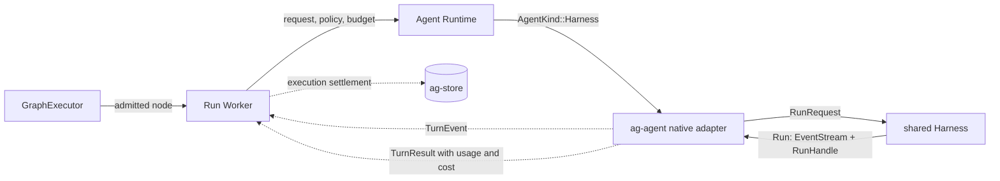
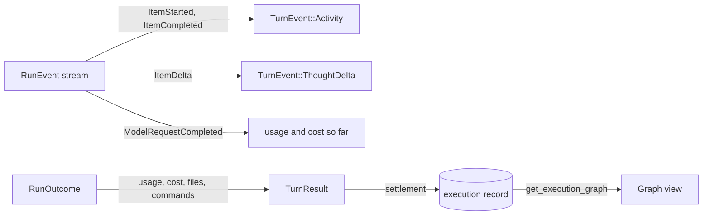

+++
title = "Harness Graph Integration"
description = "Proposed design for running execution graph nodes on the ag-harness run API."
weight = 9
+++

**Status: proposed, not shipped.** This page designs how execution graph nodes run on
the new public `ag-harness` API (`Run`, `EventStream`, `RunOutcome`, `CancelToken`,
`BudgetLedger`, `ModelCatalog`, `ToolSet`, `ContextPolicy`, and the planned
`ApprovalHandler`). The implementation is the next iteration. Until then,
[Execution Graphs](@/docs/architecture/execution-graphs.md) and
[`ag-harness` Design](@/docs/architecture/ag-harness-design.md) describe shipped
behavior.

## Goals and Non-Goals

- Run graph nodes on the native harness with the same guarantees as other backends:
  exact admission, exact handoffs, explicit resume, terminal cancellation, and limits
  fixed at first launch.
- Feed the harness's typed events, usage, and cost into durable graph state and the TUI
  without hand-folded reports.
- Share budgets and provider concurrency across parallel nodes.
- Keep the
  [execution boundary](@/docs/core-components/execution-components/execution-boundary.md)
  unchanged: **Run Worker → Agent Runtime → Harness → LLM**. Only `ag-agent` sees
  `ag-harness` types; graph code and workflows see `ag-contracts` types only.
- Keep the change behind `--experimental-harness`. Codex, Claude, and other external
  backends keep their behavior.

Not in scope: model-requested delegation (subagents), dynamic graph rewriting, cost
display for external backends that do not report prices, and making the harness the
default backend.

## Layering

The graph executor stays backend-neutral. It admits a node and dispatches it through the
worker's task-conversation or utility path. The runtime selects the native adapter for
`AgentKind::Harness`, and that adapter is the only place that maps between Agentty
contracts and the harness API.

The adapter holds **one shared `Harness` per process** (cloned handle over one inner)
instead of one per session. That shared handle carries the `ModelCatalog` with
per-provider concurrency caps, so parallel nodes on the same provider queue for the same
permits.

## Node to Run Mapping

| Graph concept                     | Harness concept                                                   |
| --------------------------------- | ----------------------------------------------------------------- |
| `GraphContext::TaskConversation`  | One durable `Session` per task, keyed by the task context ID      |
| Task attempt or continuation      | One `Session::run` on that task's session                         |
| `GraphContext::Fresh` utility run | `Harness::run_once` (memory store), or a throwaway session        |
| Node execution ID                 | `host_id` of the run, for idempotent recovery                     |
| Node model selection              | `ModelSelector::Id` resolved through the catalog                  |
| Node protocol schema              | Per-run `OutputMode` (JSON schema); output read with `parse`      |
| Node instructions and objective   | Per-run `instructions` after the cached prefix                    |
| Node generation/execution limits  | `RunLimits` (model requests, tool calls, tokens, wall time)       |
| Node permission ceiling           | Per-run `ToolSet`, `ToolPolicy`, and sandbox enforcement          |
| Shared budget ID                  | One `BudgetLedger` shared by every run that names that budget     |
| Branch from an earlier task state | `Harness::fork` at the last settled turn, into a new task session |

Rules:

- **One session, one model.** Each task node uses one session for its whole life. A node
  never switches models mid-session; a different model is a different node. This keeps
  the provider prompt cache stable and avoids cross-provider history projection.
- **Handoffs stay outputs.** Dependents receive the exact schema-validated output
  version that admission pinned, never a transcript. Transcripts stay readable through
  `Session::transcript` for display and debugging.
- **Forks for branches.** Continuing a settled task while keeping its earlier attempt
  intact forks the task's session at its last settled turn into a new session. The
  source session is never rewritten, matching the rule that continuations never rewrite
  earlier attempts. A fork gets its own prompt-cache key.
- **Fresh nodes stay fresh.** Fresh utility nodes keep no history between runs, so the
  memory-backed `run_once` path fits; only task conversations need durable sessions.

## Events, Usage, and Cost

The adapter consumes the run's `EventStream` and its terminal `RunOutcome`.

- **Activity.** Tool items map to the existing `TurnEvent::Activity` snapshots, keyed by
  attempt and item ID, so the TUI's turn activity needs no harness-specific code.
- **Deltas.** Streaming text and reasoning deltas map to transient loader updates. They
  never enter the persisted transcript or graph outputs.
- **Usage and cost.** `RunOutcome` replaces the hand-folded `TurnReport` usage. The
  contracts gain an additive, optional cost in micro-USD next to the token counts;
  backends without prices report none, and older records read as unknown, never zero.
  Each execution record persists its usage and cost, and graph status sums them per node
  and per graph.
- **Terminal event.** `Completed` is always last. The adapter returns only after the run
  settles, so Agentty still commits a settled worktree.

## Cancellation, Crash Recovery, and Idempotency

- **Cancellation.** Worker cancellation (caller drop, `cancel_execution_graph`, session
  cleanup, shutdown) calls the run's `CancelToken`. The adapter then awaits the run's
  outcome, which includes write and command settlement, before the worker releases the
  node's Env lease and capacity. Graph cancellation fans out one token per running node.
- **Leases.** The harness's renewable session lease fences concurrent processes on the
  same task session. Agentty's root lock already prevents two live instances, so the
  lease is a second line of defense, not the primary fence.
- **Idempotency.** Every harness run carries the node execution ID as its `host_id`.
  Redelivering the same execution returns the recorded outcome instead of running again.
- **Crash recovery.** Startup recovery stays explicit and never dispatches work. For a
  harness execution left running, recovery asks the harness for the `host_id` record:
  - a completed, settled run settles the execution from its recorded outcome;
  - anything else (interrupted, unsettled effects, missing) fails the execution as
    today, and `resume_execution_graph` or a node retry starts a new execution ID.
- **Settlement failures.** An unsettled run (`Unsettled`) keeps blocking new turns on
  that session; the node fails with the settlement phase, and the retry path re-awaits
  settlement before the session accepts another run.

## Budgets and Concurrency

Graphs keep their existing durable provider-call budgets. The harness `BudgetLedger`
becomes the bridge:

- The adapter wraps the request's `ProviderCallBudget` in a `BudgetLedger`. Each
  `reserve` consumes one provider call; a refused call ends the run with
  `BudgetExhausted`, which the node reports as an exhausted budget. `commit` records
  usage and cost but charges no further calls. This replaces the native harness's
  current per-request charging hook, so retries, repairs, summaries, and resends all
  draw from the same graph budget.
- Because the graph's durable ledger already records every charge and refund, a restart
  still never replenishes spent calls.
- A cost or token budget per graph (`LimitKind::Cost`, `LimitKind::Tokens`) is a
  follow-up behind an owner decision; it would reuse the same ledger bridge with a
  durable cost ledger.
- **Concurrency layers.** Worker capacity bounds concurrent utility runs; the Scheduler
  bounds session turns; the catalog's per-provider cap bounds concurrent provider
  requests across every node in the process. A node waiting for a provider permit
  already holds its worker slot and Env lease, so caps should be set high enough not to
  starve focused-review waves.

## Model Roles per Node

Graph proposals may name a role (for example `SMART` or `CHEAP`) or an exact model.
Roles resolve to an exact model ID through the catalog **during proposal resolution**,
before approval, so the approved snapshot is exact and a restart cannot change which
model a node uses. Resolution fails a proposal whose role cannot be satisfied or whose
required capabilities (for example image input) are missing. Compaction and in-turn
summaries use the catalog's `CHEAP` role through `ContextPolicy`.

## Tools, Approvals, and Sandbox

- **Tools.** The node's intersected permissions select the run's `ToolSet`: `SharedRead`
  and `BackgroundRead` nodes get `read` only; `ExclusiveWrite` task nodes add `write`
  and `bash`. Host-provided `ToolHandler`s (such as a future delegation tool) are added
  per node only when the node's agent definition allows them.
- **Approvals.** Graph nodes run unattended. Their `ApprovalHandler` decides from the
  node's permission ceiling and never waits for a person: anything outside the ceiling
  is denied with feedback the model can correct. Interactive approvals belong to
  ordinary session chat. A decision timeout ends a stuck run with `ApprovalTimeout` so
  the session lease is never held forever.
- **Sandbox.** Read-only nodes run `bash`, if granted, with filesystem enforcement;
  writer nodes keep the session worktree writable and Git metadata read-only; networking
  is never granted. When the native launcher is unavailable, the harness fails the run
  with `SandboxUnavailable` before any model call instead of silently running
  unsandboxed.

## Sequencing with the Migration Plan

The harness API lands in `ag-harness` first (core contract, then extension points). The
`ag-agent` migration steps M1–M7 then move the native adapter onto it, and A9 seals the
old surface. Graph integration rides on those steps:

| Integration step                         | Needs                       | Visible change                           |
| ---------------------------------------- | --------------------------- | ---------------------------------------- |
| Typed errors map to node failure reasons | M1                          | Clearer node failure messages            |
| Shared harness and catalog in `ag-agent` | M2 (catalog, roles)         | None; provider caps across nodes         |
| Run, event stream, usage, and cost       | M3                          | Streaming text, per-node usage and cost  |
| Ledger bridge and per-node `RunLimits`   | Budget ledger, run limits   | Budget exhaustion reported per node      |
| `host_id` recovery for graph executions  | Idempotent host requests    | Settled runs survive a crash             |
| Transcript reads and forks for branches  | M4                          | Branch continuations keep source history |
| Auto-compaction on the cheap role        | M5                          | Compaction notice                        |
| Per-node `ToolSet`, approvals, sandbox   | M6, tool handlers, approval | Sandboxed graph `bash`                   |

Every step is additive and gated by `--experimental-harness`; nothing changes for
external backends except optional cost fields, which they leave empty. M3 and M5 change
recorded TUI output and are never in flight together.

## Migration and Rollback

- **Flag.** Without `--experimental-harness`, harness nodes fail before execution as
  they do today; turning the flag off is the rollback.
- **Storage.** New columns (per-execution cost) are nullable and additive. Older
  databases load with unknown usage; a downgrade ignores the extra columns. Harness
  session databases stay per Agentty session under the data root and are removed with
  the session.
- **Compatibility.** Each step lands while the old adapter paths still compile behind
  deprecation, so a step can be reverted alone. Sealing (A9) happens only after every
  step has shipped.

## Test Plan

Prove each behavior once at the lowest level, following the test pyramid skill. Every
test uses deterministic fake models: the harness's scripted `Model` in `ag-agent` tests
and the scripted provider in worker and E2E tests. No live provider runs in CI; live
smoke tests stay manual or nightly behind an explicit opt-in.

- **Pure unit (`ag-agent`, `ag-session`).**
  - Event mapping: each `RunEventKind` to its `TurnEvent`, including the terminal event
    and ignored kinds.
  - Permission ceiling to `ToolSet`, `ToolPolicy`, and sandbox enforcement.
  - Node limits to `RunLimits`; model selection and role to catalog selector, including
    unsatisfiable roles and missing capabilities.
  - Ledger bridge: reserve charges one call, refusal maps to `BudgetExhausted`, commit
    charges nothing.
- **Boundary unit (`ag-agent` native adapter with a scripted model).**
  - A task run reports usage and cost from `RunOutcome` and returns only after
    settlement.
  - Cancellation awaits settlement; an unsettled run blocks the next run.
  - Redelivering a `host_id` returns the recorded outcome without a model call.
  - A fork leaves the source session's transcript unchanged.
- **Crate contract (`ag-worker`, `ag-store`).**
  - N parallel nodes sharing one budget stop at a deterministic total.
  - Startup recovery settles a completed harness execution from its record and fails an
    interrupted one, without dispatching.
  - Loading a database from before the cost columns reports unknown usage, not zero.
- **FeatureTest E2E (`crates/agentty/tests/e2e/`).** One scenario: an approved `/graph`
  with two parallel harness nodes and a join, driven by the scripted provider, showing
  node progress, streamed text, and per-node usage. Cancellation and recovery
  permutations stay at lower levels. Recording refreshes follow the feature-recording
  skill when captured output changes.
- **Coverage.** Every step keeps 100% line and function coverage, without exclusions.

## Implementation PR Breakdown

1. **Contracts:** optional cost in micro-USD on `TurnResult` and `TurnEvent::Completed`,
   persisted per execution with a nullable column and an old-database test.
1. **Shared harness:** one cloned `Harness` with the catalog in `ag-agent`; per-provider
   caps shared across sessions (with M2).
1. **Run adapter:** native adapter on `Run`, `EventStream`, and `RunOutcome`; event
   mapping and usage (with M3). FeatureTest for streaming text.
1. **Budgets and limits:** ledger bridge over `ProviderCallBudget` and per-node
   `RunLimits`; parallel-budget contract test.
1. **Recovery:** execution ID as `host_id`; startup recovery consults the harness
   record.
1. **Branches:** transcript reads and fork-based continuations (with M4).
1. **Tools and sandbox:** per-node `ToolSet`, unattended `ApprovalHandler`, and sandbox
   enforcement (with M6 and the approval handler).
1. **Graph E2E and docs:** the graph FeatureTest above, then updates to
   [Execution Graphs](@/docs/architecture/execution-graphs.md),
   [Runtime Flow](@/docs/architecture/runtime-flow.md),
   [Module Map](@/docs/architecture/module-map.md), and
   [Testability Boundaries](@/docs/architecture/testability-boundaries.md).

## Risks and Open Decisions

Open decisions for the owner; **(recommended)** marks the suggested option.

- **Graph budget units.**
  - **(recommended)** Keep provider-call budgets now through the ledger bridge; add a
    durable cost budget later.
  - Switch graph budgets to cost immediately.
- **Crash recovery of harness executions.**
  - **(recommended)** Settle only completed, settled runs from their record; fail the
    rest as today.
  - Always fail and retry, ignoring harness records.
- **Approvals in graph nodes.**
  - **(recommended)** Unattended: decide from the permission ceiling, never prompt.
  - Prompt the user through the session's question flow, pausing the node.
- **Role resolution time.**
  - **(recommended)** At proposal resolution, so approved snapshots are exact.
  - At dispatch, following catalog changes.
- **Sandbox fallback.**
  - **(recommended)** Fail closed with `SandboxUnavailable`.
  - Fall back to the current unsandboxed executor with a visible warning.

Risks:

- **Provider cap starvation.** A low per-provider cap can hold worker slots and Env
  leases while nodes wait. Mitigate with default caps above worker capacity and a
  contract test.
- **Two budgets drifting.** Call budgets and harness limits could disagree. Keep the
  graph budget authoritative and derive `RunLimits` from node limits only.
- **Recording churn.** Streaming and compaction change recorded TUI output; keep M3 and
  M5 sequential.
- **Upstream churn.** The harness API is unsealed until A9; the adapter must use root
  exports only so A9 does not break it.
