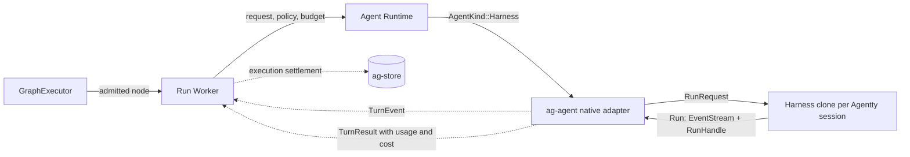
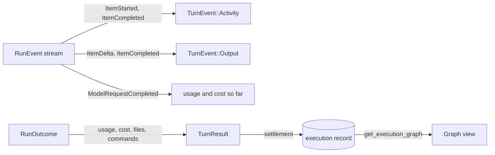

+++
title = "Harness Graph Integration"
description = "Proposed design for running execution graph nodes on the ag-harness run API."
weight = 9
+++

**Status: proposed, not shipped.** This page designs how execution graph nodes run on
the new public `ag-harness` API (`Run`, `EventStream`, `RunOutcome`, `CancelToken`,
`BudgetLedger`, `ModelCatalog`, `ToolSet`, `ContextPolicy`, and the planned
`ApprovalHandler`). The implementation is the next iteration. Until then,
[Execution Graphs](@/docs/architecture/execution-graphs.md) and
[`ag-harness` Design](@/docs/architecture/ag-harness-design.md) describe shipped
behavior.

## Goals and Non-Goals

- Run graph nodes on the native harness with the same guarantees as other backends:
  exact admission, exact handoffs, explicit resume, terminal cancellation, and limits
  fixed at first launch.
- Feed the harness's typed events, usage, and cost into durable graph state and the TUI
  without hand-folded reports.
- Share budgets and model concurrency across parallel nodes.
- Keep the
  [execution boundary](@/docs/core-components/execution-components/execution-boundary.md)
  unchanged: **Run Worker → Agent Runtime → Harness → LLM**. Only `ag-agent` sees
  `ag-harness` types; graph code and workflows see `ag-contracts` types only.
- Keep the change behind `--experimental-harness`. Codex, Claude, and other external
  backends keep their behavior.

Not in scope: model-requested delegation (subagents), dynamic graph rewriting, cost
display for external backends that do not report prices, and making the harness the
default backend.

## Layering

The graph executor stays backend-neutral. It admits a node and dispatches it through the
worker's task-conversation or utility path. The runtime selects the native adapter for
`AgentKind::Harness`, and that adapter is the only place that maps between Agentty
contracts and the harness API.

The adapter shares **one `Arc<ModelCatalog>` and the budget ledgers per process**. Each
Agentty session gets its own `Harness` clone configured with that session's database,
because a harness store is configured per builder. The catalog carries **per-model
concurrency caps** (one permit pool per catalog entry), so parallel nodes on the same
model queue for the same permits. Two models of one provider do not share permits; a
provider-wide cap is an `ag-harness` follow-up, listed under open decisions.

## Node to Run Mapping

| Graph concept                      | Harness concept                                                    |
| ---------------------------------- | ------------------------------------------------------------------ |
| Task execution lineage             | One durable `Session`, mapped from the source execution ID         |
| Task attempt or continuation       | One run appended to that lineage's session                         |
| Retry from an earlier settled turn | `Harness::fork` into a session derived from the retry execution ID |
| `GraphContext::Fresh` utility run  | `Harness::run(RunRequest)` on an in-process memory store           |
| Task node execution ID             | Host ID of the run, for idempotent redelivery and recovery         |
| Node model selection               | Exact model ID from the approved snapshot, resolved in the catalog |
| Node protocol schema               | Per-run `OutputMode` (JSON schema); output read with `parse`       |
| Node instructions and objective    | Per-run `instructions` after the cached prefix                     |
| Node generation/execution limits   | `RunLimits` (model requests, tool calls, tokens, wall time)        |
| Node permission ceiling            | Per-run `ToolSet`, `ToolPolicy`, and sandbox enforcement           |
| Shared budget ID                   | One `BudgetLedger` shared by every run that names that budget      |

Rules:

- **Sessions follow execution lineage.** The worker persists the mapping from source
  execution ID to harness session ID with the execution record. An ordinary continuation
  (`continue_execution_graph_node`) appends a turn to the same session: appending never
  rewrites earlier attempts and keeps the prompt cache.
- **Fork only to branch.** A retry that branches from an earlier settled turn forks at
  that turn. The fork's `SessionId` is derived from the retry's execution ID, so a retry
  after a crash between fork and dispatch reopens the existing fork instead of failing
  with `Conflict`. Forked host records cannot collide, because execution IDs are unique.
  Forks only work within one database, so branches stay inside one Agentty session.
- **One session, one model.** A node never switches models mid-session; a different
  model is a different node. This keeps the cache stable and avoids cross-provider
  history projection. Compaction is the only other model a session sees (see Model Roles
  per Node).
- **Handoffs stay outputs.** Dependents receive the exact schema-validated output
  version that admission pinned, never a transcript. Transcripts stay readable through
  `Session::transcript` for display and debugging.
- **Fresh nodes stay fresh.** Fresh utility nodes keep no history, so the memory-backed
  `Harness::run` path fits. They have no durable host record: an interrupted fresh node
  always fails and retries with a new execution ID.

## Events, Usage, and Cost

The adapter consumes the run's `EventStream` and its terminal `RunOutcome`.

- **Activity.** Tool items map to the existing `TurnEvent::Activity` snapshots, keyed by
  attempt and item ID, so the TUI's turn activity needs no harness-specific code.
- **Deltas.** Streaming text and reasoning deltas map to the transient
  `TurnEvent::Output` changes that harness session turns already stream. They never
  enter the persisted transcript or graph outputs.
- **Usage and cost.** `RunOutcome` replaces the hand-folded `TurnReport` usage. The
  contracts gain an additive, optional cost in micro-USD next to the token counts;
  backends without prices report none, and older records read as unknown, never zero.
  Each execution record persists its usage and cost, and graph status sums them per node
  and per graph.
- **Terminal event.** `Completed` is always last. The adapter returns only after the run
  settles, so Agentty still commits a settled worktree.

## Cancellation, Crash Recovery, and Idempotency

Host-ID idempotency and record-based recovery apply only to task-conversation nodes,
whose sessions are durable. Fresh nodes fail and retry on recovery.

- **Cancellation.** Worker cancellation (caller drop, `cancel_execution_graph`, session
  cleanup, shutdown) calls the run's `CancelToken`. The adapter then awaits the run's
  outcome, including write and command settlement, **up to a settlement deadline**. When
  the deadline expires, the adapter kills the command's process group, the session stays
  `Unsettled`, and the worker releases the Env lease and capacity with the node failed
  in the settlement phase. Graph cancellation fans out one token per running node.
- **Leases.** The harness's renewable session lease fences concurrent processes on the
  same task session. Agentty's root lock already prevents two live instances, so the
  lease is a second line of defense, not the primary fence.
- **Host record lifecycle.** Every task run carries its node execution ID as host ID.
  The harness creates the record atomically at admission, before any provider call, as
  `InProgress`. Redelivering the same host ID never runs again; it returns the record:
  - `Completed`: the recorded outcome, without a model call;
  - `Failed` or `Interrupted`: that failure, which fails the execution;
  - `InProgress`: never a second execution; after a crash it is treated as interrupted.
- **Crash recovery.** Startup recovery stays explicit, never dispatches work, and holds
  no Env lease, so it cannot run Agentty's post-run effects (worktree commit, output
  validation, output pinning). It therefore never settles an execution from a harness
  record. It fails every harness execution left running, as today. A task execution
  whose record is `Completed` is marked **recoverable**: an explicit
  `resume_execution_graph` re-dispatches it under the same execution ID, reacquires the
  Env lease, receives the recorded output through redelivery (saving the provider call),
  and then runs validation and effects in the normal order. Any other record, and every
  fresh node, retries with a new execution ID.
- **Recovery seam.** Graph code cannot read harness records. The runtime gains a
  backend-neutral recovery query in `ag-contracts` terms: given an execution ID, it
  classifies the run as completed, interrupted, unsettled, or missing. `ag-agent`
  implements it with `Session::recover`; external backends always answer missing.
- **Settlement failures.** An unsettled run (`Unsettled`) keeps blocking new turns on
  that session; the node fails with the settlement phase, and the retry path re-awaits
  settlement before the session accepts another run.

## Budgets and Concurrency

Graphs keep their existing durable provider-call budgets. The harness `BudgetLedger`
becomes the bridge:

- The adapter wraps the request's `ProviderCallBudget` in a `BudgetLedger`. Each
  `reserve` consumes one provider call; `commit` records usage and cost but charges no
  further calls. This replaces the native harness's current per-request charging hook,
  so retries, repairs, summaries, and resends all draw from the same graph budget.
- **When a call is spent.** The harness acquires the model's concurrency permit first
  and reserves budget only after it. A run cancelled while waiting for a permit
  therefore charges nothing. Once reserved, the request counts as sent: if it fails or
  is dropped in flight, the harness commits it as an unreported request, because the
  provider may have billed it. A `Reservation` dropped without being sent or committed
  runs its release function, which refunds the call to the graph ledger.
- **Telling budgets apart.** A refused reserve ends the run with
  `BudgetExhausted(LimitKind)`, and the closest kind is `ModelRequests`, the same kind a
  per-run `RunLimits` stop reports. The bridge records its own refusals, and the adapter
  reports a graph budget refusal as an exhausted shared budget and anything else as a
  node limit. A dedicated upstream `LimitKind` variant is the alternative (`LimitKind`
  is already `#[non_exhaustive]`).
- Because the graph's durable ledger records every charge and refund, a restart still
  never replenishes spent calls.
- A cost or token budget per graph (`LimitKind::Cost`, `LimitKind::Tokens`) is a
  follow-up behind an owner decision; it would reuse the same ledger bridge with a
  durable cost ledger.
- **Concurrency layers.** Worker capacity bounds concurrent utility runs; the Scheduler
  bounds session turns; the catalog's per-model cap bounds concurrent requests to one
  model across every node in the process. A node waiting for a model permit already
  holds its worker slot and Env lease, so caps should be set high enough not to starve
  focused-review waves.

## Model Roles per Node

Proposals do not name models or roles: `GraphProposalExecution` carries no model, Env,
task, or budget IDs. The host keeps capturing an exact model in the snapshot, as today.
When the host picks a node's model from a role (for example the session's `SMART` model
or a `CHEAP` utility model), it resolves the role through a role-resolver port in
`ag-contracts` that `ag-agent` implements over the catalog. Resolution happens when the
snapshot is captured, before approval, so a restart cannot change which model a node
uses, and it fails when a role cannot be satisfied or required capabilities (for example
image input) are missing.

Compaction and in-turn summaries use a compaction model that is resolved at the same
time, pinned in the snapshot, and restricted to the node model's provider and
compatibility profile; when no such cheap model exists, the node's own model compacts.
This keeps the one-session-one-model rule free of cross-provider projection.

## Tools, Approvals, and Sandbox

- **Tools.** The node's intersected permissions select the run's `ToolSet`: `SharedRead`
  and `BackgroundRead` nodes get `read` only, never `bash`; `ExclusiveWrite` task nodes
  add `write` and `bash`. Host-provided `ToolHandler`s (such as a future delegation
  tool) are added per node only when the node's agent definition allows them.
- **Approvals.** Graph nodes run unattended. Their `ApprovalHandler` decides
  synchronously from the node's permission ceiling and never waits for a person:
  anything outside the ceiling is denied with feedback the model can correct.
  Interactive approvals belong to ordinary session chat.
- **Sandbox.** Writer nodes run `bash` in the native sandbox with the session worktree
  writable and Git metadata read-only. When the native sandbox is unavailable, the run
  follows the harness's `Sandbox` choice: by default it runs unsandboxed and emits a
  `SandboxUnavailable` warning event; `IfUnavailable::Refuse` fails it with
  `SandboxUnavailable` before any model call. It never runs unsandboxed silently.
- **Sandbox is a breaking change.** Edit modes run `bash` unsandboxed with network
  today. Sandboxing writers breaks commands that fetch dependencies (for example
  `cargo build` or `npm install`) unless writers get the network grant
  (`BashConfig::with_network`), and fails harness writer nodes on hosts without the
  launcher. It therefore has its own setting, separate from `--experimental-harness`, so
  users can turn it off; whether writers get network is an open decision.

## Sequencing with the Migration Plan

The harness API lands in `ag-harness` first (core contract, then extension points). The
`ag-agent` migration steps M1–M7 then move the native adapter onto it, and A9 seals the
old surface. Graph integration rides on those steps:

| Integration step                         | Needs              | Visible change                          |
| ---------------------------------------- | ------------------ | --------------------------------------- |
| Typed errors map to node failure reasons | M1 (A1)            | Clearer node failure messages           |
| Shared catalog in `ag-agent`             | M2 (A2, B1)        | None; model caps across nodes           |
| Run, event stream, usage, and cost       | M3 (A4a, A4b, A3b) | Streaming text, per-node usage and cost |
| Ledger bridge and per-node `RunLimits`   | A6a, A6b           | Budget exhaustion reported per node     |
| Host-ID recovery for task executions     | A5, host ID on run | Recoverable executions resume           |
| Transcript reads and forks for branches  | M4 (A7)            | Branch retries keep source history      |
| Auto-compaction on the pinned model      | M5 (C2, C3)        | Compaction notice                       |
| Per-node `ToolSet`, approvals, sandbox   | M6 (S1, D1a, D2)   | Sandboxed graph `bash`                  |

M7 (`ag-harness-cli`) has no graph impact. Recovery uses the existing
`Session::recover`, but `RunRequest` does not carry a host ID on the open branches yet;
that upstream addition (the plan's `idempotency_key`) is a prerequisite.

Every step is gated by `--experimental-harness`, and every step except the sandbox is
additive; nothing changes for external backends except optional cost fields, which they
leave empty. M3 and M5 change recorded TUI output and are never in flight together.

## Migration and Rollback

- **Flag.** Without `--experimental-harness`, harness nodes fail before execution as
  they do today; turning the flag off on the same or a newer binary is the rollback.
- **Sandbox.** Writer sandboxing rolls back through its own setting, not the flag.
- **Storage.** New columns (per-execution cost) are nullable and additive, and older
  databases load with unknown usage. `ag-store` and `ag-harness` run their migrators
  without ignoring missing versions, so an older binary refuses a database with a newer
  migration (`VersionMissing`). A binary downgrade after the cost migration is
  unsupported without restoring a backup.
- **Session databases.** Harness session databases stay per Agentty session under the
  data root and are removed with the session.
- **Old paths.** Each step deletes the old adapter path it replaces instead of keeping
  both under the coverage gate. Rollback is `--experimental-harness` or `git revert` of
  the step. Sealing (A9) happens only after every step has shipped.

## Test Plan

Prove each behavior once at the lowest level, following the test pyramid skill. Every
test uses deterministic fake models: the harness's scripted `Model` in `ag-agent` tests
and the scripted provider in worker and E2E tests. Waits use `tokio::time::pause` or
barriers, never wall-clock sleeps. No live provider runs in CI; live checks stay manual,
through the `prompt-evaluation` hook (`--hook-stage manual`).

- **Pure unit (`ag-agent`).**
  - Event mapping: each `RunEventKind` to its `TurnEvent`, including the terminal event
    and ignored kinds.
  - Each `HarnessError` kind and retry class to its node failure reason.
  - Permission ceiling to `ToolSet`, `ToolPolicy`, and sandbox enforcement.
  - Node limits to `RunLimits`; role to catalog selector, including unsatisfiable roles,
    missing capabilities, and the same-provider compaction model.
  - Ledger bridge: reserve charges one call; a refusal is reported as a shared budget,
    not a node limit; commit charges nothing; a dropped unsent reservation refunds.
- **Pure unit (`ag-session`, `agentty`).** Permission intersection in `ag-contracts`
  terms, and graph status rendering unknown, not `$0`, for nodes without cost.
- **Boundary unit (`ag-agent` native adapter with a scripted model).**
  - A task run reports usage and cost from `RunOutcome` and returns only after
    settlement.
  - Cancellation awaits settlement; a paused-time settlement deadline fails the node and
    leaves the session `Unsettled`; an unsettled run blocks the next run.
  - A run cancelled while waiting for a model permit charges no call.
  - Redelivering a host ID returns the recorded outcome per state, without a model call.
  - Recovery seam over a real on-disk session database: drop a run mid-flight, reopen,
    and classify the record as completed, interrupted, unsettled, or missing.
  - A fork leaves the source transcript unchanged, and a repeated fork for the same
    retry reopens the existing fork.
  - Auto-compaction selects the pinned compaction model and emits the notice event.
  - Unattended approvals: a case table of calls inside and outside the ceiling (allow,
    or deny with feedback).
  - Sandbox: an injected launcher that reports unavailable ends the run with
    `SandboxUnavailable` and zero scripted-model requests.
  - Prompt delivery: instruction placement after the cached prefix, the schema chosen
    for each request profile, and the denial-feedback wording.
- **Gated sandbox suite.** Enforcement cases (writers cannot modify Git metadata,
  networking is denied) join the existing `crates/ag-harness/tests/sandbox.rs`, run by
  `harness-sandbox.yml` and `coverage-ag-harness-sandbox`, not a new binary.
- **Crate contract (`ag-worker`, `ag-store`).**
  - Recovery with a fake of the recovery seam: a completed record marks the execution
    recoverable, every other case fails it, and nothing is dispatched; resume reuses the
    recorded output and then runs validation and effects.
  - Shared budget, owned by `ag-worker` with the real bridge: a gated scripted model
    holds every run at a barrier on a current-thread runtime, so ordering is forced. The
    total charged equals the budget, each losing reserve gets exactly one refusal, and
    nothing over-commits.
  - A model cap below worker capacity does not deadlock a focused-review wave (gated
    model, paused time).
  - External adapters (Codex, Claude) report no cost.
  - Loading a database from before the cost columns reports unknown usage, not zero.
- **FeatureTest E2E.** One scenario, extending the existing
  `crates/agentty/tests/e2e/session/harness.rs` and `graph_proposal.rs` fixtures
  (wiremock scripted provider): an approved `/graph` with two parallel harness nodes and
  a join. It asserts stable end states (node status, join output, per-node usage) with
  `wait_for_text`, not transient streamed frames. The compaction notice and streaming
  text are covered by the M5 and M3 scenarios, not repeated here. Neither fixture
  publishes a `.zola` capture today, so this scenario needs no recording refresh.
- **Prompt evaluation.** PRs 3 and 7 each record a manual baseline and candidate
  `prompt-evaluation` run on the Run Worker → Agent Runtime → Harness → LLM path, or
  report "not run" when credentials are missing, per `docs/contributing/prompts.md`.
- **Coverage.** Every step keeps 100% line and function coverage, without exclusions.

## Implementation PR Breakdown

1. **Contracts:** optional cost in micro-USD on `TurnResult` and `TurnEvent::Completed`,
   persisted per execution with a nullable column; old-database, external no-cost, and
   unknown-cost rendering tests.
1. **Shared catalog:** one `Arc<ModelCatalog>` and per-session harness clones in
   `ag-agent`; per-model caps shared across sessions (with M2).
1. **Run adapter:** native adapter on `Run`, `EventStream`, and `RunOutcome`; event
   mapping, usage, and prompt delivery (with M3, whose FeatureTest covers streaming).
1. **Budgets and limits:** ledger bridge over `ProviderCallBudget` and per-node
   `RunLimits`; shared-budget and cap-starvation contract tests.
1. **Recovery:** execution ID as host ID, the `ag-contracts` recovery seam, and
   recoverable executions resumed through `resume_execution_graph`.
1. **Branches:** lineage-to-session mapping, transcript reads, and fork-based retries
   (with M4).
1. **Tools and sandbox:** per-node `ToolSet`, unattended `ApprovalHandler`, sandbox
   enforcement and its setting, and the gated sandbox cases (with M6 and D2).
1. **Graph E2E and docs:** the graph FeatureTest above, then updates to
   [Execution Graphs](@/docs/architecture/execution-graphs.md),
   [Runtime Flow](@/docs/architecture/runtime-flow.md),
   [Module Map](@/docs/architecture/module-map.md), and
   [Testability Boundaries](@/docs/architecture/testability-boundaries.md).

## Risks and Open Decisions

Open decisions for the owner; **(recommended)** marks the suggested option.

- **Graph budget units.**
  - **(recommended)** Keep provider-call budgets now through the ledger bridge; add a
    durable cost budget later.
  - Switch graph budgets to cost immediately.
- **Crash recovery of harness executions.**
  - **(recommended)** Fail at startup; resume completed task runs under the same
    execution ID through `resume_execution_graph`, reusing the recorded output and
    re-running validation and effects. This lets a resume keep an execution ID, which
    the graph contract must allow.
  - Always fail and retry with a new execution ID, ignoring harness records.
- **Approvals in graph nodes.**
  - **(recommended)** Unattended: decide from the permission ceiling, never prompt.
  - Prompt the user through the session's question flow, pausing the node. A decision
    timeout (`ApprovalTimeout`) would then end a stuck run and release the session
    lease, tested under paused time.
- **Role resolution time.**
  - **(recommended)** When the snapshot is captured, so approved snapshots are exact.
  - At dispatch, following catalog changes.
- **Sandbox fallback.** Decided: the harness falls back to unsandboxed execution with a
  typed `SandboxUnavailable` warning by default, and hosts that must fail closed choose
  `IfUnavailable::Refuse`.
- **Writer network access.**
  - **(recommended)** Grant writers network so dependency fetches keep working, with the
    filesystem still confined.
  - Deny network and accept the breakage.
- **Provider-wide concurrency.**
  - **(recommended)** Per-model caps now; add a provider-wide cap in `ag-harness` only
    if rate limits show it is needed.
  - Add a provider-wide cap before integration.

Risks:

- **Cap starvation.** A low per-model cap can hold worker slots and Env leases while
  nodes wait. Mitigate with default caps above worker capacity and the cap-starvation
  contract test.
- **Two budgets drifting.** Call budgets and harness limits could disagree. Keep the
  graph budget authoritative and derive `RunLimits` from node limits only.
- **Recording churn.** Streaming and compaction change recorded TUI output; keep M3 and
  M5 sequential.
- **Upstream churn.** The harness API is unsealed until A9; the adapter must use root
  exports only so A9 does not break it.
