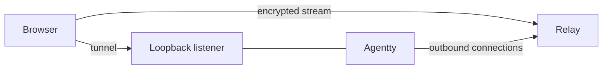

+++
title = "Remote Control Design"
description = "Transports, keys, relay trust model, and the design decisions behind remote control."
weight = 10
+++

 Remote control lets a browser on another
device drive sessions through one frame protocol over two transports: a loopback
listener reached through a private tunnel, and a relay that needs no tunnel. This page
records the design and the decisions behind it.
[Remote Control](@/docs/usage/remote-control.md) covers how to use it.

<!-- more -->

## Crates

- `ag-remote` owns the frame protocol, pairing, the loopback listener, the embedded web
  client, and the instance side of the relay link.
- `ag-noise` owns the handshakes and encrypted sessions. It performs no I/O.
- `ag-relay` joins a device's connection to one that an Agentty instance dials out, and
  serves the web client so a pairing link opens it. It keeps no accounts and no
  database.

## Trust model

The relay is untrusted. It learns which instance a device asks for, when they connect,
and how much they send. It cannot read or change what they send, and it cannot pair a
device: pairing still needs the one-time code and an approval in the terminal.

Whoever runs a relay decides which instances may register with it. After an instance
proves its key, the relay asks an admission policy about its identifier: the `ag-relay`
binary can admit a fixed list, and a program that embeds the crate can supply its own
policy. Refusing an instance is the only power this adds; the operator still cannot read
or change a stream. Agentty tells a refusal apart from other failures by the relay's
close frame and shows it, without changing the relay protocol.

Whoever serves the web client is trusted with the page's code. The relay serves it, so a
malicious relay operator could serve an altered page. Running your own relay removes
that party.

A [platform](@/docs/usage/platform.md) adds an account, not a new path to sessions.
Agentty signs in with a device code, registers the instance's identifier under the
account, and its relay admits registered instances. The access token goes only to that
platform; relays see the same handshake and streams as before. The platform serves the
pairing page its links open, so it holds the same trust as a relay's page.

## Keys and handshakes

- **Instance key.** Each Agentty installation holds one long-lived key pair. The
  instance identifier a relay routes by is the SHA-256 fingerprint of the public key, so
  nobody can claim an identifier without the private key.
- **Instance to relay.** Noise `XN`: the instance proves it holds its key before the
  relay registers it.
- **Device to instance.** Noise `IK`: the device already knows the instance key from the
  pairing link, so one round trip sets up the encrypted session and names the device
  key.
- **Device identity.** A relay device authenticates with its own key pair, and Agentty
  stores only a digest of the public key. A device on the loopback listener uses a
  stored token instead, because that listener relies on the tunnel for encryption.

Both patterns use X25519, AES-256-GCM, and SHA-256. Each role has its own prologue, so a
handshake of one role cannot be replayed as the other.

The pairing link carries the relay address, the instance key, and the one-time code in
its fragment. Browsers do not send the fragment to the server, so the relay never sees
the code.

## Design decisions

### The browser client is plain JavaScript on WebCrypto

**Context.** A browser that pairs through a relay must run the device side of the Noise
handshake. It can do that with the Rust implementation compiled to WebAssembly, or with
JavaScript that calls the browser's own cryptography (WebCrypto).

**Decision.** The web client implements the device handshake in plain JavaScript on
WebCrypto, with no build step.

**Why.**

- WebCrypto can hold the device's private key as non-extractable: the browser uses the
  key, but page scripts can never read it. A script injected into the page can misuse
  the key while the page is open, but cannot copy it. A WebAssembly build keeps the key
  as ordinary bytes that any such script can read and send elsewhere.
- The cryptography is the browser's native implementation and receives fixes with
  browser updates.
- The content security policy stays strict. WebAssembly needs the `'wasm-unsafe-eval'`
  exception.
- The web client keeps its rule of no build step and no toolchain beyond a browser.

**Consequences.**

- The Noise patterns use AES-256-GCM, because browsers do not yet ship ChaCha20-Poly1305
  in WebCrypto by default. `ag-noise` must stay within what WebCrypto provides.
- Two implementations of the device handshake exist. An integration test runs the
  JavaScript in Node.js against a real relay and server, so they cannot drift apart.
- Relay pairing needs a browser with X25519 in WebCrypto, which the major browsers have
  shipped since early 2025, and a page served over HTTPS or from `localhost`. The
  loopback listener is unaffected.

**Rejected: `ag-noise` compiled to WebAssembly.** It runs the same handshake code on
both sides, works in browsers since 2017, and works over plain HTTP. It lost on the
readable device key, the weaker content security policy, and the extra toolchain.

**Revisit when** remote control needs an algorithm that browsers do not provide, such as
a post-quantum key exchange. A small WebAssembly module for that one primitive would
then be the narrower change.

### Safari keeps the device key in a weaker form until it can store X25519 keys

**Context.** Safari loses X25519 key objects that a page stores
([WebKit bug 312279](https://bugs.webkit.org/show_bug.cgi?id=312279)), so a
non-extractable device key would not survive a reload there. Every browser on iPhone and
iPad uses Safari's engine.

**Decision.** The Noise patterns stay on X25519. A browser that cannot read back a
stored key object saves the private half encrypted under a second key that it can store.
Page scripts could decrypt that copy, so those browsers get the protection the
WebAssembly alternative would have given everywhere, not the non-extractable key.

**Consequences.**

- Nothing changes when Safari is fixed. The client checks at run time whether a stored
  key object reads back, and on the first visit after the fix it moves the key to the
  non-extractable form and deletes the weaker copy. The device stays paired.
- The fallback can be removed once affected Safari versions are no longer in use.

**Rejected: P-256 keys**, which Safari stores, either for the whole key exchange or as a
separate signing key that proves the device. Both give Safari the non-extractable key
now, but move remote control off the standard X25519 suite or add a signature step to
the protocol for a browser bug that should be temporary.

### Capabilities instead of version bumps

**Context.** The relay binary embeds its own copy of the web client, and a self-hosted
relay updates separately from Agentty. A device can therefore load a page that is older
or newer than the Agentty it talks to. The server refuses any other `protocol_version`,
so a version bump would lock out every relay device until both sides match.

**Decision.** Frame changes stay additive. New fields default when missing and are
omitted when empty. `welcome` and `paired` carry a `capabilities` list of the optional
requests the server supports, and the client offers a feature only when its capability
is listed. The server lists a capability only when the host reports the operation behind
it through `SessionService::supports`. A request with an unknown `method` gets
`Unsupported request` and the connection stays open; malformed frames still close it.

**Consequences.** An older page ignores fields and capabilities it does not know. A
newer page hides what an older server lacks. `PROTOCOL_VERSION` changes only when a
frame changes meaning or loses a field.

### Markdown is rendered by a DOM builder, not a library

**Context.** Assistant answers are Markdown written by a model, so they are untrusted.
The web client has no build step and no dependencies, and its content security policy
allows no inline styles and no other origin.

**Decision.** `markdown.mjs` parses the subset the TUI renders into a tree of plain
objects, then builds elements from a fixed table of tags with `createElement` and text
nodes. Raw HTML stays text, links keep only the `http:`, `https:`, and `mailto:`
schemes, and the page loads no images.

**Why.**

- The page never parses markup from a string, so the contract test that refuses
  `innerHTML` and its relatives keeps holding for every served file.
- Safety does not depend on a sanitizer configuration or on a library's update cycle.
- The parser works in linear passes, caps nesting at 16 levels, and skips answers over
  256 KB, so a hostile answer cannot freeze the page.

**Consequences.** The renderer differs from CommonMark at the edges: no indented code,
setext headings, reference links, footnotes, or HTML. Each answer has a `View source`
toggle for those cases. The Node tests in `crates/ag-remote/tests/web/` cover each
construct and hostile input.

**Rejected: a Markdown library and a sanitizer**, vendored as files. They cover more of
CommonMark, but render to an HTML string that the page would have to parse, need a
sanitizer to make that safe, and add third-party code to update.

### Remote devices may create, merge, and publish

**Context.** Remote control started as a way to follow sessions and reply to them, and
every new mutation was a separate security decision. Users want a paired device to cover
the main session features of the terminal, and a paired device can already send prompts
that agents run with edit permissions.

**Decision.** A paired device may stop a turn, create sessions, merge a session into its
base branch, publish a session branch and open or refresh its review request, sync a
session branch, sync a project's branch with its remote, and change session settings.
Each operation is a separate request with its own capability and reaches only the
projects and sessions the host lists; see
[Devices reach every listed project](#devices-reach-every-listed-project). Merge and
publish ask for confirmation on the device, not in the terminal, and Agentty keeps no
audit trail of remote actions yet. Running host commands, opening worktrees, changing
Agentty settings, managing projects, and choosing the remote branch name stay out of
reach.

**Consequences.**

- A paired device is close to a full operator: whoever holds one can land changes on the
  base branch and push to the Git remote with the user's credentials. Pairing
  protections stay the same, and the usage page and `SECURITY.md` say so.
- Any other mutation, host command, or read outside the listed sessions still needs its
  own decision.
- The capability list leaves room for per-device permissions or a terminal approval
  later without a protocol change.

### Devices reach every listed project

**Context.** A paired device followed the terminal's active project: it listed, read,
and changed only that project's sessions, and switching projects in the terminal
switched every device with it. Someone away from the terminal could not reach another
project's sessions, and the terminal could not move without moving the devices.

**Decision.** A device reaches every project the terminal lists, the project it has open
and every saved project its switcher offers, and picks the one its page shows. A request
about a project names a listed project, or none for the one the terminal has open when
the host serves it. A device reaches a session only while that session is in a listed
project's session list: its active sessions and the archive's first page, or the
terminal's own window for the project it has open. The approved operations stay the same
and apply in every listed project, which adds creating sessions in and syncing a project
the terminal does not have open.

**Why.** The terminal's project list is already the set of repositories the user
registered with Agentty and chose to see, and a device could already land changes in the
active one with the user's credentials, so the list bounds reach without a new setting.
Tying reach to the active project instead made it depend on terminal state that changes
under a device without its knowing.

**Consequences.**

- What a device reaches no longer depends on the terminal's project, so a terminal
  switch between `ag-remote`'s check and the host's turn changes nothing it reaches. A
  session a device listed before a switch stays reachable while it is still in its
  project's list.
- Reach still ends with the list: a project the terminal stops listing is out of reach
  from the next request the host serves, and a session deleted or archived past its list
  from the moment that list, the page the host holds, next reloads.
- The host holds a session page for each listed project a device or another programmatic
  caller views, loads it in the turn that serves the request, and drops it when idle;
  see [Runtime Flow](@/docs/architecture/runtime-flow.md). Automation that applies the
  terminal's project settings stays with the terminal's project.
- A project the terminal does not have open shows fewer details on a device; the usage
  page lists them under Limitations.

### The host enforces the remote scope itself

**Context.** `ag-remote` checks that the host lists a project or session before each
request that names it and calls only the approved operations. Those checks and the
operation run in separate turns of the foreground loop, so the host cannot trust them
alone: the project list or a project's session list can change between them.

**Decision.** The remote server's session service tags every request as remote. In the
foreground turn that serves it, the host checks again: a project the request names must
be listed, and a session it names must be in a listed project's session list, whose page
the host loads in that same turn when it is not loaded. It answers anything else as
missing, and refuses any operation outside the approved set with
`Remote control does not serve this operation`. One exhaustive classification of the
host's mutations names that set, payloads included: a question answer or proposal
request that carries attachments, which name files on the host, and a publication that
names its branch are not served. The reads remote control never makes, of graphs,
proposals, and tasks by their own identity and of a session's tasks, are refused as a
group. `ag-remote` keeps its own checks.

**Where each check lives.**

- `ag-remote` refuses a request whose operations the host does not serve, checks that a
  named project is in the host's project list, and asks the host whether it lists a
  named session, in that order, before it calls the host.
- The host's command gateway checks each mutation's classification and the project or
  session it reaches. Its query routing checks each read the same way.
- A request that names no project resolves the terminal's project once, in the turn that
  serves it, and a session listing returns its project's identity with the sessions read
  in that turn, so a page never pairs one project's sessions with another's status.

**Consequences.**

- Both limits hold even if `ag-remote` gains a call by mistake. A project that leaves
  the list, or a session that leaves its project's list, between `ag-remote`'s check and
  the host's turn is refused there; a terminal switch in between changes nothing a
  device reaches.
- A new host mutation is unavailable to devices until it is classified, so extending
  remote control changes both the host and `ag-remote`.
- Terminal and in-process callers are not affected.

### The relay is stateless and joins one connection per device

The relay keeps only open connections in memory, and a restart only makes clients
reconnect. Each device gets its own connection pair instead of a shared multiplexed
channel, so the relay needs no framing of its own and one slow device cannot stall
another. Limits on what a client can hold replace accounts.

### No relay is used unless the user chooses one

Agentty uses a relay only when started with `--remote-relay`, or when the user connects
through a platform that offers one with `--experimental-platform`: by signing in, by
starting remote control in the `Platform` tab, or, at launch, only after turning on keep
on, which is saved with the sign-in and cleared with it. The two never combine: a launch
with `--remote-relay` does not contact the platform at all. Nothing leaves the computer
unless the user chooses a relay or a platform.

### A connection runs up to eight requests at once

Some host operations reply only when their work finishes, such as creating a session.
Each request therefore runs in its own task, and the connection keeps reading requests
and pushing changes meanwhile. Replies carry the request's `id` and may arrive out of
order. Requests that change the same session still reach the host in arrival order. A
connection can keep eight requests running; another one gets an error at once, so one
connection cannot queue unbounded host work. A closed connection drops its pending
replies but counts as open until the work behind them finishes, so its requests still
count against it after a reconnect and stopping the server waits for them.
