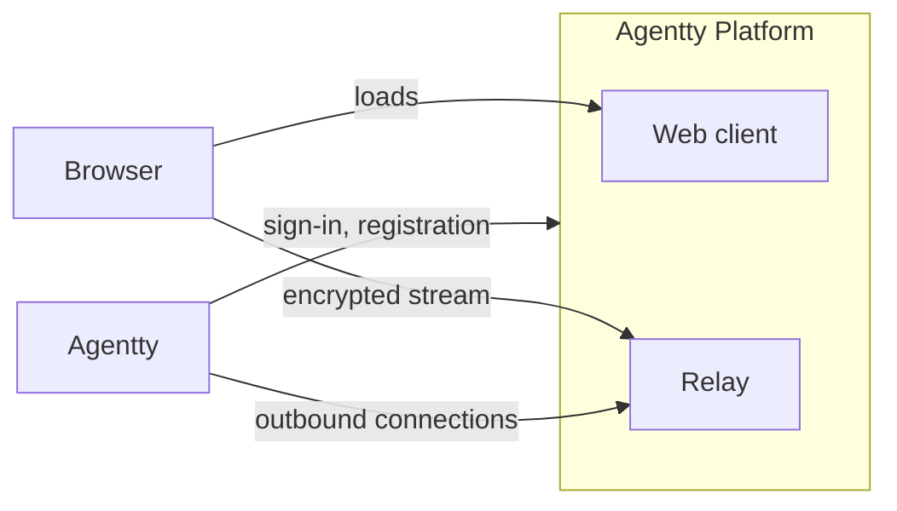

+++
title = "Remote Control Design"
description = "Relay transport, keys, platform trust model, and the design decisions behind remote control."
weight = 10
+++

 Remote control lets a browser on another
device drive sessions through one frame protocol carried by a relay. Agentty keeps an
outbound connection to the relay that its [Agentty Platform](@/docs/usage/platform.md)
names, and the platform serves the web client that devices run. This page records the
design and the decisions behind it. [Remote Control](@/docs/usage/remote-control.md)
covers how to use it.

<!-- more -->

## Crates

- `ag-remote` owns the frame protocol, pairing, and the instance side of the relay link:
  it dials the relay, answers each device stream, and serves the device's requests.
- `ag-noise` owns the handshakes and encrypted sessions. It performs no I/O.
- `ag-relay` is a library that a platform embeds. It joins a device's connection to one
  that an Agentty instance dials out, and asks the platform's admission policy which
  instances may register. It keeps no accounts and no database, and serves no page.

The web client is not part of this repository. The platform serves it; it speaks the
frame protocol and runs the device side of the handshake.

## Trust model

The relay is untrusted. It learns which instance a device asks for, when they connect,
and how much they send. It cannot read or change what they send, and it cannot pair a
device: pairing still needs the one-time code and an approval in the terminal.

The platform decides which instances its relay admits. After an instance proves its key,
the relay asks the platform's admission policy about its identifier, such as whether an
account registered it. Refusing an instance is the only power admission adds; it does
not let the relay read or change a stream. Agentty tells a refusal apart from other
failures by the relay's close frame and shows it, without changing the relay protocol.

The platform is trusted with the web client's code. On the device's side, encryption
ends inside that client, so a platform that serves altered code can read and send
everything the device can, including the pairing code, and can pass the device's key to
someone else. End-to-end encryption protects the streams from the relay and the network,
not from the client. Agentty offers no client or relay of its own to remove that party;
the user chooses which platform holds this trust.

A platform adds an account, not a new path to sessions. Agentty signs in with a device
code, registers the instance's identifier under the account, and the platform's relay
admits registered instances. The access token goes only to that platform; the relay sees
only the handshake and the streams.

## Keys and handshakes

- **Instance key.** Each Agentty installation holds one long-lived key pair. The
  instance identifier a relay routes by is the SHA-256 fingerprint of the public key, so
  nobody can claim an identifier without the private key.
- **Instance to relay.** Noise `XN`: the instance proves it holds its key before the
  relay registers it.
- **Device to instance.** Noise `IK`: the device already knows the instance key from the
  pairing link, so one round trip sets up the encrypted session and names the device
  key.
- **Device identity.** Every device authenticates with its own key pair, and Agentty
  stores only a digest of the public key. No device holds a token.

Both patterns use X25519, AES-256-GCM, and SHA-256. Each role has its own prologue, so a
handshake of one role cannot be replayed as the other.

The pairing link opens the platform's pairing page and carries the relay address, the
instance key, and the one-time code in its fragment. Browsers do not send the fragment
to a server, so neither the relay nor the platform's server receives the code; the web
client reads it from the page's address.

## Design decisions

### The handshake stays within WebCrypto

**Context.** Devices are browsers. A browser client can run the device side of the Noise
handshake on the browser's own cryptography (WebCrypto), which can hold the device's
private key as non-extractable, so that page scripts can use the key but never read it,
or on code compiled to WebAssembly, which keeps the key as bytes any script in the page
can read.

**Decision.** The Noise patterns use only primitives that WebCrypto provides: X25519,
AES-256-GCM, and SHA-256.

**Consequences.**

- The patterns use AES-256-GCM, because browsers do not yet ship ChaCha20-Poly1305 in
  WebCrypto by default. `ag-noise` must stay within what WebCrypto provides.
- Pairing needs a browser with X25519 in WebCrypto, which the major browsers have
  shipped since early 2025, and a page served over HTTPS.
- The protocol makes a non-extractable device key possible; whether a device gets one
  depends on the web client the platform serves and on the browser.

**Revisit when** remote control needs an algorithm that browsers do not provide, such as
a post-quantum key exchange.

### Capabilities instead of version bumps

**Context.** The platform serves the web client and updates it separately from each
Agentty installation. A device can therefore load a page that is older or newer than the
Agentty it talks to. The server refuses any other `protocol_version`, so a version bump
would lock out every device until both sides match.

**Decision.** Frame changes stay additive. New fields default when missing and are
omitted when empty. `welcome` and `paired` carry a `capabilities` list of the optional
requests the server supports, and the client offers a feature only when its capability
is listed. The server lists a capability only when the host reports the operation behind
it through `SessionService::supports`. A request with an unknown `method` gets
`Unsupported request` and the connection stays open; malformed frames still close it.

**Consequences.** An older page ignores fields and capabilities it does not know. A
newer page hides what an older server lacks. `PROTOCOL_VERSION` changes only when a
frame changes meaning or loses a field.

### Remote devices may create, merge, and publish

**Context.** Remote control started as a way to follow sessions and reply to them, and
every new mutation was a separate security decision. Users want a paired device to cover
the main session features of the terminal, and a paired device can already send prompts
that agents run with edit permissions.

**Decision.** A paired device may stop a turn, create sessions, merge a session into its
base branch, publish a session branch and open or refresh its review request, merge a
session's ready GitHub pull request on GitHub or add it to its merge queue, sync a
session branch, sync a project's branch with its remote, and change session settings.
Each operation is a separate request with its own capability and reaches only the
projects and sessions the host lists; see
[Devices reach every listed project](#devices-reach-every-listed-project). A
pull-request merge bypasses branch protections only when the request carries
`bypass: true` and the host reports the pull request ready with bypass, and the host
checks GitHub again before it acts. Merges and publishing ask for confirmation on the
device, not in the terminal, and Agentty keeps no audit trail of remote actions yet.
Running host commands, opening worktrees, changing Agentty settings, managing projects,
and choosing the remote branch name stay out of reach.

**Consequences.**

- A paired device is close to a full operator: whoever holds one can land changes on the
  base branch and push to the Git remote with the user's credentials. Pairing
  protections stay the same, and the usage page and `SECURITY.md` say so.
- Any other mutation, host command, or read outside the listed sessions still needs its
  own decision.
- The capability list leaves room for per-device permissions or a terminal approval
  later without a protocol change.

### Devices reach every listed project

**Context.** A paired device followed the terminal's active project: it listed, read,
and changed only that project's sessions, and switching projects in the terminal
switched every device with it. Someone away from the terminal could not reach another
project's sessions, and the terminal could not move without moving the devices.

**Decision.** A device reaches every project the terminal lists, the project it has open
and every saved project its switcher offers, and picks the one its page shows. A request
about a project names a listed project, or none for the one the terminal has open when
the host serves it. A device reaches a session only while that session is in a listed
project's session list: its active sessions and the archive's first page, or the
terminal's own window for the project it has open. The approved operations stay the same
and apply in every listed project, which adds creating sessions in and syncing a project
the terminal does not have open.

**Why.** The terminal's project list is already the set of repositories the user
registered with Agentty and chose to see, and a device could already land changes in the
active one with the user's credentials, so the list bounds reach without a new setting.
Tying reach to the active project instead made it depend on terminal state that changes
under a device without its knowing.

**Consequences.**

- What a device reaches no longer depends on the terminal's project, so a terminal
  switch between `ag-remote`'s check and the host's turn changes nothing it reaches. A
  session a device listed before a switch stays reachable while it is still in its
  project's list.
- Reach still ends with the list: a project the terminal stops listing is out of reach
  from the next request the host serves, and a session deleted or archived past its list
  from the moment that list, the page the host holds, next reloads.
- The host holds a session page for each listed project a device or another programmatic
  caller views, loads it in the turn that serves the request, and drops it when idle;
  see [Runtime Flow](@/docs/architecture/runtime-flow.md). Automation that applies the
  terminal's project settings stays with the terminal's project.
- A project the terminal does not have open shows fewer details on a device; the usage
  page lists them under Limitations.

### The host enforces the remote scope itself

**Context.** `ag-remote` checks that the host lists a project or session before each
request that names it and calls only the approved operations. Those checks and the
operation run in separate turns of the foreground loop, so the host cannot trust them
alone: the project list or a project's session list can change between them.

**Decision.** The remote server's session service tags every request as remote. In the
foreground turn that serves it, the host checks again: a project the request names must
be listed, and a session it names must be in a listed project's session list, whose page
the host loads in that same turn when it is not loaded. It answers anything else as
missing, and refuses any operation outside the approved set with
`Remote control does not serve this operation`. One exhaustive classification of the
host's mutations names that set, payloads included: a question answer or proposal
request that carries attachments, which name files on the host, and a publication that
names its branch are not served. The reads remote control never makes, of graphs,
proposals, and tasks by their own identity and of a session's tasks, are refused as a
group. `ag-remote` keeps its own checks.

**Where each check lives.**

- `ag-remote` refuses a request whose operations the host does not serve, checks that a
  named project is in the host's project list, and asks the host whether it lists a
  named session, in that order, before it calls the host.
- The host's command gateway checks each mutation's classification and the project or
  session it reaches. Its query routing checks each read the same way.
- A request that names no project resolves the terminal's project once, in the turn that
  serves it, and a session listing returns its project's identity with the sessions read
  in that turn, so a page never pairs one project's sessions with another's status.

**Consequences.**

- Both limits hold even if `ag-remote` gains a call by mistake. A project that leaves
  the list, or a session that leaves its project's list, between `ag-remote`'s check and
  the host's turn is refused there; a terminal switch in between changes nothing a
  device reaches.
- A new host mutation is unavailable to devices until it is classified, so extending
  remote control changes both the host and `ag-remote`.
- Terminal and in-process callers are not affected.

### The relay is stateless and joins one connection per device

The relay keeps only open connections in memory, and a restart only makes clients
reconnect. Each device gets its own connection pair instead of a shared multiplexed
channel, so the relay needs no framing of its own and one slow device cannot stall
another. The relay itself keeps no accounts; limits on what a client can hold bound each
connection.

### Remote control runs only through a platform

**Decision.** Agentty accepts no inbound connections and serves no page. Remote control
runs only through the relay of the platform Agentty is signed in to, and that platform
serves the web client. Agentty connects only when the user asks: by signing in, by
starting remote control in the `Platform` tab, or, at launch, only after turning on keep
on, which is saved with the sign-in and cleared with it.

**Consequences.**

- Nothing on the computer listens for devices, and every device proves itself with its
  own key.
- Remote control needs a platform that offers a relay and admits the account.
- The platform's web client is trusted with every paired device; see
  [Trust model](#trust-model).
- Agentty contacts no platform until the user signs in, and no relay until the user
  connects.

### A connection runs up to eight requests at once

Some host operations reply only when their work finishes, such as creating a session.
Each request therefore runs in its own task, and the connection keeps reading requests
and pushing changes meanwhile. Replies carry the request's `id` and may arrive out of
order. Requests that change the same session still reach the host in arrival order. A
connection can keep eight requests running; another one gets an error at once, so one
connection cannot queue unbounded host work. A closed connection drops its pending
replies but counts as open until the work behind them finishes, so its requests still
count against it after a reconnect and stopping the server waits for them.
