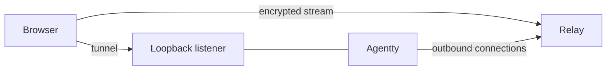

+++
title = "Remote Control Design"
description = "Transports, keys, relay trust model, and the design decisions behind remote control."
weight = 10
+++

 Remote control lets a browser on another
device drive sessions through one frame protocol over two transports: a loopback
listener reached through a private tunnel, and a relay that needs no tunnel. This page
records the design and the decisions behind it.
[Remote Control](@/docs/usage/remote-control.md) covers how to use it.

<!-- more -->

## Crates

- `ag-remote` owns the frame protocol, pairing, the loopback listener, the embedded web
  client, and the instance side of the relay link.
- `ag-noise` owns the handshakes and encrypted sessions. It performs no I/O.
- `ag-relay` joins a device's connection to one that an Agentty instance dials out. It
  keeps no accounts and no database.

## Trust model

The relay is untrusted. It learns which instance a device asks for, when they connect,
and how much they send. It cannot read or change what they send, and it cannot pair a
device: pairing still needs the one-time code and an approval in the terminal.

Whoever serves the web client is trusted with the page's code. The relay serves it, so a
malicious relay operator could serve an altered page. Running your own relay removes
that party.

## Keys and handshakes

- **Instance key.** Each Agentty installation holds one long-lived key pair. The
  instance identifier a relay routes by is the SHA-256 fingerprint of the public key, so
  nobody can claim an identifier without the private key.
- **Instance to relay.** Noise `XN`: the instance proves it holds its key before the
  relay registers it.
- **Device to instance.** Noise `IK`: the device already knows the instance key from the
  pairing link, so one round trip sets up the encrypted session and names the device
  key.
- **Device identity.** A relay device authenticates with its own key pair, and Agentty
  stores only a digest of the public key. A device on the loopback listener uses a
  stored token instead, because that listener relies on the tunnel for encryption.

Both patterns use X25519, AES-256-GCM, and SHA-256. Each role has its own prologue, so a
handshake of one role cannot be replayed as the other.

The pairing link carries the relay address, the instance key, and the one-time code in
its fragment. Browsers do not send the fragment to the server, so the relay never sees
the code.

## Design decisions

### The browser client is plain JavaScript on WebCrypto

**Status:** decided; the relay pairing page that implements it has not shipped yet.

**Context.** A browser that pairs through a relay must run the device side of the Noise
handshake. It can do that with the Rust implementation compiled to WebAssembly, or with
JavaScript that calls the browser's own cryptography (WebCrypto).

**Decision.** The web client implements the device handshake in plain JavaScript on
WebCrypto, with no build step.

**Why.**

- WebCrypto can hold the device's private key as non-extractable: the browser uses the
  key, but page scripts can never read it. A script injected into the page can misuse
  the key while the page is open, but cannot copy it. A WebAssembly build keeps the key
  as ordinary bytes that any such script can read and send elsewhere.
- The cryptography is the browser's native implementation and receives fixes with
  browser updates.
- The content security policy stays strict. WebAssembly needs the `'wasm-unsafe-eval'`
  exception.
- The web client keeps its rule of no build step and no toolchain beyond a browser.

**Consequences.**

- The Noise patterns use AES-256-GCM, because WebCrypto offers no ChaCha20-Poly1305.
  `ag-noise` must stay within what WebCrypto provides.
- Two implementations of the device handshake exist. A test must run the JavaScript
  against `ag-noise` so they cannot drift apart.
- Relay pairing needs a browser with X25519 in WebCrypto, which the major browsers have
  shipped since early 2025, and a page served over HTTPS or from `localhost`. The
  loopback listener is unaffected.

**Rejected: `ag-noise` compiled to WebAssembly.** It runs the same handshake code on
both sides, works in browsers since 2017, and works over plain HTTP. It lost on the
readable device key, the weaker content security policy, and the extra toolchain.

**Revisit when** remote control needs an algorithm that browsers do not provide, such as
a post-quantum key exchange. A small WebAssembly module for that one primitive would
then be the narrower change.

### The relay is stateless and joins one connection per device

The relay keeps only open connections in memory, and a restart only makes clients
reconnect. Each device gets its own connection pair instead of a shared multiplexed
channel, so the relay needs no framing of its own and one slow device cannot stall
another. Limits on what a client can hold replace accounts.

### No relay is built in

Agentty uses a relay only when started with `--remote-relay`. No hosted relay or default
address exists, so nothing leaves the computer unless the user chooses a relay.
