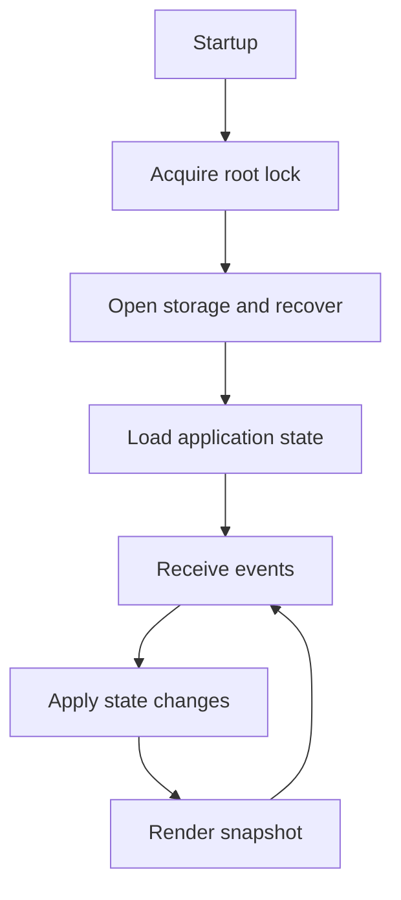
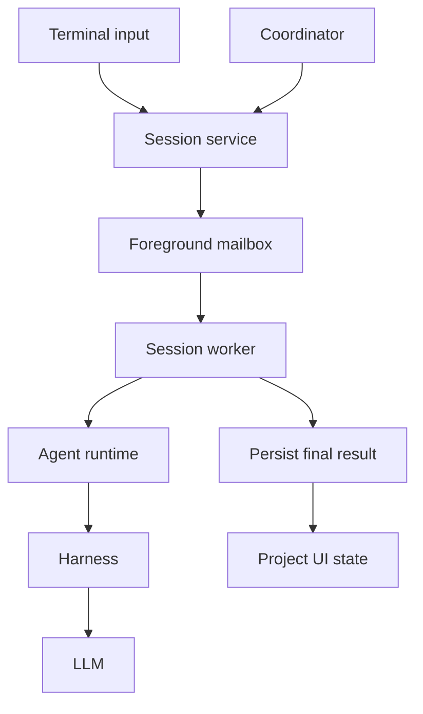

+++
title = "Runtime Flow"
description = "Event handling, session execution, background work, and recovery."
weight = 2
+++

 Agentty keeps terminal interaction
separate from session execution and external work. This page explains their
coordination; source module documentation holds implementation details.

<!-- more -->

## Architecture Goals

- Keep domain logic independent of infrastructure and rendering.
- Run external work asynchronously behind testable boundaries.
- Isolate session changes in Git worktrees.
- Route all model work through workers and runtime contracts.

## Workspace Map

See [Module Map](@/docs/architecture/module-map.md) for crate and layer ownership, and
[Execution](@/docs/core-components/execution.md) for the model execution contract.

## Main Runtime Flow

 Startup acquires exclusive ownership of the
Agentty root before opening storage and recovering operations. The OS lock remains held
for the application lifetime, preventing another instance from recovering live work.

Session creation reserves an identity and captures project settings before opening the
composer. Background setup prepares the worktree without changing navigation or input.
Saved prompts remain recoverable until execution start, transcript persistence, and
prompt acknowledgment commit together. Failed setup or handoff remains retryable;
operations that began executing are not automatically replayed.

Before each turn, the host resolves the session's shared local Env after earlier branch
effects finish. Existing isolation checks validate the worktree and protect the main
checkout; the resolved folder and main-checkout boundary supply the worker request. The
[session](@/docs/core-components/durable-components/session.md#execution-environment)
owns the Env throughout setup and cleanup, including when it has multiple tasks.

Question answers likewise claim the persisted question set before enqueueing a
continuation. A rejected enqueue restores the claim. Cancellation coordinates setup and
resource cleanup so a late preparation result cannot revive canceled work.

 The foreground loop drains bounded batches
of application and terminal events, renders an immutable snapshot, and waits for more
work. It owns presentation state and shared render caches. Event-driven refresh is
primary; periodic polling provides recovery from missed updates.

Terminal session updates leave prompt and question input modes before further input is
dispatched. The foreground loop also reconciles restored modes before rendering. Unsent
composer state and its image attachments are discarded on this transition.

Activity snapshots follow the same worker/runtime event path as progress. The session
host reduces them by attempt and operation identity in first-seen order and publishes
one replaceable snapshot with at most one unread `AppEvent` notification per turn. The
foreground formats the latest snapshot when consuming that notification and replaces a
transient plain-text block with compact status and command/argument rows, preserving all
invocations when events are batched. Only failed calls show output, capped at two lines;
the renderer clips live rows to the pane width. Provider output deltas update the
matching call. After the final answer or failure notice, a durable usage message
replaces the live rows. These messages participate in render-cache invalidation and
saved history, but are excluded from provider replay. Commit and rebase assistance
collect utility activity concurrently and save the same usage footer immediately after
their displayed answer or attempt failure notice, before propagating failures to the
overall workflow. Existing session rebase-assistance turns clear their live rows before
returning success, failure, or cancellation.

## Project Access

Startup uses the launch repository and loads saved project rows without validating other
checkout paths. The one-time discovery suggestion grants access only when the user
accepts. Project discovery runs through an injected filesystem boundary on a background
task; `AppEvent` completions update the foreground dialog. Cancellation stops traversal
cooperatively and invalidates late results. Only selected results are registered. Saved
checkouts are validated when explicitly opened.

## Session Channel Composition

Composition injects `SessionRunFactory`, which returns a worker-owned
`SessionRunClient`. The worker obtains its adapter from `ag-runtime`; application
workflows do not retain raw adapters. `SessionWorkerHandle` owns the mailbox, task,
ordering, and wakeups. Hosts supply command policy and ordered effects. The shared
`ag-scheduler` admission pool limits concurrent session turns across regular and managed
sessions without changing their mailbox order.

Role-aware task commands share that mailbox and the session's Env while using separate
runtime identities, captured models, and durable response histories. Task continuation
and clarification retain that task's input and responses. A chain's Planner also
receives the session conversation captured in its graph request as historical data on
every attempt, including after restart; later workflow messages stay outside that
snapshot. Ordinary session questions and provider continuation remain unchanged.
Admission resolves definitions through the injected catalog and persists their complete
instructions and restrictions. A plan-and-implement launch captures both definitions;
later repository edits affect new workflows, not retained task conversations. Planner
execution restricts permissions to `ReadOnly` and performs no commit or forge effects.
Implementer post-processing uses an isolated transcript projection and remains ordered
through publication. Implementer answers refresh persisted and visible diff stats before
commit and publishing effects, with another refresh during finalization. Diff inspection
remains available during active work. A settled task attempt refreshes its owning
session only after operation bookkeeping finishes, so consumers observe its final
durable status.

The terminal offers `/plan` only with the launch-time `--experimental-multi-agent`
setting; the shared task API retains its own programmatic contract. Routing does not
depend on the flag: a session that owns a task chain sends every composer message,
`/apply` instruction, and automatic review remediation to the orchestrator.

Role admission invalidates earlier ordinary review work and its durable recovery
trigger, and the admitted attempt owns review suppression. After its effects, a
successful Implementer attempt without questions emits `ImplementerAttemptSucceeded`.
The reducer releases suppression only when that attempt still owns it, then follows the
ordinary completed-turn review path. Other task completions and stale events start no
automatic review; explicit review and later ordinary turns retain their existing
behavior. See [Execution](@/docs/core-components/execution.md) for context ownership and
cleanup.

Application shutdown closes every session worker's admission and waits for active
effects, queued-work cancellation, and runtime cleanup within the shared five-second
deadline. Task ownership survives mailbox removal. When grace expires, stuck session
tasks are dropped and awaited before the tracing exporter shuts down; unfinished
operations remain available for startup recovery.

Model changes pause scheduling, wait for active work, and atomically save selection and
conversation reset. Failed saves preserve pending work. Successful switches retire the
old runtime and discard pending work before a new channel is composed.

## Data Channels

| Channel                 | Carries                                     |
| ----------------------- | ------------------------------------------- |
| Terminal events         | Keyboard and terminal input                 |
| `AppEvent` bus          | Background results for the reducer          |
| Session runtime mailbox | Programmatic lifecycle requests and replies |
| `TurnEvent` stream      | Transient progress and process identity     |
| Shared session handles  | Live transcript, status, and queued work    |

Workers and handles survive project switches; project reloads replace display snapshots,
not execution ownership.

## App Event Reducer

 `App::apply_app_events()` is the
single application path for background state changes. It batches updates and orders
effects around snapshot mutation. Expensive reloads and Git reads stay off the input
path.

Results carry session, operation, or request generations. The reducer rejects stale
completions after navigation, cancellation, or replacement. Review claims and
changed-diff identity persist together, so restart can resume pending review without
reviewing an unchanged diff again. A rebase without conflicts retains its focused
review. When Git reports a conflict, the worker invalidates review evidence before
assistance edits files and signals the reducer to remove the displayed review. The
reducer clears that review before persisting batched results, and generated review
writes require their invocation to remain active in SQLite. Failed admission preserves
the review.

Terminal session states release workers. Forge updates may mark a session `Merged`, but
only a successful manual target sync archives it as `Done`.

## Session Chat Rendering

 Durable transcript rows contain user
prompts, final answers, workflow notices, role-attributed task-chain answers, and
execution-graph markers. Typed transient slots hold progress, queued actions, and review
output with explicit placement and lifetime. Chat messages and workflow actions,
including selected review-comment batches, share one submission sequence for both
display and execution. Review-comment commands retain their thread allowlist and replace
the queued row with loading progress only when execution starts. Queued review batches
wait for clarification answers, including after session restoration. A restored question
session creates a paused worker when accepting the batch. Generated prompts enter
durable history when the worker starts them, so canceled waiting work cannot be
replayed.

Completion replaces matching progress with its result in one reducer update. Stale
results cannot persist notices. Rendering reads snapshots; it does not perform workflow
side effects. Runtime-owned caches share derived layout between scrolling and painting.

Session chat is the only task-chain surface. An armed `/plan` composer launches the
chain, and the session's later messages become natural-language replies; both use the
same command gateway as programmatic callers. Chain ownership is read from storage at
submit time, so routing is correct before the transcript or graph snapshot loads after a
restart. A reply waiting for an orchestrator decision is accepted at once; a failure of
the decided action is appended as a transcript notice when it returns. Busy chains
reject replies instead of queueing them, and the composer keeps the draft. Stopping a
running role cancels the chain through the gateway, which records the cancellation
before interrupting the attempt. Rendering never advances a workflow.

Launch admission saves the original request and execution-graph marker in its
transaction; saving a chain-owned response likewise saves its role-attributed answer
atomically. The host mirrors committed messages into live chat without a second write.
These rows stay out of ordinary provider replay, so each role keeps its isolated
conversation. The marker preserves the exact chain identity. The reducer keeps a bounded
latest-chain snapshot for the visible session, reloaded when its update version changes,
and the card renders that live state. Failed reads retain the previous graph and retry
after a short delay, even when the session stays idle.

New admission initializes blank session prompt metadata and starts the shared Fast-model
title utility from the original request through the session-scoped `RunClient`.
Redelivered launches do not restart title generation; authoritative titles stay
protected.

Foreground gateway admission records each workflow stage and its attempt atomically;
only a new claim reaches the session worker. Duplicate deliveries acknowledge their
original receipt without repeating execution. Plan acceptance binds the exact producing
version before implementation admission, and cancellation targets the selected attempt.
Actor queries read persisted state and never dispatch or resume work. Continuation input
retains the attempt shown when composition began; admission rejects a stale source
before it can reach another stage or role.

Resource sampling runs behind `ResourceClient`. Process creation identities guard
against PID reuse. Temperature sampling runs independently and expires stale readings,
so sensor I/O cannot block accounting or terminal input. Accounting PIDs never authorize
cancellation.

## Session Turn Data Flow

 `ag-session::SessionService` provides the
frontend-neutral lifecycle API. Agentty's bounded session-runtime mailbox executes its
requests against the foreground session manager without sharing `App` behind a mutex.
The [Command Gateway](@/docs/core-components/command-gateway.md) routes terminal and
programmatic mutations through shared foreground admission while preserving each
workflow's queueing and acknowledgement contract. Delivery envelopes own response
channels separately from application payloads and transfer deferred replies to workspace
preparation or the publication worker. Ordinary messages pass through a pure planner
before effects run: terminal composer intent controls staging and first starts, while
API messages use current session state and start staged drafts automatically. Busy
messages queue; other follow-ups retain the reply workflow's eligibility checks. Reads
remain separate queries. Accepted workflows update
[messages](@/docs/core-components/durable-components/message.md) and operation records
through persistence adapters; workers retain execution ordering through post-processing.

Explicit [task submissions](@/docs/core-components/durable-components/task.md) use the
same gateway and durable-turn worker path. Task creation can separately persist an
outcome through the gateway without worker dispatch; session-scoped listing stays on the
query path. Storage admits the desired outcome, attempt, and operation atomically.
Delivery retries acknowledge an existing attempt before live session eligibility checks;
new attempts retain ordinary durable-turn eligibility. Operation settlement and startup
recovery supply attempt status. The task remains open until a caller explicitly accepts
its outcome, independently of session lifecycle.

The static Planner-to-Implementer workflow uses the same command gateway and serial
worker through a fixed execution graph. Accepting a specific plan version records
evidence and wakes dispatch; the executor atomically pins that accepted version when
admitting implementation. Duplicate requests acknowledge their saved receipt; queries
and reopening never start work. Cancellation targets the current attempt, and retries
require an explicit new delivery. Failed delivery remains visible in operation state.
Image attachments are durable task inputs: continuations retain earlier images, add new
ones, and carry them through acceptance to the Implementer. The worker submits the
images as structured turn attachments alongside the explicit task input.

Natural-language workflow replies also enter through the gateway. Foreground admission
returns earlier receipts, rejects busy workflows, and stores the reply with its
transcript prompt and exact source execution atomically. Its first decision is durable,
so redelivery cannot approve a newer plan. While a plan awaits acceptance, the gateway
transfers the caller's response channel to a background task and treats the chain as
busy until the decided action returns. That task runs the orchestrator decision through
the session-scoped `RunClient`, then submits the decided acceptance or revision through
the runtime mailbox for ordinary admission. Every other settled phase continues the
current role immediately in the foreground. An image reply awaiting plan acceptance
revises the Planner directly, keeping visual guidance out of the text-only approval
decision.

The host's opt-in tool-content capture policy travels with the execution trace context,
including independent roots, queued work, and linked operations. Scoped utility clients
retain an explicit capture policy across background task spawns, even when captured
outside a span; span inheritance does not replace that policy. Background project sync
carries the host context into conflict assistance. Provider adapters own field
selection, credential suppression, and preview bounds; prompt and reasoning content
never enter this capture path.

`ag-worker::RuntimeConfig` captures each harness's subagent, tool, and MCP policy.
Workers resolve that policy for session turns and utilities before runtime dispatch;
adapters preserve it across retries and repairs, reject unsupported explicit controls,
and restart retained processes when their startup policy differs. Per-turn filesystem
permissions remain independent. See
[Execution Policy](@/docs/core-components/execution.md#execution-policy) for controls,
defaults, and adapter support.

1. Runtime converts composer state into a typed application request.
1. The application persists an operation before sending it to the session worker.
1. The worker checks cancellation, preparation, and isolation, then executes in shared
   submission order. Active branch actions reuse the existing worker.
1. Turn preparation resolves current permission, reasoning, style, speed, and agent
   settings and submits a `TurnRequest` through `SessionRunClient` after acquiring
   shared session capacity.
1. Progress remains transient. Post-turn handling persists the answer, questions, usage,
   and provider continuation state before projecting them into the UI.
1. Ordered post-processing commits changes, coordinates publishing and stacked children,
   refreshes diff metadata, and enters `Review` or `Question`.

### Operation Lifecycle and Recovery

 Operations move from `queued` to
`running`, then `done`, `failed`, or `canceled`. Stable coordinator operation IDs
prevent duplicate delivery. Persisted cancellation takes precedence at terminal
settlement.

Startup updates retired model selections and reconciles unfinished operations before
admitting sessions. Interrupted rebases are cleaned up, affected sessions return to
`Review`, and abandoned operations fail with an interruption reason. Missing worktrees
do not prevent reconciliation; storage or Git failures stop startup for retry.
Previously executed mutating requests are never blindly replayed.

### Status Transition Rules

 `Status::can_transition_to()` and workflow
eligibility policies govern lifecycle changes. See
[Session Lifecycle](@/docs/usage/workflow.md#session-lifecycle) for visible states.
Stack operations evaluate one shared snapshot of parent, child, and sibling activity
before starting branch work.

## Agent Channel Architecture

 External adapters implement transport-neutral
contracts. Composition selects the adapter; workers own its execution and cleanup.

 Types from `ag-contracts`:

| Type               | Purpose                                     |
| ------------------ | ------------------------------------------- |
| `TurnRequest`      | Inputs, permissions, settings, agent        |
| `TurnContinuation` | Fresh, replay, or native-resume context     |
| `TurnEvent`        | Progress, completion, failure, PID updates  |
| `TurnResult`       | Answer, usage, provider identity            |
| `AgentRequestKind` | Start, resume, account-read, utility intent |

 Successful turns persist
provider conversation identity and the applied instruction fingerprint. Matching
continuations can use compact reminders; changed policy or lost context requires
bootstrap or replay. Agent changes follow the same successful-persistence boundary.
Upgrading from session personalities marks existing sessions for one explicit clearing
instruction, including full bootstraps into retained native history. Failed turns keep
the marker for retry; successful ordinary-turn persistence replaces it without losing
chat history or task definitions. CLI command construction preserves that update through
stdin prompt rendering when resuming a provider conversation.

Explicit transcript replay does not require provider-native resume. Each graph attempt
starts a fresh provider conversation and supplies only its node's persisted history;
Claude graph attempts never select the latest worktree conversation with `-c`.

Codex and Antigravity retain resident runtimes between turns. Gemini shuts down after
each turn and replays stored history. Managed runtime cleanup owns provider subprocesses
and their descendants.

 Every turn validates its worktree and
expected branch. Main-checkout status is compared before and after work, warning on new
tracked dirt. Base mutations require a clean target. Permissions travel with each
request, and runtime identity includes permission mode so writable processes cannot be
reused for read-only work. Provider-specific limits are described in
[Agents & Models](@/docs/agents/backends.md).

## Agent Interaction Protocol Flow

 `ag-protocol` defines shared
responses, schemas, diagnostics, prompt envelopes, and repair requests. Session turns
return `answer`, `questions`, and `review_comment_outcomes`; utilities and reviews use
narrower request-specific schemas.

Policy is delivered separately from user input and evidence. Workspace paths, history,
malformed output, and diagnostics are encoded as data; quoted instructions never
suppress policy. Long-history replay uses bounded excerpts and a complete temporary
archive, without changing canonical history. Archive cleanup requires trusted ownership
evidence.

Adapters prefer native schema enforcement and fail closed when output cannot be
validated. Bounded repair attempts retain the request's schema and permission policy and
prohibit task execution. Invalid output exposes derived diagnostics rather than raw
payloads; nonzero CLI exits retain bounded output needed to explain launch failures.
Provider transport and parsing differences remain inside `ag-agent`.

## Clarification Question Loop

 Persist questions before entering
`Question`. Runtime collects answers and submits one continuation through the worker.
Ending question mode without answering restores `Review` and wakes queued branch work;
it does not submit an empty generated reply.

## Background Task Catalog

| Work                                | Trigger                                   |
| ----------------------------------- | ----------------------------------------- |
| Project status and forge refresh    | Startup, project switch, periodic refresh |
| Agentty update                      | Startup and hourly                        |
| Agent CLI discovery and update      | Startup                                   |
| Harness model listing               | Session picker or Harness `/model`        |
| Worktree preparation and cleanup    | Session lifecycle                         |
| File indexing and image capture     | Composer interaction                      |
| Full diff and Markdown preview      | Inspection request                        |
| Title and commit-message generation | Session input and changed turns           |
| Focused review                      | Eligible changed diff or manual request   |
| Publish, sync, merge                | User request or ordered workflow          |

All model-backed tasks use `RunClient` or `SessionRunClient`. Subprocesses have bounded
execution and cleanup, and background results retain their original session/project
identity.

Focused review packs captured diffs by file and hunk, independently checks original
changes for boundary and cross-file risks even for a single batch, then verifies and
reconciles candidates. Fragmented boundary calls share bounded context from all captured
changes and initial findings, with condensation disclosed, while retaining each original
source fragment. Consolidation accounts for every candidate with a retained finding or a
rejection reason and links every output to an input; incomplete accounting preserves the
original findings. Project criteria load through the filesystem boundary and are
selected by changed paths and file types, with bounded rendered criteria. Discovery
retains original source; final verification retains the captured file scope when context
is summarized. Diff capture normalizes Git presentation settings so file identities and
source coordinates remain stable. Host-side citation matching checks typed source
evidence against the captured old or new source without reading a newer worktree state.
Repairs reconcile duplicate primary citations while preserving supporting references.
Processed-file counts and unanchored findings expose coverage limits. Worker-owned
runtime reuse preserves isolated conversation context. One deadline and provider-call
budget cover preparation, retries, and repair. Successful calls preserve discovery
inputs, candidate findings, and group-scoped consolidation decisions in retry
checkpoints. Completion atomically archives these call records with the review before
clearing retry state. The latest completed audit survives invalidation, partial retries,
and cached review restoration until an active review generation completes or its session
is deleted; generation checks reject stale evidence. Failed coverage remains explicit
rather than being presented as a completed review. Each generation runs as a static
execution graph of parallel fragment readers joined by cross-file and consolidation
nodes; see [details](@/docs/architecture/execution-graphs.md#focused-review-graph).

Commit-message generation summarizes large diffs and has a bounded fallback using
changed filenames, conversation, and the existing commit message. It never discards
worktree changes to fit a prompt.

## Sync, Merge, and Rebase Flows

 Git and forge effects stay behind
`GitClient` and `ReviewRequestClient`:

- **Project sync** serializes captured project requests, coalesces duplicates, and gives
  existing merges priority. Its base-checkout guard blocks conflicting mutations without
  blocking navigation or isolated session turns.
- **Local merge** rebases and squash-merges an unlinked session, preserving its commit
  message. Linked review requests are ineligible.
- **Session sync** rebases onto the local or remote base. Agent assistance resolves
  conflicts; Agentty owns staging, hook checks, continuation, and bounded repair.
- **Publishing** shares branch ownership with sync and auto-push. Force-with-lease
  protects remote changes. Creation, manual refresh, and automatic metadata updates use
  the same read-only utility through the Run Worker, with cumulative committed evidence
  from immutable published commits, bounded user intent, and repository PR/MR guidance.
  Generation compares published commits against the effective review target; updates
  read the live forge target before acquiring the advertised source and target commits
  independently of configured fetch refspecs. Existing description content is preserved
  in the generated section order; code normalizes Agentty attribution after
  reconciliation. Best-effort concurrent-edit checks precede metadata updates.
- **Remote merge** marks `Merged`. Successful manual target sync persists archival and
  child-restack intent before cleanup; failed persistence leaves work retryable.

Review-comment targets persist before execution and are scoped to the linked open review
request. Clarification answers and subsequent turns restore unfinished targets and
re-evaluate prior outcomes. Complete outcome batches persist with the answer and bind to
the successful fix commit. Review turns await post-push thread updates before the worker
runs queued edits. Automatic and manual pushes share the same handler; a changed tip
retains the batch for re-evaluation. Durable posting markers permit retries without
duplicate replies. Only `fixed` threads resolve, while `no_change_needed` receives a
reply and remains open.

Turn cancellation interrupts workspace preparation while waiting for earlier branch
effects. Awaited review publishing observes the same turn token and drops in-flight Git
and forge work before releasing the branch lock. Unfinished operations retain their
posting markers for retry; cancellation does not undo effects already accepted remotely.

## Persistence and Recovery Boundaries

 SQLite is authoritative for restart
recovery; live handles and immutable snapshots serve rendering. Operation admission,
turn completion, review evidence, and cleanup intent must persist before their dependent
side effects. Recoverable failures remain visible instead of claiming terminal success.
Startup fails abandoned queued operations without dismissing pending clarification.
Unstarted queued work does not change a session's `Question` status.

The native harness has its own store, lease, and effect-settlement contracts. Each
Harness session keeps its durable history in `harness/<session id>/` under the Agentty
root, outside the worktree; a turn returns only after its settlement, and failed cleanup
is retried once and again before the session's next turn. Deleting, canceling, or
rolling back the session removes that directory. See
[`ag-harness` Design](@/docs/architecture/ag-harness-design.md).

## Headless execution ownership

`ag-worker` owns shared ordering, execution, heartbeats, cancellation, and operation
settlement. Hosts supply question policy and ordered Git/forge effects. Closing or
retiring a mailbox settles or cancels outstanding work and notifies callers, including
those using retained handle clones.

The static `GraphExecutor` separately drains dependency-ready branches through injected
worker adapters. Storage admits each node once with pinned inputs and its existing
execution authority. Shared Env leases and provider budgets constrain parallel branches;
all prerequisite gates must hold before a join runs. Focused review launches its own
graph from its background task; `/plan` launches its two task-conversation nodes through
the same executor. See [Execution Graphs](@/docs/architecture/execution-graphs.md).

Explicit graph launches use the same foreground admission gateway. Graph task handoffs
enter the owning session's ordered mailbox with a completion reply retained through
operation settlement. The selected graph command publishes active ownership before
waiting for Env access, so sync queues behind it. Gate waits observe cancellation;
completion retains acquired leases through settlement. Queued nodes cannot hold a lease
ahead of earlier commands. Utilities retain their concurrent worker path. Graph writers
also exclude focused-review readers, which overlap ordinary session work and
conflict-free sync as background readers. Acceptance and Env release wake active graph
drivers without polling or startup replay. Each settled graph node also wakes drivers
after releasing shared capacity and its Env lease, independently of the rest of its
dispatch wave. Returning capacity or an Env lease from an unclaimed check wakes only
drivers waiting for that resource, avoiding unconditional broadcasts. Drivers retain
their launch and remaining budgets while waiting for explicit retry or clarification
intent. Progress queries do not dispatch work. Cancellation closes durable admission
before signaling workers, and startup never recreates drivers. Explicit resume uses the
saved revision; retry and clarification actions append new executions against the exact
source receipt. Completion requires every node's question-free settlement. Detached
utilities retain their Env leases in worker-owned scopes through cancellation cleanup.
Ordinary worker leases release and notify on early returns as well as normal completion.

Channel owners clean up provider processes after cancellation. Operation completion
includes post-processing, not just model completion. Heartbeat failures are reported
without abandoning live work; startup recovery requires exclusive application ownership.

Turn preparation groups the current permissions, reasoning level, response style, speed,
and agent into resolved settings after workspace preparation. The model selection still
travels with the queued turn; the worker applies its captured execution policy at
submission. Resolution preserves existing reads and defaults rather than persisting an
earlier configuration snapshot. Agent application state is saved only after a successful
turn.

## Utility run supervision

Utility runs carry purpose, session/project ownership, and inherited cancellation.
Nested utilities execute directly under worker supervision rather than waiting behind
the session command that needs them. Caller drop, parent cancellation, and shutdown stop
owned execution.

Session deletion waits for utilities before removing resources. Durable admission
closure rejects late submissions. Application shutdown gives workers, setup, and cleanup
one shared five-second grace period, then forces remaining runtime resources to drop.
Pending turn telemetry is flushed after background work settles, within the same
deadline. Unfinished records remain available for startup recovery.

See [Execution](@/docs/core-components/execution.md) for the shared contract.

## Execution Traces

The application owns optional OTLP export. Queue entries retain turn trace ownership
until worker selection; spawned utilities explicitly capture the initiating trace
context alongside run ownership. The turn span includes ordered post-processing and
operation settlement. Provider adapters observe raw structured operations inside each
`agent.attempt` before reducing them to UI progress. Attempt-owned trackers retain
bounded operation identities internally and export only allowlisted categories and
numeric metadata. Host phases distinguish diff capture, commit context preparation,
message generation, fallback, Git execution, and individual commit attempts. Utilities
retain captured turn ownership and link the active phase from that same trace. Missing
provider completion events are labeled incomplete; their observed span lifetimes are not
exact model execution durations. Span guards close canceled or abandoned work when its
owner drops. Explicit Codex context compaction records its request and completion wait
as `agent.compaction`, distinguishing proactive, overflow recovery, and provider-native
triggers. Codex usage uses cumulative-counter deltas for turn totals and the latest
request input for context pressure. Duplicate updates are ignored; resumed threads
establish a new baseline without billing retained history. Turns lacking cumulative
counters discard stale baselines before fallback usage can be counted again. A later
complete snapshot establishes a fresh baseline; missing counters remain unknown in
telemetry. Exporter shutdown follows worker cleanup and terminal restoration. See
[Session Traces](@/docs/usage/workflow.md#session-traces) for enablement and data scope.
The same export owns an optional event log; the analytics sender emits each usage event
to it before, and independently of, the `PostHog` request. See
[Local Usage Events](@/docs/usage/workflow.md#local-usage-events).
