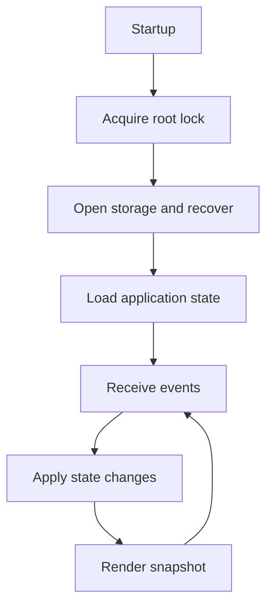
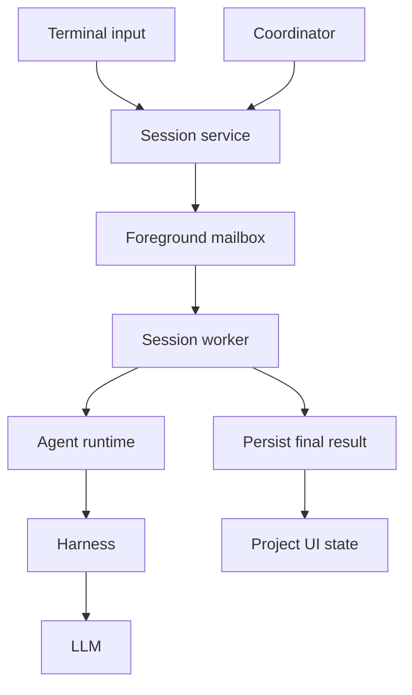

+++
title = "Runtime Flow"
description = "Event handling, session execution, background work, and recovery."
weight = 2
+++

 Agentty keeps terminal interaction
separate from session execution and external work. This page explains their
coordination; source module documentation holds implementation details.

<!-- more -->

## Architecture Goals

- Keep domain logic independent of infrastructure and rendering.
- Run external work asynchronously behind testable boundaries.
- Isolate session changes in Git worktrees.
- Route all model work through workers and runtime contracts.

## Workspace Map

See [Module Map](@/docs/architecture/module-map.md) for crate and layer ownership, and
[Execution](@/docs/core-components/execution-components/execution-boundary.md) for the
model execution contract.

## Main Runtime Flow

 Startup acquires exclusive ownership of the
Agentty root before opening storage and recovering operations. The OS lock remains held
for the application lifetime, preventing another instance from recovering live work.

 The foreground loop drains bounded batches
of application and terminal events, renders an immutable snapshot, and waits for more
work. It owns presentation state and render caches. Event-driven refresh is primary;
periodic polling recovers from missed updates. The poll reloads only when the total
session count or the active project's latest session update changes, and a reload reads
saved transcripts only into live handles that are not yet hydrated.

Session creation reserves an identity and captures project settings before opening the
composer; background setup prepares the worktree without blocking input. Saved prompts
stay recoverable until execution start, transcript persistence, and prompt
acknowledgment commit together. Before each turn, the host resolves the session's
[Env](@/docs/core-components/durable-components/env.md) after earlier branch effects
finish and validates worktree isolation. Cancellation coordinates setup and cleanup so a
late preparation result cannot revive canceled work.

Startup uses the launch repository and loads saved projects without validating their
checkouts. Project discovery runs only after the user accepts the suggestion, and saved
checkouts are validated when opened.

## Data Channels

| Channel                 | Carries                                      |
| ----------------------- | -------------------------------------------- |
| Terminal events         | Keyboard and terminal input                  |
| `AppEvent` bus          | Background results for the reducer           |
| Session runtime mailbox | Programmatic lifecycle requests and replies  |
| `TurnEvent` stream      | Transient progress, output, process identity |
| Shared session handles  | Live transcript, status, and queued work     |
| Session-change revision | Coalesced refetch signal for remote clients  |

Workers and handles survive project switches; project reloads replace display snapshots,
not execution ownership.

 The
[remote-control](@/docs/usage/remote-control.md) listener runs on the foreground
runtime's Tokio executor but owns no application state. It calls the session API through
the mailbox like any programmatic caller. The reducer advances the session-change
revision after it applies session updates, reloads, admitted mutations, a change to a
session's live status line or queued actions, a step of a project sync, or new Git
status of the project or its sessions; connected clients then fetch the list and the
open session again, so remote views converge on durable state instead of replaying
events. A session diff query captures its diff source in the mailbox and runs Git in a
detached task that answers the caller directly, so it adds no reducer event. A session
file listing works the same way: the mailbox captures the worktree folder, or answers
from the `@`-mention index cache, and a blocking worker walks the worktree.

## App Event Reducer

 `App::apply_app_events()` is the
single application path for background state changes. It batches updates and orders
effects around snapshot mutation; expensive reloads and Git reads stay off the input
path.

Results carry session, operation, or request generations, so the reducer rejects stale
completions after navigation, cancellation, or replacement. Review claims and the
changed-diff identity persist together, so restart can resume a pending review without
reviewing an unchanged diff again. A rebase without conflicts keeps the review; a
conflict invalidates it before assistance edits files.

Terminal session states release workers. Forge updates may mark a session `Merged`, but
only a successful manual target sync archives it as `Done`.

## Session Chat Rendering

 Durable transcript rows hold user
prompts, final answers, and workflow notices. Typed transient slots hold progress,
queued actions, live tool activity, and review output. Chat messages and workflow
actions share one submission sequence for display and execution; generated prompts enter
durable history only when the worker starts them, so canceled waiting work is never
replayed.

Rendering reads snapshots and performs no workflow side effects. Runtime-owned caches
share derived layout between scrolling and painting and invalidate on content, width, or
theme changes.

Live tool activity follows the same worker event path as progress: the host reduces it
into one replaceable snapshot per turn, and a durable usage summary replaces it when the
turn finishes. Usage summaries are saved history but excluded from provider replay.

Harness sessions also stream model output on that path. The agent runtime turns the
harness run's item events into `TurnEvent::Output` changes, decoding the protocol answer
as it arrives; the worker accumulates them into one replaceable snapshot below the
activity rows. One notification stays armed while the output changes, and the foreground
applies further changes once per frame, so a fast stream cannot flood the event loop.
The runtime drops a discarded response's items and reports which message the validated
answer replaces. The worker removes the snapshot right after it saves the answer or
failure notice to the transcript; streamed output is never persisted or replayed. When a
harness turn compacts the session's earlier context, or fails to, the runtime also sends
a `TurnEvent::Notice`; the worker saves it as a workflow notice ahead of the turn's
answer, which provider replay leaves out.

Sandbox notices travel the same path as `TurnEvent::Notice`. Session turns and sync
assistance turns relay the turn's events before the consumer and append each sandbox
notice as a workflow notice as soon as it arrives: a `[Sandbox Warning]` unless the
transcript's latest sandbox state is the same warning, a `[Sandbox]` note when the
sandbox works again after a warning, and a `[Sandbox]` hint once per turn when a command
may have been blocked; provider replay leaves them out. The `agentty` binary dispatches
the native sandbox helper before it starts any runtime, so a harness can start the same
executable as its helper.

Session chat also routes replies for
[execution graphs](@/docs/architecture/execution-graphs.md). While a graph proposal is
pending, a chat message is a reply to it, whether it comes from the composer or a
session API message, including remote control; while a graph node waits for answers or
for acceptance of a predecessor's output, the message is a reply to that exact execution
or output version. A reply to an output of the session's newest working graph first
resumes that graph through the command gateway when it is paused, so the work stays
inside it. A read-only utility run on the Run Worker classifies replies that need a
decision, and the resulting action enters the shared command gateway. Proposal and
output replies are saved with their first decision, so recovery after a restart or
project switch decides or applies a reply whose action was not attempted. Pending graph
questions open the ordinary question panel bound to the exact asking version or
execution, so a reply never reaches work that asked later.

## Session Turn Data Flow

 `ag-session::SessionService` provides the
frontend-neutral lifecycle API. Agentty's bounded session-runtime mailbox executes its
requests against the foreground session manager without sharing `App` behind a mutex.
The [Command Gateway](@/docs/core-components/control-plane/command-gateway.md) admits
terminal and programmatic mutations; accepted workflows persist
[messages](@/docs/core-components/durable-components/message.md) and operations before
workers execute them. [Tasks](@/docs/core-components/durable-components/task.md) and
execution graphs use the same gateway and serial session worker.

1. Runtime converts composer state into a typed application request.
1. The application persists an operation before sending it to the session worker.
1. The worker checks cancellation, preparation, and isolation, then executes in shared
   submission order.
1. Turn preparation resolves current settings and submits a `TurnRequest` through
   `SessionRunClient` after acquiring shared session capacity.
1. Progress remains transient. Post-turn handling persists the answer, questions, usage,
   and provider continuation state before projecting them into the UI.
1. Ordered post-processing commits changes, coordinates publishing, refreshes diff
   metadata, and enters `Review` or `Question`.

The worker applies each harness's configured
[execution policy](@/docs/core-components/execution-components/run-worker.md#execution-policy)
before dispatch. Model changes pause scheduling, wait for active work, and save the
selection and conversation reset atomically before a new channel is composed.

### Operation Lifecycle and Recovery

 Operations move from `queued` to
`running`, then `done`, `failed`, or `canceled`. Stable coordinator operation IDs
prevent duplicate delivery, and persisted cancellation takes precedence at settlement.

Startup reconciles unfinished operations before admitting sessions: interrupted rebases
are cleaned up, affected sessions return to `Review`, and abandoned operations fail with
an interruption reason. Storage or Git failures stop startup for retry. Previously
executed mutating requests are never replayed.

### Status Transition Rules

 `Status::can_transition_to()` and workflow
eligibility policies govern lifecycle changes. See
[Session Lifecycle](@/docs/usage/workflow.md#session-lifecycle) for visible states.
Graph proposal generation and reply decisions hold a `Draft` or `Review` session
`InProgress` through a lease backed by a running operation. The foreground claims the
lease in memory before spawning the task, which then persists the operation and status;
the last lease or turn to finish returns the session to `Review`, and an older status
write never overwrites a newer one.

## Agent Channel Architecture

 External adapters implement transport-neutral
contracts. Composition selects the adapter; workers own its execution and cleanup.

 Types from `ag-contracts`:

| Type               | Purpose                                     |
| ------------------ | ------------------------------------------- |
| `TurnRequest`      | Inputs, permissions, settings, agent        |
| `TurnContinuation` | Fresh, replay, or native-resume context     |
| `TurnEvent`        | Progress, completion, failure, PID updates  |
| `TurnResult`       | Answer, usage, provider identity            |
| `AgentRequestKind` | Start, resume, account-read, utility intent |

 Successful turns persist the
provider conversation identity and the applied instruction fingerprint. Matching
continuations can send compact reminders; changed policy or lost context requires a full
bootstrap or transcript replay. Replay does not require provider-native resume: each
graph attempt starts a fresh provider conversation with only its node's history. Codex
and Antigravity keep resident runtimes between turns; runtime cleanup owns their
subprocesses and descendants.

 Every turn validates its worktree and
expected branch. Main-checkout status is compared before and after work, warning on new
tracked changes. Base mutations require a clean target. Permissions travel with each
request, and runtime identity includes the permission mode so writable processes are
never reused for read-only work. Provider-specific limits are described in
[Agents & Models](@/docs/agents/backends.md).

## Agent Interaction Protocol Flow

 `ag-protocol` defines shared
response schemas, parsing, diagnostics, prompt envelopes, and repair requests. Session
turns return `answer`, `questions`, and `review_comment_outcomes`; utilities, reviews,
and graph proposals use narrower request-specific schemas.

Policy is delivered separately from user input and evidence. Workspace paths, history,
malformed output, and diagnostics are encoded as data, so quoted instructions cannot
override policy. Adapters prefer native schema enforcement and fail closed when output
cannot be validated; bounded repair attempts keep the request's schema and permissions.
Provider transport and parsing differences stay inside `ag-agent`.

## Clarification Question Loop

 Questions persist before the session
enters `Question`. Runtime collects answers and submits one continuation through the
worker. Ending question mode without answering restores `Review` and wakes queued branch
work; it does not submit an empty reply.

## Background Task Catalog

| Work                                | Trigger                                   |
| ----------------------------------- | ----------------------------------------- |
| Project status and forge refresh    | Startup, project switch, periodic refresh |
| Agentty update                      | Startup and hourly                        |
| Agent CLI discovery and update      | Startup                                   |
| Harness model listing               | Session picker or `ag-harness` `/model`   |
| `ChatGPT` plan sign-in              | Composer sign-in popup                    |
| Project discovery                   | Accepted discovery suggestion             |
| Worktree preparation and cleanup    | Session lifecycle                         |
| Archived worktree sweep             | Startup                                   |
| File indexing and image capture     | Composer interaction                      |
| Full diff and Markdown preview      | Inspection request; every 10 s while open |
| Process resource sampling           | Foreground ticks, rate-limited            |
| Title and commit-message generation | Session input and changed turns           |
| Focused review                      | Eligible changed diff or manual request   |
| Publish, sync, merge                | User request or ordered workflow          |

All model-backed tasks use `RunClient` or `SessionRunClient`. Subprocesses have bounded
execution and cleanup, and background results keep their original session and project
identity.

An automatic focused review keeps its durable trigger while a live driver dispatches a
graph that does the session's work and can still finish. It starts once that graph
completes, fails, exhausts a budget, or its driver stops. A node turn that has ended
while its driver still settles the response counts as running, not failed.

Focused review checks captured diff fragments, cross-file risks, and consolidation as a
[static execution graph](@/docs/architecture/execution-graphs.md#focused-review-graph).
It cites evidence against the captured diff rather than a newer worktree, reports
coverage limits explicitly, and checkpoints successful calls so retries reuse them.
Commit-message generation summarizes large diffs and falls back to bounded context; it
never discards worktree changes to fit a prompt.

## Sync, Merge, and Rebase Flows

 Git and forge effects stay behind
`GitClient` and `ReviewRequestClient`:

- **Project sync** serializes project requests, coalesces duplicates, and blocks
  conflicting base mutations without blocking navigation or isolated session turns.
- **Local merge** rebases and squash-merges an unlinked session, preserving its commit
  message.
- **Session sync** rebases onto the local or remote base. Agent assistance resolves
  conflicts; Agentty owns staging, hook checks, continuation, and bounded repair.
- **Publishing** shares branch ownership with sync and auto-push and uses
  force-with-lease. Review-request descriptions come from a read-only utility run over
  the published commits, preserving existing description content.
- **Remote merge** marks `Merged`. A successful manual target sync persists archival
  before cleanup. A review request closed without merging cancels the session with the
  same cleanup as an in-app cancel.
- **Review-request refresh** polls each target about once a minute. A target whose
  result repeats for three passes is polled every fifth pass until it changes, so
  external changes arrive at most about five minutes late. Explicit refreshes and manual
  sync poll every target; watched requests with running checks keep the full cadence.
- **Review-request watching** is opt-in per session. For sessions in `Watching`, forge
  refresh reports head commit, conflicts, checks, and unresolved threads from trusted
  bots configured in `.agentty/review-watch.json`. The reducer starts at most one
  follow-up per report through the ordinary sync, review-comment, or reply workflow and
  persists it so unchanged forge state does not repeat it.

Review-comment targets persist before execution and stay scoped to the linked open
review request. Outcomes bind to the fix commit; durable posting markers allow retries
without duplicate replies. Only `fixed` threads resolve; `no_change_needed` receives a
reply and stays open. Cancellation drops in-flight Git and forge work but does not undo
effects already accepted remotely.

## Persistence and Recovery Boundaries

 SQLite is authoritative for restart
recovery; live handles and immutable snapshots serve rendering. Operation admission,
turn completion, review evidence, and cleanup intent persist before their dependent side
effects. Recoverable failures stay visible instead of claiming success. Startup fails
abandoned queued operations without dismissing pending clarification.

Each Harness session keeps its durable history under `harness/<session id>/` in the
Agentty root, outside the worktree; deleting, canceling, or rolling back the session
removes it. See [`ag-harness` Design](@/docs/architecture/ag-harness-design.md).

 Archiving a session as `Done` or
`Canceled` removes its worktree in the background, after the status is saved; the in-app
merge instead removes it before saving `Done` and returns to `Review` on failure.
Cleanup deletes the directory first, without a Git time bound, then prunes Git's record
of the worktree and deletes the session branch, attempting every step and reporting
failures once. One lane serializes archived-session and deletion cleanups, so large
removals never run concurrently. Startup captures the archived sessions before handling
any event and sweeps their leftover folders in the background, rechecking each row under
that lane; it skips any folder that a non-archived session also maps to, symbolic links,
and directories without a session row.

## Headless execution ownership

`ag-worker` owns ordering, execution, heartbeats, cancellation, and operation
settlement. Hosts supply question policy and ordered Git and forge effects. Closing a
mailbox settles or cancels outstanding work and notifies every caller. Operation
completion includes post-processing, not only model completion.

Chat turns always run with editing permissions. Turn preparation resolves reasoning
level, response style, speed, and agent after workspace preparation; the model selection
travels with the queued turn. Agent application state is saved only after a successful
turn.

 Steering bypasses the queue without
breaking ordering: the foreground removes the leading steerable chat prompts so the
worker cannot also start them, and a background task offers each to the running session
turn through the worker's own `SessionRunClient::steer`. Deliveries for one session run
one at a time, and a delivery that finds an older prompt back in the queue follows it
instead of overtaking it. Accepted prompts become durable user prompts; the first
rejection returns it and every later prompt to their queue positions and wakes the
worker. If the user stopped that turn, they are discarded with the rest of the queue
instead. After each turn the worker waits for the session's deliveries before it selects
more work, so a prompt joins only the turn it was taken for, and a returned prompt runs
before newer queued ones. The worker marks a session steerable only while it runs a chat
turn, so agent-task and graph turns, which use their own conversations, leave queued
chat waiting. Only adapters reporting `supports_turn_steering` accept steering, and only
for session turns: the Codex app-server sends `turn/steer`, and the Claude CLI channel
keeps `stream-json` stdin open until the first turn result so it can write more user
messages. Closing stdin then lets Claude answer every message it read before exiting;
when that takes follow-up turns, the turn result appends their answers in order and sums
their usage. A follow-up answer that fails protocol parsing and repair is kept as plain
text, so it never fails the turn. A completed Codex turn waits briefly for answers to
`turn/steer` requests it already sent, so a prompt Codex applied is not reported as
rejected. A Codex turn retried after a runtime restart or context compaction resends the
prompts it already accepted.

The static `GraphExecutor` drains dependency-ready graph nodes through the same session
and utility paths; see [Execution Graphs](@/docs/architecture/execution-graphs.md).

## Utility run supervision

Utility runs carry purpose, session or project ownership, and inherited cancellation.
Nested utilities run directly under worker supervision instead of queueing behind the
session command that awaits them. Session deletion waits for utilities before removing
resources. Application shutdown gives workers, setup, cleanup, and telemetry flushing
one shared five-second grace period; unfinished records remain for startup recovery. See
[Run Worker](@/docs/core-components/execution-components/run-worker.md).

## Execution Traces

The application owns optional OTLP export. Turn and utility spans keep their initiating
trace context across queues and background tasks, and the turn span includes ordered
post-processing and settlement. Workflows spawned outside the worker queue start a root
before spawning and carry it into the task: `session.create` or `session.fork`,
`session.merge`, `session.delete`, `session.push`, `session.auto_push`, and
`review.graph`, each linked to its initiating operation. Their phases, such as
`rebase.step`, `merge.squash`, and `branch.push`, and their utilities nest beneath that
root, as they do beneath queued `session.sync` and `session.publish` roots. `ag-git` and
`ag-forge` record each Git and forge CLI subprocess at their command boundaries only
beneath an active trace, carrying the caller's context into blocking Git work, so
untraced background polling starts no traces. Provider adapters export only allowlisted
categories and numeric metadata; prompt and reasoning content never enter traces, and
tool content is captured only when the host opts in. Incomplete provider events are
labeled rather than inferred. The exporter shuts down after worker cleanup and terminal
restoration. See [Session Traces](@/docs/usage/workflow.md#session-traces) and
[Local Usage Events](@/docs/usage/workflow.md#local-usage-events).

Host work outside turns has its own roots. Export starts after the database opens, so
`app.startup` is backdated to the launch, records the database open and migration time
as `agentty.db.open_ms`, and ends once the `App` is assembled, before the runtime loop;
its phases are `project.load`, `agents.detect`, `runs.recover`, `sessions.load`, and
`review_watch.resume`. Each sync orchestrator pass is one `sync.refresh` with
`git.fetch`, `sync.branch_status`, and `sync.review_requests` phases; failed fetches and
tracking queries fail their phase while the best-effort snapshot is still emitted, and
superseded passes end canceled. A failed `git.fetch` records a content-free `error.type`
of `auth`, `network`, `timeout`, or `other` with its consecutive failure count, and
further fetches for that project back off exponentially; a pass that skips its fetch
records `agentty.sync.fetch_backed_off` instead of a `git.fetch` phase.
`sync.branch_status` reuses a session's ahead/behind and conflict comparison while its
branch and base tips are unchanged. Manual sync runs under `project.sync_main`, which
parents its review refresh and conflict-assistance utilities. The foreground loop
measures busy time from each wake-up through the following draw with the injected clock
and exports `ui.slow_cycle` only when it reaches 50 ms, recording per-phase
milliseconds, the handled event count, and the dominant `agentty.ui.phase`.
