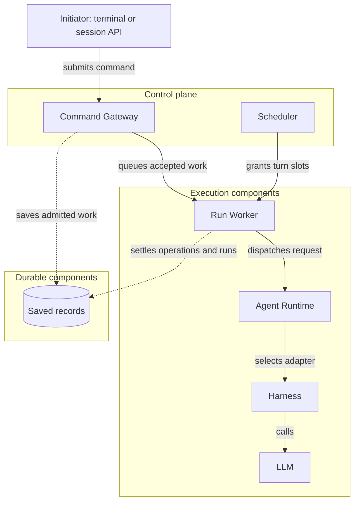
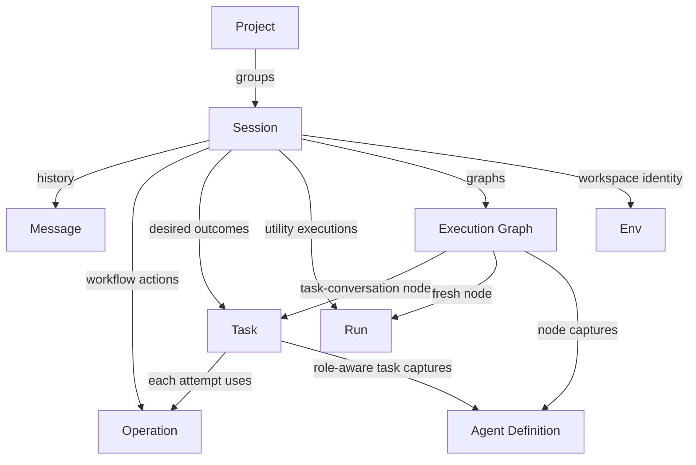

+++
title = "Component Map"
description = "How Agentty's control plane, execution components, and durable components connect."
weight = 0
+++

Agentty's core has three groups: a control plane that admits work, execution components
that run model work, and durable components that survive restarts. Each component page
has its own diagram of direct connections.

## Layers

- **Control plane:** the
  [Command Gateway](@/docs/core-components/control-plane/command-gateway.md) admits
  commands from the terminal and the session API; the
  [Scheduler](@/docs/core-components/control-plane/scheduler.md) bounds concurrent
  session turns.
- **Execution components:** all model work follows the
  [execution boundary](@/docs/core-components/execution-components/execution-boundary.md)
  from [Run Worker](@/docs/core-components/execution-components/run-worker.md) through
  [Agent Runtime](@/docs/core-components/execution-components/agent-runtime.md) to a
  [Harness](@/docs/core-components/execution-components/harness.md) and its LLM.
- **Durable components:** workflows save admitted work before execution, and the worker
  settles it afterwards. Nothing is replayed automatically after a restart.

## Durable Components

A [session](@/docs/core-components/durable-components/session.md) is the owner of almost
every other record. See
[Durable Components](@/docs/core-components/durable-components/_index.md) for each one.
