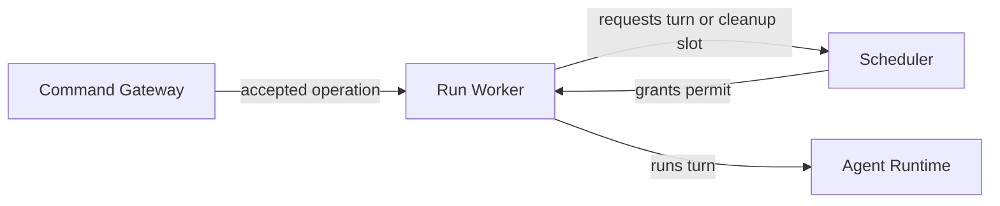

+++
title = "Scheduler"
description = "How Agentty admits session turns."
weight = 2
aliases = [ "/docs/core-components/scheduler/"]
+++

`ag-scheduler` provides shared admission. A shared admission pool bounds concurrent
session model turns to eight per Agentty process. Regular and stacked sessions use the
same pool.

## Connections

## Turn and Cleanup Slots

A turn waits for capacity after its session operation is accepted; cancellation ends
that wait. A canceled running turn retains its turn slot through provider shutdown.
Shutdown outside a running turn uses a separate pool of eight cleanup slots. A canceled
request can wait for a cleanup slot, then allows up to five seconds for provider
shutdown before reporting interruption. Each session's worker still orders its own
messages and commands.

## Outside the Scheduler

The scheduler grants capacity only. The
[Run Worker](@/docs/core-components/execution-components/run-worker.md) owns utility
capacity, kept separate so a session can await a nested utility without waiting behind
itself, and enforces provider-call budgets. Its graph executor chooses which
[execution graph](@/docs/architecture/execution-graphs.md#static-dispatch) nodes are
ready to run.

## Restart

Scheduler permits exist only in the running process. Persisted session
[operations](@/docs/core-components/durable-components/operation.md) remain the recovery
authority. On restart, Agentty reconciles unfinished operations before admitting new
work; it does not replay a turn that may have started.
