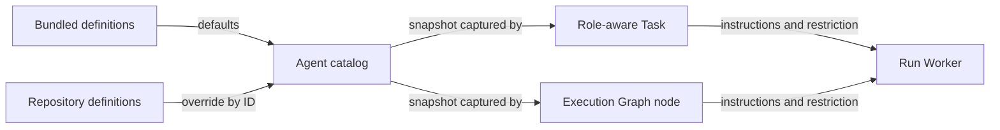

+++
title = "Agent Definition"
description = "Reusable agent instructions and restrictions captured by tasks and graph nodes."
weight = 8
+++

An Agent Definition is a reusable description of an agent: an ID, a name, a description,
instructions, and an optional read-only restriction. It supplies behavior, not identity
or access; names and prompt text never grant permissions.

## Connections

## Sources

Agentty bundles `planner` and `implementer` definitions. A repository adds or overrides
definitions under `.agents/agents/<id>/agent.md`; both sources use the same format and
parser, and global definitions are not loaded. A definition inherits the selected
provider and model; tool lists and model overrides are unsupported. See
[the workflow guide](@/docs/usage/workflow.md) for the file format.

## Capture and Enforcement

Definitions are Markdown sources, not database records. A role-aware
[task](@/docs/core-components/durable-components/task.md#role-aware-tasks) or
[execution graph](@/docs/core-components/durable-components/execution-graph.md) node
saves a snapshot of the definition it resolved, so later edits do not change admitted
work.

The runtime receives a definition's instructions through the same provider instruction
contract as ordinary session agents. A read-only definition restricts execution further;
its restriction intersects with session and workflow permissions and can never widen
them. Host workflow roles, such as Planner and Implementer, stay separate from
definition identity.
