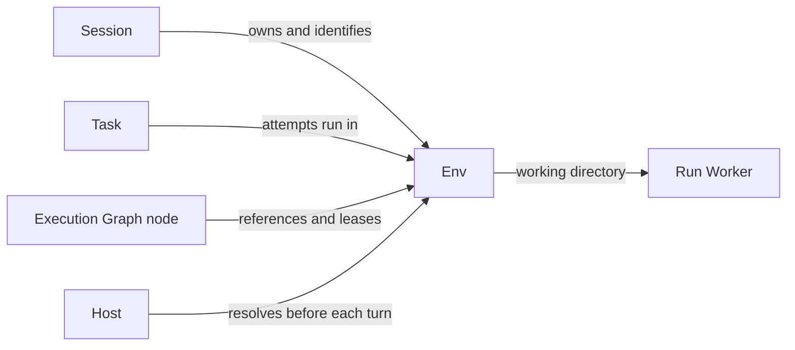

+++
title = "Env"
description = "The session-owned workspace where turns execute."
weight = 9
+++

An Env is the workspace where model work executes. Turns run in a session's local
worktree, shared by every task in that session and isolated from the main repository
checkout. A session can also keep separate task worktrees for parallel writers. They
have identity, records, and cleanup, but no turn runs in one yet. Remote execution is
not implemented.

## Connections

## Identity

`EnvId::SessionWorktree` identifies the shared Env by the full persisted
[session](@/docs/core-components/durable-components/session.md) ID. `Session::env_id()`
and `Task::env_id()` expose the same identity for every task in that session. The
session's existing ownership supplies this binding; there is no separate Env record.

`EnvId::TaskWorktree` identifies a task worktree by its session and a worktree ID that
is unique within that session. `EnvId::session_id()` names the owning session for both
kinds. A task worktree has its own branch, `wt/<session>-<worktree>`, and a directory of
the same name beside the session worktree. Both use the first eight characters of each
ID, so a session cannot reserve two worktree IDs that share that prefix. Execution
graphs reject task worktree Envs until dispatch supports them.

## Task Worktree Records

Each task worktree has a record with the commit it branches from, fixed when the
worktree is reserved. The record also tracks how far creation or removal got:

| State      | Meaning                                                                       |
| ---------- | ----------------------------------------------------------------------------- |
| `creating` | The worktree may be missing or partly made; recreate it from the base commit. |
| `ready`    | The worktree exists and may hold commits; keep it.                            |
| `removing` | Removal started; finish removing it and never use it.                         |

A session keeps at most `TASK_WORKTREE_LIMIT` (2) task worktrees, counting ones still
being created or removed, so parallel writers cannot fill the disk. Reservation checks
the limit and records the worktree in one transaction.

## Resolution

Before a turn executes, the host resolves a `ResolvedEnv` with the validated branch,
working directory, and protected main checkout. Bare repositories have no main checkout
to protect. Identity alone does not mean a workspace is ready: draft setup,
missing-directory failures, and isolation checks retain their existing behavior. The
session's project and base-branch metadata remain authoritative; resolution does not
freeze a base revision or move a branch.

## Ownership

The session owns provisioning, branch operations, and cleanup. Task completion does not
remove the workspace, and attempts remain serialized through the session worker. An Env
does not select an agent, create a separate conversation, or grant permissions.
[Execution graph](@/docs/architecture/execution-graphs.md#execution-requirements) nodes
share an Env as readers or hold it exclusively as writers.

Deleting or canceling a session removes its task worktrees' directories and branches; a
directory or branch that is already missing counts as removed. Deletion drops the
records with the session. Cancellation deletes each record only after its directory and
branch are gone. A worktree whose removal fails keeps its record in the `removing`
state, so it still counts toward the limit.
