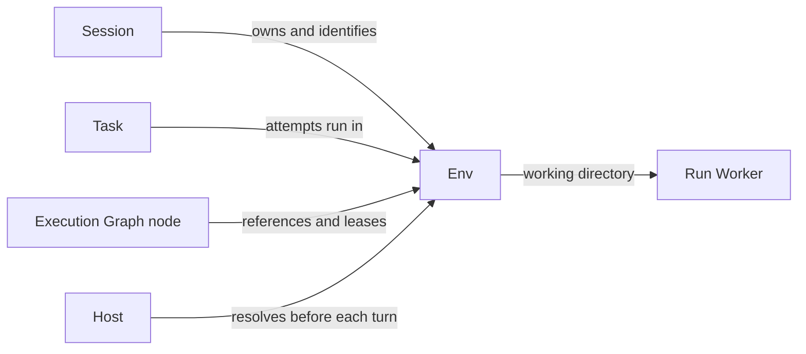

+++
title = "Env"
description = "The session-owned workspace where turns execute."
weight = 9
+++

An Env is the workspace where model work executes. The only supported Env is a session's
local worktree, shared by every task in that session and isolated from the main
repository checkout. Per-task worktrees and remote execution are not implemented.

## Connections

## Identity

`EnvId::SessionWorktree` identifies the Env by the full persisted
[session](@/docs/core-components/durable-components/session.md) ID. `Session::env_id()`
and `Task::env_id()` expose the same identity for every task in that session. The
session's existing ownership supplies this binding; there is no separate Env record.

## Resolution

Before a turn executes, the host resolves a `ResolvedEnv` with the validated branch,
working directory, and protected main checkout. Bare repositories have no main checkout
to protect. Identity alone does not mean a workspace is ready: draft setup,
missing-directory failures, and isolation checks retain their existing behavior. The
session's project and base-branch metadata remain authoritative; resolution does not
freeze a base revision or move a branch.

## Ownership

The session owns provisioning, branch operations, and cleanup. Task completion does not
remove the workspace, and attempts remain serialized through the session worker. An Env
does not select an agent, create a separate conversation, or grant permissions.
[Execution graph](@/docs/architecture/execution-graphs.md#execution-requirements) nodes
share an Env as readers or hold it exclusively as writers.
