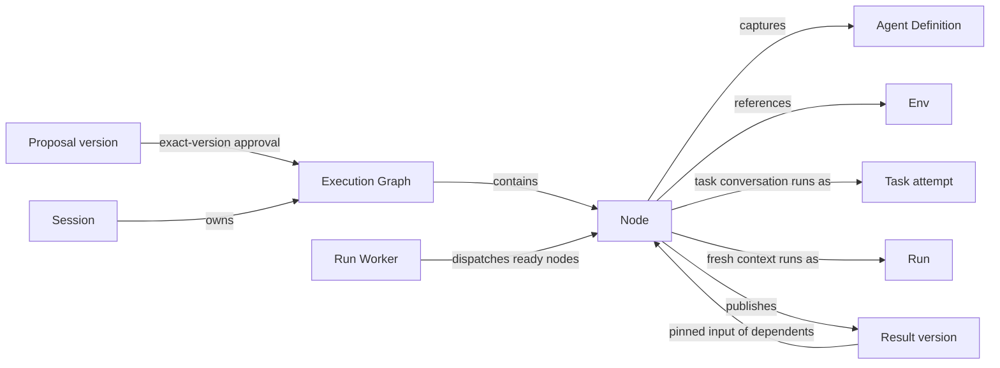

+++
title = "Execution Graph"
description = "Validated node snapshots, their executions, and exact results."
weight = 7
+++

An Execution Graph is a validated, static set of nodes owned by one
[session](@/docs/core-components/durable-components/session.md). Each node is one piece
of agent work with explicit dependencies, so independent branches can run concurrently
and later nodes receive exact earlier results. Focused review and approved `/graph`
proposals both run as graphs.

## Connections

## Records

- **Proposal:** a model-authored draft from `/graph`. The host captures the request,
  agent catalog, model, and limits; each version is saved separately. Approving an exact
  version publishes its resolved snapshot before any node starts.
- **Graph revision:** an immutable snapshot of nodes. Each node captures its
  [agent definition](@/docs/core-components/durable-components/agent-definition.md),
  model selection, request, execution profile,
  [Env](@/docs/core-components/durable-components/env.md) reference, dependencies, and
  named inputs and outputs.
- **Execution link:** a node's execution is an existing
  [task attempt](@/docs/core-components/durable-components/task.md) or utility
  [run](@/docs/core-components/durable-components/run.md). Graphs add no separate
  execution status.
- **Result version:** an immutable output body with host-recorded validation and
  acceptance evidence. Dependents pin the exact version they consumed.

## Guarantees

- A node is admitted once, in the same transaction that checks its revision, gates, Env
  conflicts, and exact inputs.
- Successful provider execution alone does not satisfy a result gate, accept an output,
  or complete a task.
- Restart restores snapshots and results without dispatching work; resume is explicit.
- Cancellation is terminal for that graph. Deleting the owning session removes its graph
  records.
- Revisions are rejected once executions are linked, and provider-call budgets are not
  durable.

See [Execution Graphs](@/docs/architecture/execution-graphs.md) for the full contract
and [the proposal workflow](@/docs/usage/workflow.md#generated-graph-proposals) for
`/graph`.
