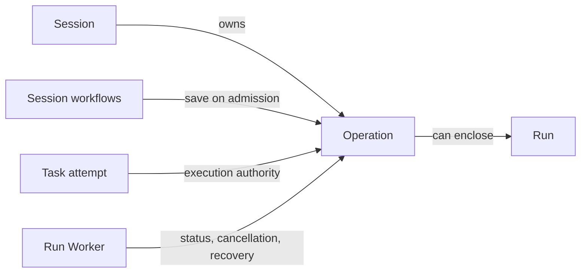

+++
title = "Operation"
description = "Durable tracking for session workflow execution."
weight = 4
+++

An Operation tracks an admitted workflow action within a
[session](@/docs/core-components/durable-components/session.md). Its durable record
supports execution status, cancellation, and recovery when work is interrupted.

## Connections

## Workflow Boundary

An operation can encompass model work and ordered Git or forge effects. Completion
therefore reflects the workflow outcome, not just an assistant response. Isolated model
work within a workflow can have its own
[run](@/docs/core-components/durable-components/run.md).

The [worker](@/docs/core-components/execution-components/run-worker.md) coordinates
execution and recovery. Saving an operation does not guarantee automatic replay after a
restart.

A [task attempt](@/docs/core-components/durable-components/task.md) uses a unique
operation as its execution authority. Its terminal operation cannot be reopened;
explicit retries create a new attempt and operation, preserving earlier history.
