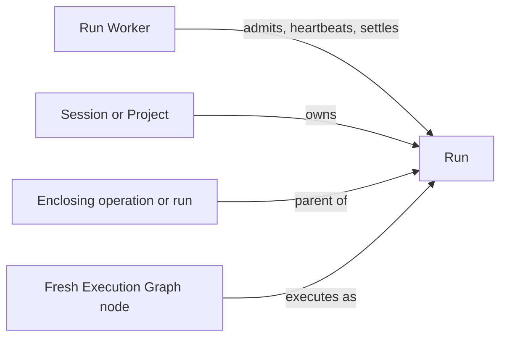

+++
title = "Run"
description = "Durable records for isolated utility model executions."
weight = 5
+++

A Run records one isolated utility model execution, such as title generation or conflict
assistance. It preserves the execution's purpose, ownership, and outcome, and can be
associated with a project, session, or enclosing
[operation](@/docs/core-components/durable-components/operation.md).

## Connections

## Execution Scope

The durable Run model covers utility execution. A
[task attempt](@/docs/core-components/durable-components/task.md) separately links a
desired outcome to a session workflow operation. Provider retries remain within the same
run.

[Workers](@/docs/core-components/execution-components/run-worker.md) own execution,
cancellation, and recovery. Abandoned runs are marked failed after restart rather than
automatically replayed.
