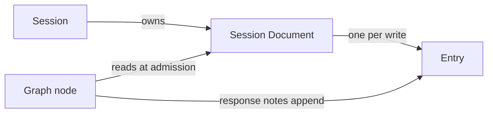

+++
title = "Session Document"
description = "Shared notes that a session's graph nodes read and add to."
weight = 10
+++

A Session Document is one text per
[session](@/docs/core-components/durable-components/session.md) that the
task-conversation nodes of its
[execution graphs](@/docs/core-components/durable-components/execution-graph.md) read
and add to. It holds shared notes only, such as findings, decisions, and hand-offs;
graph structure, executions, and evidence stay in the graph's own records.

## Connections

## Records

- **Document:** the current body and its version. A session that never wrote one reads
  as an empty document at version zero.
- **Entry:** one accepted write with its author (the graph, node, and execution that
  returned the note, or the user; storage also accepts the session's main chat, which
  writes nothing yet), its kind (a note appended to the body or a replacement of the
  whole body), its text, and its time. Storage refuses an author whose execution does
  not match its kind, and empty identifiers. A note's section in the body starts with a
  heading that names its version and author; nodes read entries, not the body. An empty
  replacement by the user clears the document.

## Guarantees

- Every write is one transaction, which serves as the document's lock. An append takes
  the next version, so concurrent appends from overlapping nodes all land, in commit
  order.
- Replacing the body requires the expected current version and changes nothing on a
  mismatch.
- A note is at most 2 KiB (`SESSION_DOCUMENT_NOTE_MAX_BYTES`) and the body at most 32
  KiB (`SESSION_DOCUMENT_BODY_MAX_BYTES`), its headings included. A write over either
  bound is refused whole; storage never shortens or drops part of it.
- One response adds at most five notes (`SESSION_DOCUMENT_NOTES_PER_RESPONSE`). Storage
  strips characters that render as nothing from every note and body before checking its
  size.
- An execution adds notes once: after it wrote any entry, a redelivered response adds
  nothing, even with different notes.
- The document persists across all graphs of the session until the user clears it.
- Deleting the owning session deletes its document and entries.

See [Execution Graphs](@/docs/architecture/execution-graphs.md#session-document) for how
nodes read and write it.
