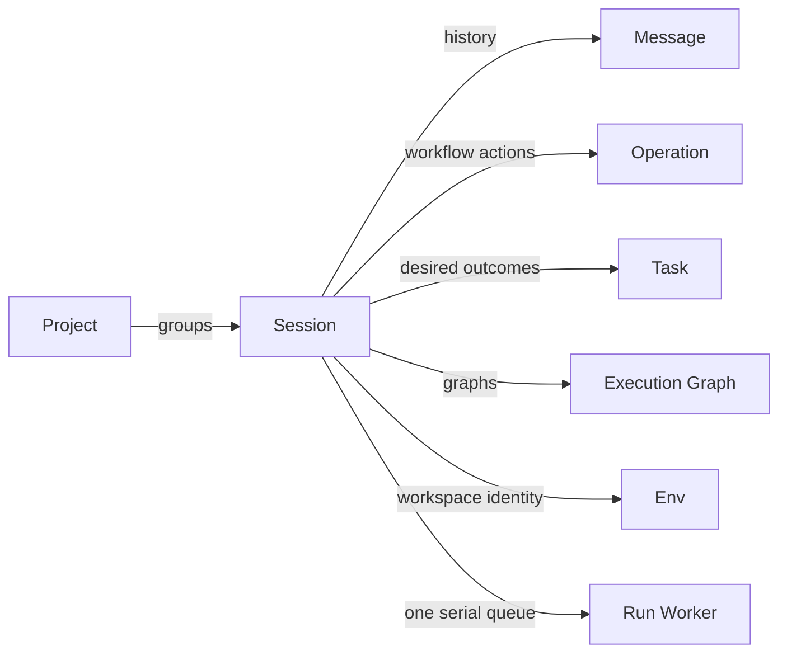

+++
title = "Session"
description = "Persistent conversation and workspace context for ongoing work."
weight = 3
+++

A Session holds the conversation and workspace context for work within a
[project](@/docs/core-components/durable-components/project.md). Its saved state
includes execution preferences, lifecycle progress, and its relationship to the working
branch and workspace.

## Connections

## Ownership

A session owns its [messages](@/docs/core-components/durable-components/message.md),
[operations](@/docs/core-components/durable-components/operation.md),
[tasks](@/docs/core-components/durable-components/task.md), and
[execution graphs](@/docs/core-components/durable-components/execution-graph.md);
deleting the session deletes them. It also owns the
[Env](@/docs/core-components/durable-components/env.md) its turns execute in, including
provisioning, branch operations, and cleanup.

## Continuity

Messages preserve the session's history, while operations track workflow execution. A
session can span many turns and operations; it is not a single execution attempt.

Saved context remains available after restart. Interrupted execution is reconciled by
the [worker](@/docs/core-components/execution-components/run-worker.md), rather than
automatically repeated.
