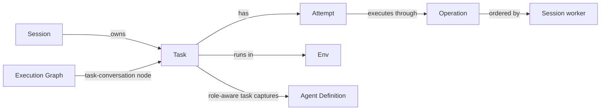

+++
title = "Task"
description = "Desired outcomes and explicit attempts through session workers."
weight = 6
+++

A Task records a desired outcome in one
[session](@/docs/core-components/durable-components/session.md). Each attempt runs one
turn and its ordered post-processing through a unique
[operation](@/docs/core-components/durable-components/operation.md). Ordinary tasks use
session conversation context; role-aware tasks keep their own conversation.

## Connections

## Ownership and Concurrency

One session can own multiple tasks, all sharing that session's
[Env](@/docs/core-components/durable-components/env.md); task completion does not
release the workspace. Attempts execute serially through the session's worker.
Submitting an attempt while the session is busy is rejected rather than queued, and only
one attempt per task may be unfinished. Tasks in different sessions can run concurrently
within existing capacity.

Task management is programmatic. Tasks alone provide no dependency scheduling or
automatic retries;
[execution graphs](@/docs/core-components/durable-components/execution-graph.md)
schedule dependent task conversations.

## Planning and Querying

`SessionService::create_task` saves a nonempty `task_id` and `objective` without adding
an attempt, operation, message, or worker work. The owning session must exist but may be
draft, busy, or terminal. Repeating the same request preserves the task; changing its
session or objective is rejected.

`SessionService::list_tasks` returns one session's tasks with their attempt histories as
one snapshot in creation order; `SessionService::get_task` retrieves one task.

## Submission and Completion

`SessionService::submit_task` takes a stable `task_id`, an immutable `objective`, a
globally unique `attempt_id`, a `message` for that attempt, and a transcript
`visibility`. New attempts require a loaded session in `Review`, `AgentReview`,
`Watching`, or `Question`, and submission creates the task if needed.

Admission atomically saves the task, attempt, and queued operation before worker
delivery and acknowledges admission, not execution. Redelivering identical inputs with
the same attempt ID acknowledges the existing attempt; changed inputs under an existing
identity are rejected.

Attempts project queued, running, succeeded, failed, or canceled state from their
operations; running includes ordered post-processing. A successful turn does not mean
the objective is satisfied: only `SessionService::complete_task` records the caller's
explicit acceptance. Completion requires every attempt to have settled, is allowed with
zero attempts, prevents new attempts, and does not merge, publish, or finish the
session.

## Role-Aware Tasks

 `ag_session::TaskAgentRole` provides two
built-in workflow roles:

- **Planner** — read-only; proposes a plan and validation steps and skips mutating host
  effects. A fresh `Draft` session can start with a Planner without an ordinary turn.
- **Implementer** — requires an accepted plan, keeps session permissions, and finishes
  permitted commit and publication effects before the next turn. A successful attempt
  without questions starts the ordinary automatic review.

Roles are host workflow contracts; a separate
[Agent Definition](@/docs/core-components/durable-components/agent-definition.md)
supplies instructions and optional read-only restrictions. Neither role's output
completes a task.

`SessionService::submit_agent_task` admits a role-aware attempt through the session's
serial worker, capturing the model selection, role, definition snapshot, original
request, and explicit clarification. These stay fixed across attempts and survive
restart; a task with ordinary session-context history cannot acquire a role. Except for
a Planner starting a `Draft`, role attempts require `Review`, `AgentReview`, or
`Watching`, and unmaterialized workspaces are rejected before model execution. Role
admission invalidates earlier ordinary review work, and only a successful Implementer
attempt starts an automatic review.

`SessionService::accept_agent_plan` explicitly accepts the latest successful Planner
response with a nonempty plan and no questions; generic task completion does not accept
a plan. Implementer admission verifies that acceptance, the session, the original
request, and the captured model. Repeated acceptance of the same version is idempotent.

Task-owned history keeps each response with its producing attempt, separate from
ordinary chat. A response can be visible while post-processing still runs, so inspect
the attempt status before accepting it. `SessionService::get_agent_task_history` returns
the assignment, inputs, responses, and usage.

## Clarification, Retries, and Recovery

An ordinary task's clarification response finishes its attempt and leaves the session
waiting for input; submit a new attempt with the answers in its message to continue.
Role-aware clarification stays in the task's own history; continue it with a new attempt
carrying `TaskAgentInput::clarification`. Every explicit retry or continuation uses a
new attempt ID; provider retries stay inside the current attempt.

Session cancellation settles attempts through ordinary operation cancellation and leaves
the outcome open. Restart recovery marks unfinished attempts failed without replaying
them. Deleting the owning session deletes its tasks and attempts.
