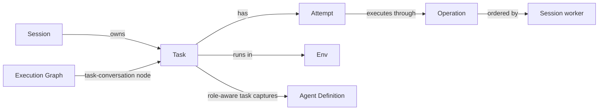

+++
title = "Task"
description = "Desired outcomes and explicit attempts through session workers."
weight = 6
+++

A Task records a desired outcome in one
[session](@/docs/core-components/durable-components/session.md). Each attempt runs one
turn and its ordered post-processing through a unique
[operation](@/docs/core-components/durable-components/operation.md). Ordinary tasks use
session conversation context; role-aware tasks retain their own conversation.

## Connections

## Ownership and Concurrency

One session can own multiple tasks. Each task stays with its owning session and shares
that session's [Env](@/docs/core-components/durable-components/env.md); task completion
does not release the workspace.

Attempts execute serially through the session's worker. Submitting an attempt while the
session is busy is rejected, not added to the ordinary chat queue, and only one attempt
per task may be unfinished. Tasks in different eligible sessions can execute
concurrently within existing capacity and workspace limits.

Task management is programmatic.
[Execution graphs](@/docs/core-components/durable-components/execution-graph.md)
schedule dependent task conversations; tasks alone provide no dependency scheduling or
automatic retries.

## Planning and Querying

`SessionService::create_task` saves a nonempty `task_id` and `objective` before
execution. The owning session must exist in storage, but may be draft, busy, or
terminal. Creation adds no attempt, operation, message, or worker work. Repeating the
same request preserves the task; changing its session or objective is rejected.

`SessionService::list_tasks` returns one session's tasks with their attempt histories as
one storage snapshot in creation order; a missing session returns an empty list.
`SessionService::get_task` retrieves one task by ID.

## Submission and Completion

`SessionService::submit_task` takes a stable `task_id`, an immutable `objective`, a
globally unique `attempt_id`, a `message` instructing that attempt, and a `visibility`
for its transcript presentation. New attempts require a loaded session in `Review`,
`AgentReview`, or `Question`. Submission creates the task if needed.

Admission atomically saves the task, attempt, and queued operation before worker
delivery, and acknowledges admission, not execution. Redelivering identical inputs with
the same attempt ID acknowledges the existing attempt, including after it settles;
changed inputs under an existing identity are rejected. An enqueue failure can leave a
failed attempt; inspect it before retrying.

Attempts project queued, running, succeeded, failed, or canceled state from their
operations; running includes ordered post-processing. A successful turn does not
establish that the objective is satisfied: only `SessionService::complete_task` records
the caller's explicit acceptance. Completion requires every attempt to have settled,
prevents new attempts, and is allowed with zero attempts. It does not merge, publish, or
finish the session.

## Role-Aware Tasks

 `ag_session::TaskAgentRole` provides two
built-in task roles:

| Role          | Required context                               | Permissions                                     | Expected answer                        |
| ------------- | ---------------------------------------------- | ----------------------------------------------- | -------------------------------------- |
| `Planner`     | User request and clarification                 | Read only                                       | Proposed plan and validation steps     |
| `Implementer` | User request, accepted plan, and clarification | Session permissions, including read-only limits | Observed changes, checks, and blockers |

Roles are host workflow contracts. A separate
[Agent Definition](@/docs/core-components/durable-components/agent-definition.md)
supplies instructions and optional read-only restrictions. Neither role's output
automatically completes a task.

`SessionService::submit_agent_task` admits a role-aware attempt through the session's
serial worker. Its `SubmitAgentTaskRequest` captures the model selection, role,
definition snapshot, original request, and explicit clarification. The assignment and
original inputs stay fixed across attempts and survive restart; a task with ordinary
session-context history cannot acquire one.

- **Planner** turns are read-only and skip mutating host effects. A fresh regular
  `Draft` can start with a Planner without an ordinary chat turn.
- **Implementer** turns require a verified accepted plan, retain session permissions,
  and finish permitted commit and publication effects before the next turn; a failed
  effect settles the attempt as failed. A successful attempt without questions starts
  the ordinary automatic review.
- Other role attempts require `Review` or `AgentReview`. Unmaterialized deferred
  workspaces are rejected before model execution.
- Role admission invalidates prior ordinary review generations. Planner, question,
  failed, canceled, and superseded attempts start no automatic review; explicit review
  remains available.

`SessionService::accept_agent_plan` explicitly accepts one persisted Planner attempt:
only the latest successful, uncanceled response with a nonempty plan and no questions is
eligible. Generic task completion does not accept a plan. Implementer admission verifies
the acceptance, session, original request, and captured model together with the attempt.
A newer Planner attempt makes an older version ineligible for new handoffs, while its
acceptance record is preserved. Repeated acceptance of the same eligible version is
idempotent.

Task-owned history keeps each response with its producing attempt, separate from
ordinary session chat. A response can be available while post-processing is still
running, so inspect the attempt status before accepting it.
`SessionService::get_agent_task_history` returns the assignment, explicit inputs,
responses, and usage.

## Clarification, Retries, and Recovery

For ordinary tasks, a clarification response finishes its attempt and leaves the task
open and the session waiting for input. Submit a new attempt with the answers in its
message to continue task accounting; ordinary question answers are not automatically
attached to a task.

Role-aware clarification stays in that task's response history and does not replace the
session's pending questions. Submit a new role-aware attempt with explicit
`TaskAgentInput::clarification` to continue the task's own conversation.

Use a new attempt ID for an explicit retry or continuation. Provider retries remain
inside the current attempt.

Session cancellation settles its attempts through ordinary operation cancellation and
leaves the desired outcome open. Restart recovery marks unfinished operations and their
attempts failed without replaying them. Earlier attempts retain their identities and
history. Deleting the owning session deletes its tasks and attempts. Utility
[runs](@/docs/core-components/durable-components/run.md) remain separate records.
