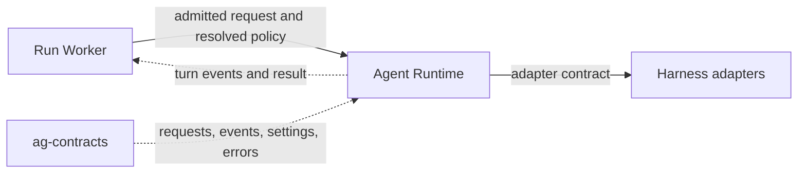

+++
title = "Agent Runtime"
description = "How the agent runtime composes harness adapters and dispatches requests."
weight = 2
+++

`ag-runtime` composes harness adapters, dispatches worker-admitted requests, and
coordinates provider lifecycle. It defines one protocol for every harness, whether CLI,
app server, or in process.

## Connections

Only the [Run Worker](@/docs/core-components/execution-components/run-worker.md) calls
the runtime, and only the runtime constructs
[harness](@/docs/core-components/execution-components/harness.md) adapters. Provider
transports never reach application workflows.

## Responsibilities

- **Dispatch:** select the adapter for the requested agent and forward the request,
  preserving cancellation, usage, and provider-call budgets.
- **Policy:** carry the worker's resolved
  [execution policy](@/docs/core-components/execution-components/run-worker.md#execution-policy)
  to the adapter, which translates and enforces it. A retained provider process must
  match the requested policy before reuse.
- **Lifecycle:** keep provider processes behind runtime objects and clean them up after
  cancellation or shutdown.

Shared requests, events, settings, and errors live in `ag-contracts`. Frontend policy,
mailbox scheduling, and persistence stay outside the runtime.
