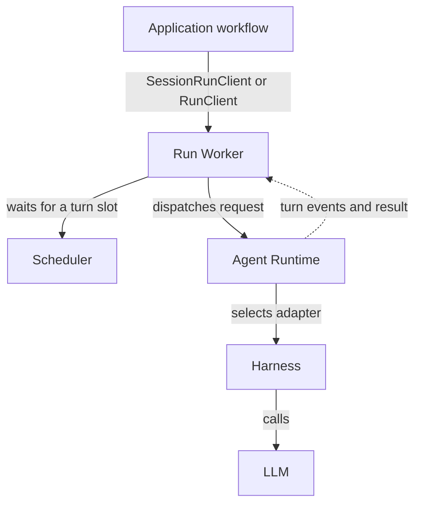

+++
title = "Execution Boundary"
description = "How run workers, the agent runtime, harnesses, and LLMs fit together."
weight = 0
aliases = [ "/docs/core-components/execution/"]
+++

Every Agentty request for model reasoning or generation goes through a worker-owned
execution boundary: **Run Worker → Agent Runtime → Harness → LLM**. This includes
session turns, titles, focused reviews, summaries, commit messages, review-request
metadata, and conflict assistance.

-  
  [Run Worker](@/docs/core-components/execution-components/run-worker.md): admission,
  ordering, cancellation, recovery, and
  [execution policy](@/docs/core-components/execution-components/run-worker.md#execution-policy).
- 
  [Agent Runtime](@/docs/core-components/execution-components/agent-runtime.md): adapter
  composition, dispatch, and provider lifecycle.
-   
  [Harness](@/docs/core-components/execution-components/harness.md): the agent loop, the
  [LLM](@/docs/core-components/execution-components/harness.md#llm) behind it, and
  [observed activity](@/docs/core-components/execution-components/harness.md#observed-activity).

## Crates

| Component          | Crates                         | Responsibility                                    |
| ------------------ | ------------------------------ | ------------------------------------------------- |
| Scheduler          | `ag-scheduler`                 | Session admission                                 |
| Run Worker         | `ag-worker`                    | Admission, scheduling, cancellation, recovery     |
| Agent Runtime      | `ag-runtime`                   | Adapter composition, dispatch, provider lifecycle |
| Shared contracts   | `ag-contracts`, `ag-protocol`  | Requests, events, policy types, response schemas  |
| Harness (external) | `ag-agent`                     | CLI and app-server adapters, policy enforcement   |
| Harness (native)   | `ag-harness`, `ag-harness-cli` | Model loop run in process by `ag-agent`, and CLI  |
| LLM                | None                           | Reached through the harness                       |
| Supporting         | `ag-session`, `ag-store`       | Session models, model selection, and persistence  |

## Dependency Rule

 Only `ag-worker` depends on `ag-runtime`, and only
`ag-runtime` depends on `ag-agent`. Only `ag-harness-cli` and `ag-agent` may depend on
`ag-harness`. Applications configure worker handles and import shared types from
`ag-contracts`.

The `check-execution-boundary` hook enforces this boundary on every commit: dependency
rules cover all workspace dependencies, including test code, and source checks keep raw
adapter use and agent CLI launches out of production code outside the execution crates.

See [Module Map](@/docs/architecture/module-map.md) for ownership and
[Runtime Flow](@/docs/architecture/runtime-flow.md) for orchestration and recovery.
