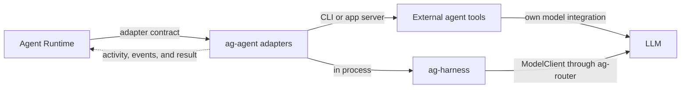

+++
title = "Harness"
description = "How harnesses run the agent loop, reach the LLM, and report activity."
weight = 3
+++

A harness runs the agent loop: it combines context, calls models, executes tools, and
decides when to continue or finish. `ag-agent` implements the runtime's adapter
contracts for every harness and owns transport details, provider flags, and provider
resource cleanup.

## Connections

## Harness Kinds

External agent tools provide the loop for CLI and app-server providers. `ag-harness`
provides a Rust implementation that `ag-agent` runs in process for `AgentKind::Harness`
when the host enables it; Agentty does so only when started with
`--experimental-harness`. Without that configuration, harness work fails before
execution. The native harness charges each model request against a utility's
provider-call budget. See
[`ag-harness` Design](@/docs/architecture/ag-harness-design.md) for its component
contracts.

## LLM

The LLM is the model invoked by the harness for reasoning and generation. It does not
schedule Agentty runs or execute tools itself. `ag-harness` separates model access
behind its `ModelClient` contract and uses `ag-router` for built-in provider chat
requests; external harnesses manage their own model integrations.

## Observed Activity

`TurnEvent::Activity` carries tool and explicit skill lifecycle snapshots through the
existing worker stream. Call identity combines an attempt ID with the provider operation
ID, so retries and protocol repairs remain distinct. Unfinished calls settle as
interrupted when their attempt ends; this does not imply tool rollback.

Codex, Claude, and Antigravity adapters publish activity independently of telemetry.
Only explicit Claude `Skill` calls identify skill usage. Input and output previews are
bounded, stripped of terminal control characters, and transient: they are excluded from
provider replay and telemetry export. Each attempt and each turn retain a bounded number
of calls, so these are observations, not an exhaustive audit log. Utility callers may
supply `OneShotRequest::activity_tx` through `RunClient::submit` to receive the same
events, including repairs. Hosts own persistence and rendering.
