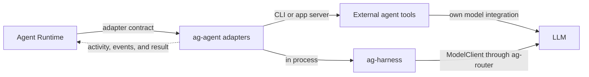

+++
title = "Harness"
description = "How harnesses run the agent loop, reach the LLM, and report activity."
weight = 3
+++

A harness runs the agent loop: it combines context, calls models, executes tools, and
decides when to continue or finish. `ag-agent` implements the runtime's adapter
contracts for every harness and owns transport details, provider flags, and provider
resource cleanup.

## Connections

## Harness Kinds

External agent tools provide the loop for CLI and app-server providers. `ag-harness`
provides a Rust implementation that `ag-agent` runs in process for `AgentKind::Harness`
when the host configures its native transport, as Agentty always does. Without that
configuration, harness work fails before execution. The native harness charges each
model request against a utility's provider-call budget. Its adapter decides each failed
turn from the harness `ErrorKind`: a cancelled run is reported as stopped, and a
retryable kind is noted as possibly temporary, with the provider's requested wait when
present. The adapter does not replay the turn, which would repeat its tool effects. See
[`ag-harness` Design](@/docs/architecture/ag-harness-design.md) for its component
contracts.

## LLM

The LLM is the model invoked by the harness for reasoning and generation. It does not
schedule Agentty runs or execute tools itself. `ag-harness` separates model access
behind its `ModelClient` contract and uses `ag-router` for built-in provider chat
requests; external harnesses manage their own model integrations.

## Observed Activity

`TurnEvent::Activity` carries tool and explicit skill lifecycle snapshots through the
existing worker stream. Call identity combines an attempt ID with the provider operation
ID, so retries and protocol repairs remain distinct. Unfinished calls settle as
interrupted when their attempt ends; this does not imply tool rollback.

Each snapshot carries `ActivityFacts` where the provider reports them: the target path,
query, or command line, a read's line range, an edit's line counts, the duration, a
command's pipeline statuses and signal, and the reason a call was rejected. Reads,
searches, and listings have their own kinds. `ActivityEvent::outcome` decides the state
to show: a completed command whose own exit status is nonzero, judged by the first
failing stage of its final pipeline, or that a signal terminated, failed. Native session
turns build these snapshots from the run's event stream, ordered with its streamed
output.

Codex, Claude, and Antigravity adapters publish activity independently of telemetry.
Only explicit Claude `Skill` calls identify skill usage. Input and output previews are
bounded, stripped of terminal control characters, and transient: they are excluded from
provider replay and telemetry export. Each attempt and each turn retain a bounded number
of calls, so these are observations, not an exhaustive audit log. Utility callers may
supply `OneShotRequest::activity_tx` through `RunClient::submit` to receive the same
events, including repairs. Hosts own persistence and rendering.

## Context Compaction

`TurnRequest::context_compaction` decides whether a native turn compacts its durable
history (`ContextPolicy::auto_compact`) or evicts it. Agentty compacts its own session
turns and keeps task agents, graph nodes, and assist turns on eviction, since no
transcript shows their notices. `ContextCompaction::Automatic` carries the summary
model, Agentty's Default Fast Model on a Harness session; the adapter sets it with
`Harness::set_summary_model`, or `Session::set_summary_model` after a model switch, only
when it resolves to another ready harness model with structured output, and otherwise
logs why and lets the session's model summarize. The summary model is not part of the
recorded registration, so sessions recorded before or without it resume unchanged.
Compaction requests run inside the turn's harness run, so they stay on the Run Worker,
Agent Runtime, Harness, LLM path, count toward the turn's usage, and are priced at the
summary model. A failed summary request never fails the turn, which evicts the oldest
turns instead; the run's budget ledger refusing a request, its wall-time limit, and
session store failures still fail it. The adapter reports a published checkpoint or a
failed summary as `TurnEvent::Notice`, which the host saves as a transcript notice
before the turn's answer and leaves out of provider replay; a compaction with nothing to
cover reports none.

## Streamed Output

`TurnEvent::Output` carries the model output an in-process `ag-harness` session turn
streams. Items start, receive fragments, and complete with authoritative text. The
validated final answer names the message it replaces, and the items of a discarded
response, or items a run left unfinished, are dropped. External agent adapters emit none
and keep showing answers when the turn completes. Like activity, the output is transient
session content: hosts render it and never persist, replay, or export it.

## Sandbox Notices

`TurnEvent::Notice` also carries what an in-process `ag-harness` session turn reports
about the native sandbox its `bash` commands run in: that commands run without it, with
user-facing remedy text, that they ran in it, or that a sandboxed command likely hit a
sandbox denial. The host shows the warning as soon as it arrives, once per change of the
sandbox state, a note when the sandbox works again after a warning, and the denial hint
once per turn, and leaves them all out of provider replay. Notices are advisory; no
layer reruns a command outside the sandbox because of one. One-shot utility runs report
no notices, because `OneShotSubmission` carries none, so they refuse to run commands
where the sandbox cannot run, failing with its remedy.
