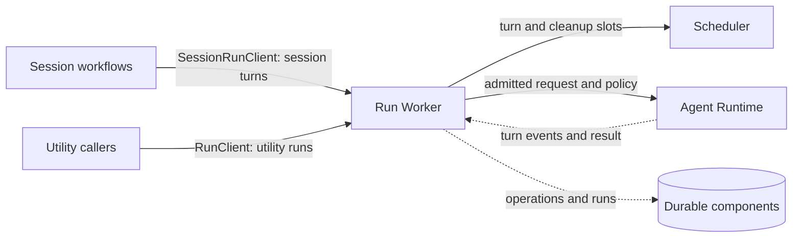

+++
title = "Run Worker"
description = "How the run worker admits, orders, cancels, and recovers model work."
weight = 1
+++

`ag-worker` schedules runs and coordinates heartbeats, cancellation, completion, and
restart recovery. Hosts supply workflow policy and persistence; the worker has no TUI,
Git, or database implementation dependency.

## Connections

Application composition supplies worker configuration and host policy. The worker
settles [operations](@/docs/core-components/durable-components/operation.md) and
[runs](@/docs/core-components/durable-components/run.md) through host-supplied
repositories.

## Queues and Capacity

One boundary does not mean one global queue. Session commands stay ordered through
post-processing, and each turn waits for a
[Scheduler](@/docs/core-components/control-plane/scheduler.md) slot. Isolated utility
runs execute concurrently within a bounded capacity, so a session workflow can await a
utility child without queueing it behind itself. The worker's static graph executor
dispatches ready
[execution graph](@/docs/architecture/execution-graphs.md#static-dispatch) nodes through
these same paths.

## Admission and Budgets

Admission persists ownership and purpose before execution. Retries and protocol repairs
are attempts within the same supervised run and keep its filesystem permissions and
provider-call budget.

A provider-call budget is one shared limit across a request, its retries, repairs, and
utility children; a child's own limit is an additional ceiling. One call is one turn
attempt on every backend: a CLI or app-server turn, repair, or restart retry, or one
native harness run, however many model requests it sends. A budget built with
`ProviderCallBudget::with_ledger` reports each charge and refund to a host ledger, which
graph hosts persist so restarts never replenish spent calls. `extend` adds calls to a
live pool after the host records an explicit extension; it reports nothing to the
ledger.

## Steering

`SessionRunClient::steer` offers one user prompt to the client's running session turn
without starting a turn, so hosts may call it outside the serial worker. Success means
the provider accepted the prompt; on error it was not delivered and the host keeps it
for a later turn. `supports_turn_steering` reports which harnesses can accept steering.

## Task Contexts

`SessionRunClient::for_task_context` gives a task its own provider resources and native
history while session ownership, capacity, and tracing stay with the owning session.
Task-owned inputs and responses never enter ordinary chat replay. See
[Task](@/docs/core-components/durable-components/task.md#role-aware-tasks).

## Cancellation and Recovery

Caller drop, parent cancellation, or shutdown stops owned execution; nested scopes keep
parent cancellation. Cleanup precedes resource deletion, and closed admission rejects
late work. Shutdown has one shared five-second grace period before forcing unfinished
runtime work to stop. Startup recovery fails abandoned runs rather than replaying
potentially mutating requests.

Resources attached with `with_execution_resource`, such as
[Env](@/docs/core-components/durable-components/env.md) leases, stay owned by the worker
through cancellation cleanup. A coordinating run holds no utility slot while its
children run and settles only after every child finishes cleanup.

## Utility Usage

A `RunScope` that names a session and a `usage_purpose` makes each successful utility
run under it record its usage, per model, through `RunRepository::record_usage`. Nested
scopes inherit the purpose, so a narrower scope such as title generation overrides a
session-wide default. A failed write is logged and never fails the run.

## Execution Policy

`ag-worker::RuntimeConfig` owns the subagent, built-in tool, and MCP policy for each
harness; hosts set it with `with_execution_policy`. Each worker replaces the request's
`ExecutionPolicy` before runtime dispatch, for session turns, utility runs, retries, and
repairs alike. Per-turn settings are resolved separately during
[turn preparation](@/docs/architecture/runtime-flow.md#headless-execution-ownership).

- Worker capacity bounds concurrent utility runs; it does not count provider children.
- `max_concurrent_subagents` requests a positive limit on provider-native children,
  excluding the parent. It is not a global process limit.
- `ToolPolicy` selects inherited behavior, unattended approvals, or a built-in tool
  allowlist; read-only permissions remain an independent restriction.
- `McpPolicy` inherits or disables configured MCP servers. Restricting built-in tools
  alone does not restrict MCP tools.

By default, Codex and Claude request two concurrent children, and Claude preapproves its
edit, Bash, web, and plan-mode tools and inherits configured MCP servers. Subagent
limits are supported for Codex and Claude, and tool and MCP overrides only for Claude.
Explicit unsupported controls fail before model execution; the native harness accepts
none.
