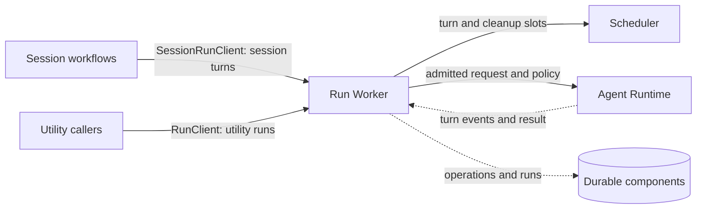

+++
title = "Run Worker"
description = "How the run worker admits, orders, cancels, and recovers model work."
weight = 1
+++

`ag-worker` schedules runs and coordinates heartbeats, cancellation, completion, and
restart recovery. Hosts supply workflow policy and persistence; the worker has no TUI,
Git, or database implementation dependency.

## Connections

Application composition supplies worker configuration and host policy. The worker
settles [operations](@/docs/core-components/durable-components/operation.md) and
[runs](@/docs/core-components/durable-components/run.md) through host-supplied
repositories.

## Queues and Capacity

One boundary does not mean one global queue. Session commands remain ordered through
post-processing, and each turn waits for a
[Scheduler](@/docs/core-components/control-plane/scheduler.md) slot. Isolated utility
runs execute concurrently with a bounded capacity. A session workflow can await a
utility child directly without placing that child behind itself in the session queue.

The worker also provides the static graph executor, which dispatches ready
[execution graph](@/docs/architecture/execution-graphs.md#static-dispatch) nodes through
these same session and utility paths.

## Admission and Budgets

Admission persists ownership and purpose before execution. Retries and protocol repairs
remain attempts within the same supervised run and retain its per-turn filesystem
permissions and provider-call budget.

A provider-call budget is one shared limit across a request, its retries, repairs, and
utility children; a child's own limit remains an additional ceiling. A coordinator can
reserve the first call before durable admission; an unused reservation is refunded. A
budget built with `ProviderCallBudget::with_ledger` reports each charge and refund to a
host `ProviderCallLedger`, which graph hosts persist so restarts never replenish spent
calls. Other budgets live only in the running process.

## Task Contexts

`SessionRunClient::for_task_context` gives a task its own retained provider resources
and native history while session ownership, shared capacity, and tracing stay with the
owning session. Hosts dispatch such turns through that session's serial worker and clean
up each context they own. Ordinary chat retains its existing runtime identity, and
task-owned inputs and responses never enter ordinary chat replay. See
[Task](@/docs/core-components/durable-components/task.md#role-aware-tasks) for
role-aware admission.

## Cancellation and Recovery

Caller drop, parent cancellation, or shutdown stops owned execution; nested scopes
retain parent cancellation. Cleanup precedes resource deletion, and closed admission
rejects late session work. Shutdown has one shared five-second grace period before
forcing unfinished runtime work to stop. Session deletion waits for the owning worker
and utility cleanup before reclaiming task history. Startup recovery fails abandoned
runs rather than replaying potentially mutating requests.

Resources attached with `with_execution_resource`, such as
[Env](@/docs/core-components/durable-components/env.md) leases, stay owned by the worker
through cancellation cleanup, even after the caller stops waiting. A coordinating run,
such as a focused-review graph node, holds no utility slot while its children run and
settles only after every child finishes cleanup.

## Execution Policy

For per-turn settings and their resolution timing, see
[Turn preparation](@/docs/architecture/runtime-flow.md#headless-execution-ownership).

`ag-worker::RuntimeConfig` owns the configured subagent, built-in tool, and MCP policy
for each harness. Hosts use `with_execution_policy` when composing workers. Each worker
captures its configuration and replaces the request's `ExecutionPolicy` before runtime
dispatch; changing configuration affects newly constructed workers. Session turns and
utility runs use the same policy path, including retries and protocol repairs.

The controls are distinct:

- Worker capacity bounds concurrent utility runs; it does not count provider children.
- `max_concurrent_subagents` requests a positive limit on provider-native children,
  excluding the parent. Provider exceptions still apply; this is not a global process
  limit.
- `ToolPolicy` selects inherited behavior, unattended approvals, or a built-in tool
  allowlist. An empty allowlist disables built-ins. Tool names are provider-native;
  read-only permissions remain an independent restriction.
- `McpPolicy` selects inherited MCP configuration or disables configured MCP servers.
  Restricting built-ins alone does not restrict MCP tools.

Defaults preserve existing behavior: Codex and Claude request two concurrent children;
Claude preapproves the existing edit and web tools and disables inherited MCP servers.
Other controls inherit the harness configuration. The current adapters support subagent
limits for Codex and Claude, and tool and MCP overrides for Claude. Explicit unsupported
controls fail before model execution. Codex declining interactive MCP elicitation is
separate from disabling MCP access. The native harness accepts none of these controls.
