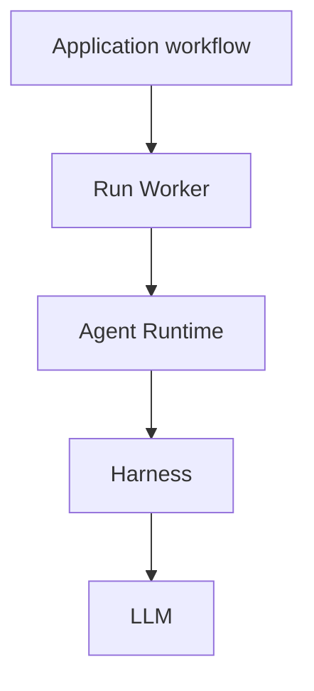

+++
title = "Execution"
description = "How run workers, runtime contracts, harnesses, and LLMs fit together."
weight = 1
+++

Every Agentty request for model reasoning or generation goes through a worker-owned
execution boundary: **Run Worker → Agent Runtime → Harness → LLM**. This includes
session turns, titles, focused reviews, summaries, commit messages, review-request
metadata, and conflict assistance.

## Crates

| Component          | Crates                         | Responsibility                                    |
| ------------------ | ------------------------------ | ------------------------------------------------- |
| Scheduler          | `ag-scheduler`                 | Session admission                                 |
| Run Worker         | `ag-worker`                    | Admission, scheduling, cancellation, recovery     |
| Agent Runtime      | `ag-runtime`                   | Adapter composition, dispatch, provider lifecycle |
| Shared contracts   | `ag-contracts`, `ag-protocol`  | Requests, events, policy types, response schemas  |
| Harness (external) | `ag-agent`                     | CLI and app-server adapters, policy enforcement   |
| Harness (native)   | `ag-harness`, `ag-harness-cli` | Model loop run in process by `ag-agent`, and CLI  |
| LLM                | None                           | Reached through the harness                       |
| Supporting         | `ag-session`, `ag-store`       | Session models, model selection, and persistence  |

## Run Worker

`ag-worker` schedules runs and coordinates heartbeats, cancellation, completion, and
restart recovery. Hosts supply workflow policy and persistence; the worker has no TUI,
Git, or database implementation dependency.

`ag-scheduler` supplies the shared session-turn capacity. The worker still owns
per-session ordering and runtime cleanup; see
[Scheduler](@/docs/core-components/scheduler.md).

One boundary does not mean one global queue. Session commands remain ordered through
post-processing; isolated utility runs execute concurrently with a bounded capacity. A
session workflow can await a utility child directly without placing that child behind
itself in the session queue.

Application composition supplies worker configuration and host policy. Session turns use
`SessionRunClient`; utilities use `RunClient`. Admission persists ownership and purpose
before execution. Retries and protocol repairs remain attempts within the same
supervised run and retain its per-turn filesystem permissions and provider-call budget.
Coordinators can reserve an initial provider call before durable admission. The request
and its clones share that reservation: the first attempt redeems it, retries charge the
shared pool, and dropping all unused owners refunds the call. Combining overlapping
budget chains charges each shared counter once and retains reserved credit. Consumption
reserves every counter before committing; rejected attempts refund all credits even
under contention. Commit generation prepares bounded evidence deterministically; primary
and fallback requests share their budget, including transport repairs. Captured utility
ownership remains authoritative when an active host phase supplies a trace link.

`SessionRunClient::for_task_context` binds retained provider resources and native
history to a host-allocated task-context UUID. Session ownership, shared capacity, and
tracing stay attached to the owning session. Hosts must dispatch through that session's
serial worker, supply task-only continuation, and clean up each owned context. Ordinary
chat retains its existing runtime identity. Role-aware task admission through
`SessionService::submit_agent_task` uses this boundary on the owning session worker.
Requests carry a captured agent definition alongside the provider/model selection and
host workflow role. The runtime receives its instructions through the same provider
instruction contract as ordinary session agents. Definition restrictions intersect with
session and workflow permissions; names and prompt text never grant access. Tasks
require a prepared workspace. A new regular session can start with a Planner without an
ordinary chat turn; unmaterialized deferred drafts are rejected before model execution.
Planner requests enforce `ReadOnly` permissions and skip mutating host effects.
Implementer requests require a verified accepted plan, retain session permissions, and
finish permitted commit and publication effects before another turn starts. Task-owned
inputs, responses, and effect diagnostics never enter ordinary chat replay.

Session deletion retains validated task resource identities before database cascades
remove ownership records. Cancellation and deletion wait for the owning serial worker
and utility cleanup before reclaiming task-native history outside the worktree.

Caller drop, parent cancellation, or shutdown stops owned execution. Nested scopes
retain parent cancellation. Detached utility hosts attach Env leases with
`with_execution_resource` so worker ownership retains them through cancellation cleanup
and terminal bookkeeping, even after a caller or deadline stops waiting. A recorded
coordinating run, such as a focused-review graph node, holds no utility slot while its
children run; its record settles only after every child, including canceled ones,
finishes cleanup. Cleanup precedes resource deletion; durable admission closures reject
late session work. Shutdown has one shared five-second grace period before forcing
unfinished runtime work to stop. Startup recovery fails abandoned runs rather than
replaying potentially mutating requests.

### Execution Policy

For per-turn settings and their resolution timing, see
[Turn preparation](@/docs/architecture/runtime-flow.md#headless-execution-ownership).

`ag-worker::RuntimeConfig` owns the configured subagent, built-in tool, and MCP policy
for each harness. Hosts use `with_execution_policy` when composing workers. Each worker
captures its configuration and replaces the request's `ExecutionPolicy` before runtime
dispatch; changing configuration affects newly constructed workers. Session turns and
utility runs use the same policy path, including retries and protocol repairs.

The controls are distinct:

- Worker capacity bounds concurrent utility runs; it does not count provider children.
- `max_concurrent_subagents` requests a positive limit on provider-native children,
  excluding the parent. Provider exceptions still apply; this is not a global process
  limit.
- `ToolPolicy` selects inherited behavior, unattended approvals, or a built-in tool
  allowlist. An empty allowlist disables built-ins. Tool names are provider-native;
  read-only permissions remain an independent restriction.
- `McpPolicy` selects inherited MCP configuration or disables configured MCP servers.
  Restricting built-ins alone does not restrict MCP tools.

Defaults preserve existing behavior: Codex and Claude request two concurrent children;
Claude preapproves the existing edit and web tools and disables inherited MCP servers.
Other controls inherit the harness configuration. The current adapters support subagent
limits for Codex and Claude, and tool and MCP overrides for Claude. Explicit unsupported
controls fail before model execution. Codex declining interactive MCP elicitation is
separate from disabling MCP access.

Shared policy types live in `ag-contracts`; `ag-runtime` carries the resolved policy,
and harness adapters translate and enforce it. Provider flags stay in `ag-agent`.
Retained processes must match the requested policy before reuse. The native harness
accepts none of these controls and charges each model request against a utility's
provider-call budget.

## Agent Runtime

`ag-runtime` composes harness adapters, dispatches worker-admitted requests, and
coordinates provider lifecycle. Shared requests, events, settings, and errors live in
`ag-contracts`. `ag-agent` implements the adapter contracts for external CLI and
app-server harnesses and for the in-process native harness, owning transport details and
provider resource cleanup.

## Harness

A harness runs the agent loop: it combines context, calls models, executes tools, and
decides when to continue or finish. External agent tools provide this loop for CLI and
app-server providers. `ag-harness` provides a Rust implementation that `ag-agent` runs
in process for `AgentKind::Harness` when the host enables it; Agentty does so only when
started with `--experimental-harness`. Without that configuration, harness work fails
before execution.

## LLM

The LLM is the model invoked by the harness for reasoning and generation. It does not
schedule Agentty runs or execute tools itself. `ag-harness` separates model access
behind its `ModelClient` contract and uses `ag-router` for built-in provider chat
requests; external harnesses manage their own model integrations.

## Supporting Boundaries

`ag-session` owns session models and model selection; `ag-store` supplies persistence.
Static graph tasks enter the existing serial session worker with isolated runtime
identities and captured instructions. Their completion includes ordered session effects.
Shared provider-call budgets pass through session turns, retries, repairs, and utility
children; a child's own call limit remains an additional ceiling. Only `ag-worker`
depends on `ag-runtime`, and only `ag-runtime` depends on `ag-agent`. Only
`ag-harness-cli` and `ag-agent` may depend on `ag-harness`. Applications configure
worker handles and import shared types from `ag-contracts`. The
`check-execution-boundary` hook enforces this boundary on every commit: dependency rules
cover all workspace dependencies, including test code, and source checks keep raw
adapter use and agent CLI launches out of production code outside the execution crates.

See [Module Map](@/docs/architecture/module-map.md) for ownership and
[Runtime Flow](@/docs/architecture/runtime-flow.md) for orchestration and recovery.

## Observed Activity

`TurnEvent::Activity` carries tool and explicit skill lifecycle snapshots through the
existing worker stream. Call identity combines an attempt ID with the provider operation
ID, so retries and protocol repairs remain distinct. Snapshots include category, bounded
name, optional parent ID, observation time, status, reported exit code, and optional
input/output previews. Unfinished calls settle as interrupted when their attempt ends;
this does not imply tool rollback.

Codex, Claude, Gemini ACP, and Antigravity adapters publish activity independently of
telemetry. Only explicit Claude `Skill` calls identify skill usage. Input and output
previews strip terminal control characters and retain at most 4096 characters plus a
truncation marker each. Output updates replace previews; Codex output deltas accumulate
within that bound. Previews are transient display data, excluded from provider replay
and telemetry export. Each attempt retains at most 512 operations; the host footer
retains at most 2048 calls per turn. These are bounded observations, not an exhaustive
audit log. Utility callers may supply `OneShotRequest::activity_tx` through
`RunClient::submit` to receive the same events, including repairs. Hosts own persistence
and rendering.
