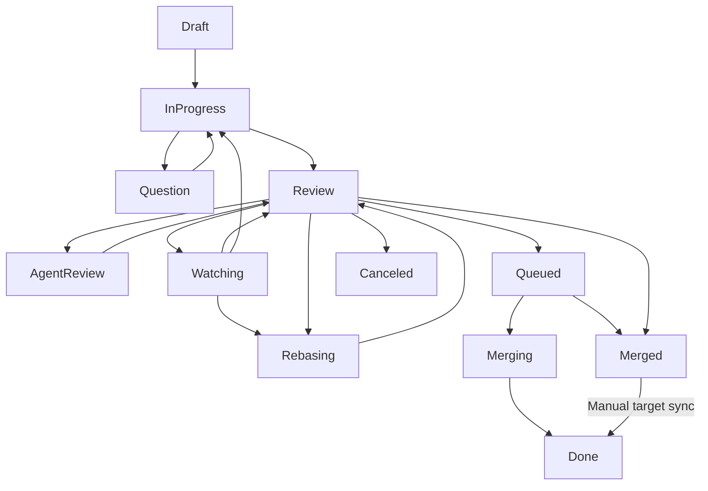

+++
title = "Workflow"
description = "Interface layout, session lifecycle, slash commands, and data location."
weight = 1
+++

<a id="usage-workflow-introduction"></a> Create a session, review its changes, then
merge locally or publish a review request. See
[Keybindings](@/docs/usage/keybindings.md) for shortcuts by view.

<!-- more -->

## Interface Layout

<a id="usage-interface-layout"></a> Use `Tab` and `Shift+Tab` to move between tabs.
Agentty restores the last tab on startup.

- **Projects**: Choose a repository; view activity, usage, and installed agent CLIs.
- **Sessions**: Create and manage work in merge-queue, active, and archive groups. Press
  `p` to switch projects. Each row shows a short model name, such as `opus-5.5`, and its
  reasoning level.
- **Settings**: Configure appearance, model defaults, and launch commands.
- **Remote**: Pair a phone or browser with the project's sessions. The tab appears only
  with `agentty --experimental-remote` or `--remote-relay <URL>`; see
  [Remote Control](@/docs/usage/remote-control.md).
- **Platform**: Sign in to an Agentty Platform so paired devices reach Agentty through
  its hosted relay. The tab appears only with `agentty --experimental-platform`, and not
  with `--remote-relay`; see [Agentty Platform](@/docs/usage/platform.md).

Press `?`, shown as `?: help` in the top bar, to list the shortcuts available on the
current page. With `NO_COLOR`, selections use bold reverse video.

Session chat shows `[size]`, the title, and added and removed line totals, plus any
linked review request. Scroll history with `j` / `k` or the arrow keys; `g` jumps to the
oldest output and `G` returns to the newest and follows updates. The composer border
shows `agent/model [reasoning]`, response style, speed when supported, and timers such
as `Timer: 2m 0s · Started 4m ago`. The footer shows the active directory, branch, and
ahead/behind counts.

Archiving a session while you type discards unsent drafts, partial answers, and attached
images. Up to eight session turns run at once; others wait for capacity.

### Projects and Discovery

Agentty opens the repository you launch it from. Otherwise, choose or add one in
**Projects**. Unavailable saved projects stay in your history and show an error when
opened. Older projects saved as repository subdirectories remain selectable with their
sessions and settings.

On first launch, a popup offers once to scan your home directory for repositories.
**No** is the default, and Agentty remembers your choice. Scanning may trigger
operating-system folder-access prompts.

In **Projects**, press `a` to add a repository root by path or `d` to discover
repositories in a folder. Paths can be absolute, relative to the current project, or
start with `~`. Scans search up to five levels and 200 repositories, skipping hidden
folders, Agentty worktrees, and directory symlinks. Select results with `Space`, then
press `Enter` to save them.

### Resource Usage

The list tab header shows `Processes`, `CPU`, and `RAM` (resident memory) for Agentty
and its descendant processes, including session agents, refreshed about every two
seconds. CPU can exceed `100%`, and shared memory may be counted more than once.
Detached processes are excluded.

### Project Sync

New worktrees start from the local base branch. Press `s` from a list tab to pull remote
changes first. Sync runs in the background; until it finishes, creating or starting
sessions, merging, and rebasing against that project's base checkout must be retried.
Other projects can sync at the same time. The top status bar shows the current project's
sync progress.

Ahead/behind counts come from a background `git fetch` about every 30 seconds. When
fetches keep failing, for example because the remote is unreachable or rejects your
credentials, Agentty retries less often, down to about every eight minutes, and keeps
showing counts from the last successful fetch. A successful fetch or `s` sync restores
the normal cadence.

A red `[merge conflict]` label means a session's committed branch conflicts with its
base.

For a linked GitHub pull request, a green `[ready]` label means GitHub reports the open,
non-draft request as cleanly mergeable under the repository's rules. `[ready (bypass)]`
appears when you can bypass branch protections, every required check has passed, and
either only a required approval is missing or a draft has no conflicts and no unresolved
review comments. Labels refresh every minute; a request that stays unchanged for a few
minutes is checked about every five minutes until it changes.

## Session Lifecycle

<a id="usage-session-lifecycle"></a>

| Status          | Meaning                                                  |
| --------------- | -------------------------------------------------------- |
| **Draft**       | Prompt staging or workspace setup; work has not started. |
| **InProgress**  | Agent is working.                                        |
| **Review**      | Changes are ready to inspect.                            |
| **AgentReview** | Focused review is running.                               |
| **Watching**    | Review-ready; linked review request is watched.          |
| **Question**    | Agent is waiting for clarification.                      |
| **Queued**      | Waiting in the Agentty or GitHub merge queue.            |
| **Rebasing**    | Session branch is syncing.                               |
| **Merging**     | Changes are merging into the base branch.                |
| **Merged**      | Merged remotely; waiting for manual local target sync.   |
| **Done**        | Completed; worktree removed.                             |
| **Canceled**    | Canceled; worktree removed.                              |

New sessions open the composer while their workspace is prepared; submit right away and
the prompt waits for setup. If setup fails, press `s` in session view to retry. Prompts
and images whose turns never began survive restart; review the transcript before
retrying a turn interrupted during dispatch. Startup restores interrupted rebases to
**Review**; storage or Git cleanup failures must be resolved before startup finishes.

### Typical Transitions



### Active Turns and the Message Queue

Press `Enter` during **InProgress** or **Rebasing** to queue a message. Messages,
session sync (`r`), and publishing (`p`) run in submission order after the active work
and are listed below the status. Repeated `r` presses queue one sync.

During **InProgress**, `Ctrl+C` removes the newest queued message; with none left, it
stops the turn and cancels queued branch actions. Rebases cannot be interrupted. Queued
chat survives project switching but not an Agentty restart.

Harnesses that accept input mid-turn, currently Claude and Codex, show `Ctrl+s` below
queued chat. It sends the queued messages into the running turn, oldest first, so the
agent reads them before it finishes; they then appear in the transcript as your prompts.
Messages with images still wait for the next turn, and any message the agent does not
accept stays queued with a notice. Stopping the turn discards them like the rest of the
queue. Other harnesses keep queued chat for the next turn, and so do task and graph
runs, which work in their own conversations.

While work runs, `/` offers only `/model`, `/reasoning`, `/style`, `/fast`, and
`/usage`. `/model` and `/fast` changes wait until the active work and queue finish and
appear as the last queued action; choosing the current value cancels the change. Pending
changes are lost on restart.

While composing, `Tab` focuses chat for scrolling; from there, `d` previews changes and
`q` returns to the list with the draft kept.

In Diff mode, add file, line, or range comments and press `s` to submit them with the
draft and images. Leaving Diff mode with unsent comments asks whether to submit them;
declined comments are kept until the next turn starts. Read-only sessions cannot submit
comments. See [Diff Mode](@/docs/usage/keybindings.md#diff-mode).

An open diff of a live worktree re-reads it every 10 seconds, so edits made while it is
open appear without reopening it. The selected file and line stay selected while they
still exist; an update waits while you edit a comment or select rows.

### Continuing Long Sessions

Follow-ups keep the active goal and accepted decisions unless you cancel or replace
them; a status question does not cancel work. Long sessions send opening and recent
context with access to the full saved history. Agents reuse successful checks while
their inputs are unchanged and still run repository-required checks.

### Focused Review

Agentty reviews a changed diff automatically when a session enters **Review**; unchanged
diffs and stopped turns are skipped. While an approved
[graph](@/docs/usage/workflow.md#generated-graph-proposals) is running or waiting on
you, the review waits until the graph finishes, fails, runs out of provider calls, is
canceled, or pauses. Press `f` to show the review, request one, or bring a running
review's progress into view. Results stay visible until the next prompt, and a
conflict-free sync keeps them.

Reviews read the diff, conversation, files, and history and may browse, but recommend
checks instead of running them. Each finding is verified against source; findings whose
cited code does not match the diff are marked unanchored. Coverage lists processed and
unfinished files; a processed file is not guaranteed defect-free.

Each attempt has a 128-call budget and a 30-minute deadline. A `Partial` result keeps
its findings and lists unfinished checks; an empty suggestion list does not mean the
review completed. Press `f` and confirm regeneration to resume a partial review for
unchanged inputs, including after restart. Completed reviews, changed inputs, and
accepted syncs start fresh.

Reviews apply criteria for the changed file types and test code. They also flag added
code that duplicates existing code or could be materially simpler, but not naming or
formatting preferences. Add project criteria in `.agentty/review-rules.json` in the
session worktree:

```json
{
  "rules": [
    {
      "path_prefix": "src/api/",
      "extensions": ["rs"],
      "instructions": "Check authorization before accessing tenant data."
    }
  ]
}
```

Both filters must match when present; omit one to match everything. Use relative path
prefixes and extensions without dots; renames match old and new paths. Rules add to the
standard review policy, and an invalid file stops the review with an error. The file is
limited to 64 KiB and the selected criteria to 8,000 bytes; shorten instructions or
narrow the review if they exceed it. Regenerate a review to apply changed criteria.

Use `/apply` to have the agent verify suggestions and apply those that remain valid.
Agentty [automates this](@/docs/usage/workflow.md#slash-commands) for up to three
iterations.

### Session Output Markdown

Chat renders headings, lists, quotes, code blocks, and tables, keeping indentation when
lines wrap. Tabs use four-column stops.

<a id="usage-session-mermaid"></a> Mermaid code blocks render simple flowcharts (`TD`,
`TB`, and `LR`), entity-relationship diagrams, and sequence diagrams; labels over 32
characters are truncated. Unsupported or oversized diagrams stay readable as code.
Markdown file previews use the same renderer.

### Forking a Review Session

Press `F` in a **Review** or **AgentReview** session to fork it after confirmation. The
fork gets a new worktree from the source commit and a copy of the saved conversation;
uncommitted changes are not copied. Publishing, review state, usage, and timing start
fresh.

### Commit and Merge Behavior

After each file-changing turn, Agentty commits the changes. Until you publish the
branch, it creates or updates one session commit, and reverting all changes removes the
empty commit. After publishing, each file-changing turn adds a new commit instead, so
reviewers can see what changed since their last look.

The project's Fast model writes each message, honoring the coauthor setting; that can be
a [harness model](@/docs/agents/backends.md#backends-harness-fast-model). The session
commit message covers the cumulative changes, and a later commit covers only its turn.
If message generation fails, auto-commit stops and the worktree stays intact.

Agentty never commits a Git repository nested in the worktree, such as one an agent
created there; it stays on disk, untracked. Its diffs and status checks ignore
submodules. An initialized submodule still works as before. While any other repository
sits at a submodule path, Agentty stops committing and rebasing and says which path to
clear.

<a id="usage-title-refinement"></a> The Fast model also refines session titles from the
overall goal. Draft titles update as messages are staged, committed work uses the
session commit title, and failed refinement keeps the provisional title. Commits added
after publishing leave the title unchanged. Generated session titles, commit messages,
and review-request titles and descriptions are in English unless the project's agent
instructions specify another language.

A Git index lock is retried for five seconds, then reported as `[Commit Error]`. Agentty
never removes the lock; wait for active Git operations to finish, and let only the
repository owner remove a confirmed stale lock.

If the project has pre-commit configuration but no installed hook, session creation
warns you: continue with `Enter` or cancel with `Esc` / `q`, and install the hook with
`prek install` or `pre-commit install`. Commits without the hook show
`[Commit Warning]`; failing hooks stop commits.

For an unlinked session, `m` queues a local squash merge using the session commit
message, followed by the titles of any commits added after publishing. The target
checkout must be clean. A failed rebase or merge returns the session to **Review**.
Linked review requests merge through their forge; see
[Review Request Sync](@/docs/usage/workflow.md#review-request-sync).

Session sync (`r`) rebases onto the local base for unpublished sessions, or onto the
fetched remote base for published ones. The session agent resolves conflicts; Agentty
stages the repairs, runs the installed pre-commit hook, and continues. After three
failed hook repairs, the rebase aborts with `[Sync Error]` and nothing is pushed. A
conflict clears the focused review.

`[Main Checkout Warning]` means tracked files in the main checkout changed during a turn
and remain dirty. Inspect them before continuing.

### Continuing a Terminal Session

Press `c` on **Done** or **Canceled** to confirm a new continuation draft. It uses the
merged commit or saved conversation as context and leaves the original session
unchanged.

## Session Types

<a id="usage-session-types"></a> Press `a` on **Sessions** and choose a type.
Unavailable types are shown muted.

- **Regular**: The first `Enter` starts work.
- **Draft**: Each `Enter` stages a message; `s` starts them together and creates the
  worktree from the current base branch.

Any session can switch to Agentty's built-in agent loop by choosing `ag-harness` in
`/model`; see [Harness Agent](@/docs/agents/backends.md#backends-harness).

The orchestrator session type is retired. Former controllers and their children remain
independent sessions with transcripts and workspaces intact; pending campaign work is
stopped, and former controllers and research sessions stay read-only.

Stacked sessions are retired. Existing stacked sessions become independent sessions;
unfinished ones target their root session's base branch.

## Branch Publish Flow

<a id="usage-review-request-flow"></a> Press `p` to publish a GitHub pull request or
GitLab merge request. During a turn or rebase, publishing waits in the queue.

1. Keep the default branch name or enter one that does not exist remotely. The name is
   fixed after publishing.
1. Agentty pushes with a force-with-lease check, then creates or refreshes an open
   review request.
1. The request URL appears in chat. Later completed turns push their new commits to the
   same branch automatically when no chat or sync is queued. Retry failed pushes with
   `p`.

A new review request takes its title from the session commit title, adjusted only to
satisfy repository PR/MR title rules. Titles then stay stable unless the primary
objective changes. Descriptions follow repository PR/MR instructions (`AGENTS.md`,
`CLAUDE.md`, or `GEMINI.md`), skills, and templates, or else use `Why?`, `What?`, and
`Impact?` sections. They compare the published branch with the request's current target
branch and exclude uncommitted edits. Updates preserve existing content, notes, and
checklists, and the coauthor setting adds one Agentty attribution footer. Generation
failures are reported for retry. Agentty checks for concurrent remote edits before
updating, but a later edit can still race.

<a id="usage-review-request-prerequisites"></a> Publishing requires Git credentials and
an authenticated forge CLI: `gh` for GitHub or `glab` for GitLab. See
[Forge Authentication](@/docs/usage/forge-authentication.md).

### Addressing Review Comments

Open linked comments with `c`, select actionable threads with `Space`, and press `Enter`
to have the agent address them in one turn. Resolved threads and standalone comments are
read-only; outdated unresolved threads stay actionable. While the session is busy, the
batch joins the queue; while clarification is pending, it waits for your answers. Only
one review-comment batch or watched follow-up can wait at a time.

After a successful commit and push, Agentty replies to each selected thread, in the
language of its latest reviewer comment, and resolves those reported as fixed. Threads
needing no change get an explanation and stay open; a reviewer follow-up makes them
actionable again. Review targets survive clarification and restart.

`[Review Comments Warning]` reports failures, and failed or incomplete batches stay
pending for the next turn. Later pushes retry saved replies while the fix commit is
still the branch tip, without duplicating posted replies; if the branch has changed,
continue the session to re-evaluate them. Stopping a review turn also stops its push and
thread updates, which remain retryable.

## Review Request Sync

<a id="usage-review-request-sync"></a> Published review-ready sessions refresh forge
status in the background:

| Indicator | Meaning                             |
| --------- | ----------------------------------- |
| `↑`       | Branch published; no request found. |
| `⊙ <id>`  | Request is open.                    |
| `✓ <id>`  | Request was merged.                 |
| `✗ <id>`  | Request was closed.                 |

A GitHub pull request waiting in its merge queue shows **Queued** until GitHub merges it
or removes it from the queue, which returns the session to **Review** or **Watching**. A
remote merge moves the session to read-only **Merged**, keeping its transcript and diff
in Active. Sync its local target branch with `s` from the list to move it to **Done**
and remove the worktree; if that fails, follow the warning and retry. Closing an
unmerged request cancels its session and removes its worktree.

### Watching a Review Request

<a id="usage-review-request-watch"></a> When you publish a branch that is not pushed
yet, Agentty asks whether to watch the review request, with `Yes` preselected: `Enter`
or `y` watches, `n` publishes without watching, and `Esc` cancels publishing. Press `W`
in session view to start or stop watching later.

A watched session shows **Watching** instead of **Review** and keeps every review
action. About once a minute, Agentty checks the request and starts at most one
follow-up. A request that stays unchanged for a few minutes, with no checks running, is
checked about every five minutes until it changes:

1. **Merge conflicts**: Syncs the branch as `r` does, unless the request now targets a
   different branch than the session.
1. **Review comments**: Addresses unresolved threads awaiting a response from you or a
   trusted author, as in
   [Addressing Review Comments](@/docs/usage/workflow.md#addressing-review-comments).
   Once all checks finish, failed checks join the same turn.
1. **Failing checks**: Once all checks finish, starts a turn to fix the failures. If
   other work is running, it waits in the queue as `fix N failing checks: <names>`.

Trusted authors are GitHub owners, members, and collaborators, GitLab project members
with at least the Developer role, and review bots listed in `.agentty/review-watch.json`
in the project folder:

```json
{ "trusted_bots": ["greptile-apps"] }
```

On GitHub, a listed login matches only a bot account; on GitLab, it matches the
username. A trusted bot's own failed check is not fixed separately, because its findings
arrive as comments. Without the file, no bot is trusted.

Each conflict or failed check is tried once per pushed commit, and each thread once per
new reviewer comment. If a fix turn pushes nothing, Agentty reruns the failed GitHub
Actions or GitLab pipeline jobs once; checks that still fail, or cannot be rerun, get
one `Leaving N failing checks to you` notice. `[Review Watch]` notices record each
follow-up and any failure, which is retried on the next check. Watching pauses during
turns, sync, and focused review, ends when you press `W` or the request is merged or
closed, and runs only while Agentty is open with the session's project active.

## Clarification Interaction Loop

<a id="usage-clarification-loop"></a> In **Question**, answer each question; Agentty
sends all answers together as one follow-up turn.

<a id="usage-question-options"></a> Choose an option with `j` / `k` or the arrow keys
and `Enter`, or move past the options to type a free-text answer; a blank answer means
`no answer`. Free-text answers support `@` file lookup and
[pasted images](@/docs/usage/workflow.md#usage-prompt-extras). Choosing a predefined
option discards images pasted for that question.

`Ctrl+C` from the answer input ends the turn without replying; for graph questions it
only closes the panel. `q` outside free-text input returns to the list, and reopening
resumes the unanswered questions. See
[Question Input](@/docs/usage/keybindings.md#question-input-free-text).

## Prompt Input Extras

<a id="usage-prompt-extras"></a> Paste a clipboard image with `Ctrl+V`, `Ctrl+Shift+V`,
or `Alt+V`; in a draft session, these also open the composer. Each image appears as
`[Image #n]`; typing that text does not attach a file. You can keep typing while
`Pasting image...` is shown, and `Enter` waits until the paste finishes. On Wayland,
image paste uses `wl-paste` when available; unsupported clipboards show an inline error.

`Up` / `Down` browse prompt history, keeping attached images. Type `@` to look up
repository files; Rust and Python files show their module documentation summary.
Unstarted drafts look up files in the project checkout. See
[Prompt Input](@/docs/usage/keybindings.md#prompt-input) for editing keys.

During a turn, the output shows a live timeline. Each message the model writes starts a
`•` step, with its time since the turn started on the right, a dim `✻ Thought` line for
its reasoning, and one row per tool call: `✓`, `✗`, or a spinner, a verb such as `Ran`
or `Edit`, what the call acted on, and its result, such as `exit 0`, `+38 −4`, or
`rejected · <reason>`. Consecutive reads, searches, and listings fold into one
`Explored` row, a read directly followed by an edit of the same file folds into the
edit, a failed command keeps its last output lines, a running call shows how long it has
run, and a finished call that took 5 seconds or more shows its duration. Agent CLIs that
report no messages show the rows alone. A status line above the composer names what the
turn does now and for how long, the step count, and the turn's time.

When a turn that called tools ends, a summary replaces the timeline above its saved
answer or error notice: `Edited` lists each changed file with its added and removed
lines and edit count, `Failed` lists failed calls with `✓` and how the turn recovered,
such as `→ rerun exit 0` or `→ retried after re-reading`, or `✗` when it did not,
`Explored` counts reads, searches, and commands, and `Used` counts MCP, skill, and other
tool calls. A `─ Worked` rule ends it with the turn's time, steps, tool calls, and
failures. A Codex patch that changes several files is listed under its first file with
the whole patch's line counts. Older sessions keep their `Tools`, `MCP`, and `Skills`
lines. Codex, Claude, Antigravity, and Harness report this activity. Provider failures
show a short error and captured output where available.

## Session Sizes

<a id="usage-session-size"></a> Sizes reflect lines changed against the base branch,
committed or not, and refresh while a turn edits files:

| Size    | Changed lines |
| ------- | ------------- |
| **XS**  | 0–10          |
| **S**   | 11–30         |
| **M**   | 31–80         |
| **L**   | 81–200        |
| **XL**  | 201–500       |
| **XXL** | 501+          |

## Slash Commands

<a id="usage-slash-commands"></a> Type `/` in the composer to open a fuzzy-matching
command picker. From session view, `/` opens a fresh composer, replacing any saved
draft.

| Command      | Action                                                     |
| ------------ | ---------------------------------------------------------- |
| `/apply`     | Verify and apply valid focused-review suggestions.         |
| `/graph`     | Request a graph proposal.                                  |
| `/model`     | Choose a backend and model, including `ag-harness` models. |
| `/reasoning` | Set reasoning effort for this session.                     |
| `/style`     | Choose concise, balanced, or detailed answers.             |
| `/fast`      | Toggle normal or fast responses for Claude or Codex.       |
| `/usage`     | Show this session's token usage and estimated cost.        |

`/apply` requires a completed focused review. Chat turns always run with editing
permissions; see [Permissions](@/docs/agents/backends.md#permissions).

See [Agents & Models](@/docs/agents/backends.md#switching-models) for speed costs and
model compatibility.

Agentty verifies and applies focused-review suggestions automatically, for up to three
turns per message; a new prompt resets that limit. A notice in the chat explains this
after a session's first message. Turn off `Auto Address Comments` in the project's
Settings to disable it.

`/style` applies to later turns: **Concise** keeps essential results, caveats, and
verification; **Balanced** adds useful context; **Detailed** explains decisions and
trade-offs. Explicit prompt instructions take precedence, and style never changes
permissions or required output.

### Session Usage

<a id="usage-session-usage"></a> `/usage`, or `u` in session view, opens the session's
token usage; `Esc` closes it, and `j` / `k` or `PgUp` / `PgDn` scroll it when it is
taller than the terminal. It reads only what Agentty recorded, plus each running turn's
usage after every completed model request, refreshes when new usage is saved, and never
calls a model.

The panel sums the estimated cost, tokens, turns, and requests, shows the latest and
largest context fill, and lists one row per model and purpose. Utility work such as
titles, commit messages, reviews, and rebases appears dimmed after the model. `Input`
includes cached tokens and `Output` includes reasoning. Narrow terminals drop the
cache-write, reasoning, context, and cached columns first; the cost column stays.

Figures carry a mark when they are not exact, and a note under the table names the
cause:

| Mark      | Meaning                                                                                            |
| --------- | -------------------------------------------------------------------------------------------------- |
| `≥`       | Lower bound: some requests reported no tokens or had no price, or the run predates detailed usage. |
| `≤`       | Upper bound: cached input priced at the input price, with no cache price.                          |
| `~`       | Both a lower and an upper bound.                                                                   |
| `≈`       | API-equivalent: plan-billed usage priced at API list prices; no per-token charge.                  |
| `?`       | Unreported: no request of that model reported token counts.                                        |
| `unknown` | Unpriced: no price for that model; a total over other priced models leaves it out.                 |
| `—`       | Not recorded: the backend does not report it, or the run predates detailed usage.                  |

A lower-bound cost below half a cent reads `≥$0.00`. Costs are estimates from built-in
list prices, configured prices, or the agent's own report; the provider's bill is
authoritative. On a subscription login, the panel title names the login, and costs are
API equivalents: what the same tokens would cost at the provider's API list prices. They
are never added to charged estimates; a total with both shows them side by side, such as
`$1.20 + ≈$5.03`. A plan model without an API twin reads `unknown`. See
[subscription logins](@/docs/agents/backends.md#backends-subscription-logins) for how
each backend is detected.

## Agent Definitions

Generated graph proposals and the Task API choose agents from a catalog of bundled
`planner` and `implementer` definitions plus repository definitions in
`.agents/agents/<id>/agent.md`. A repository definition with a bundled ID overrides it.
Global definitions are not loaded.

Definitions use simple `key: value` frontmatter followed by Markdown instructions:

```markdown
---
id: planner
name: Project Planner
description: Plans changes for this project
enabled: true
permission-mode: read-only
---

Inspect the project and propose a concrete plan, including validation.
```

`id` defaults to the directory name; `name`, `description`, and the instruction body are
required. `enabled: false` hides an agent, including a bundled one. `permission-mode`
accepts `inherit` (default) or `read-only` and cannot expand session permissions.
Definitions inherit the session's provider and model (`model: inherit` is accepted).
Other model overrides, tool lists, hooks, MCP configuration, and Claude-specific fields
are unsupported and produce a diagnostic, so convert Claude YAML subagents to this
subset. Proposals capture the definitions they use, so later edits affect only new
proposals.

## Settings Scope

Move the selection with `j` / `k`, then press `Enter` to open or edit a setting.

<a id="usage-settings-scope"></a> **Global settings** control the theme and the
[subagent limit](@/docs/agents/backends.md#subagent-limits), which applies after
restart. **Project settings** include model, reasoning, speed, and style defaults,
commit trailers, launch configurations, and automatic review addressing. Defaults affect
new sessions; use slash commands to change an existing one. See
[Backend Defaults](@/docs/agents/backends.md#selecting-a-backend) for the Smart, Fast,
and Review roles.

`Launch Configurations` is a command list: add with `a`, edit with `e` or `Enter`,
delete with `d`, and reorder with `J` / `K`. When Agentty runs in `tmux`, session-view
`o` runs a configured command in the worktree, or opens a selector if there are several.

## Generated Graph Proposals

In a prepared idle session, select `/graph`, describe the task, and press `Enter`; `Esc`
disarms it and keeps your draft. The composer title shows `Graph`, and pasted images
reach generation and every proposed node. Generation reads the workspace; no node runs
until you approve. If the session already has a graph that can still run, the request
[adds work to that graph](@/docs/usage/workflow.md#adding-work-to-a-running-graph).

Chat and questions stay in the left pane. The right pane, at most 35% of the width,
shows the proposal version and how many nodes are done in its title. Below the overall
status, a progress bar fills green for finished nodes and blue for working ones, with a
highlight sweeping through active work. Status glyphs spin while a preview generates or
nodes work. Nodes form a timeline: each node's status glyph leads its name, with the
status (Waiting, Working, Needs your input, Done, Failed, or Canceled) on the right and
its model and the reasoning effort it runs at, such as `claude-opus-5-5 [high]` (the
session's current effort for task conversations, `high` for fresh nodes), then its
objective wrapped underneath, up to 128 characters. The rail between nodes names what
each one waits for, such as `after inspect` or `needs report accepted`, in a highlighted
label; it is dotted (`┊`) while blocked and solid (`│`) once satisfied. When space runs
out, objectives shrink to one row and are then hidden along with models; when the graph
is still taller than the pane, a one-row-per-node summary prioritizes nodes needing
attention and counts hidden nodes. Proposals are restored when you reopen the session or
restart Agentty.

While a proposal is generated or a reply is being decided, a **Draft** or **Review**
session shows **InProgress**, starting as soon as you send the message. A running graph
keeps the session **InProgress** while any of its nodes runs, including between a node
and the next node it unblocks; it returns to **Review** once the graph finishes or waits
for you. A message sent meanwhile starts at once. `Ctrl+C` cancels generation or drops
an undecided reply.

Reply in chat to act on a pending proposal. The session model decides what your reply
means:

- Clear approval, such as "run it", approves the displayed version and starts it.
- A clear request to discard, such as "cancel", cancels the proposal.
- Anything else, including answers and requested changes, generates a new version within
  the generation limit.

When unsure, it revises. Wait for each decision before replying again. Images in a
revision reply carry over to every later version; a reply with images always revises, so
send a text approval afterward. At the generation limit, it approves without the images
and says so.

Questions from a pending proposal or running node open in the same panel as
[clarification questions](@/docs/usage/workflow.md#usage-clarification-loop), and
answers go to the exact version or node that asked. `Ctrl+C` closes the panel; reopen
the session to show it again, or reply in chat. A paused graph continues once you resume
it from `w`.

Approval does not accept later outputs. When a node waits for another node's output to
be accepted, the producer shows **Awaiting your approval**, and chat shows its output
with a prompt to approve it. Your next chat reply accepts it, as with "start
implementing", or sends revision guidance; replies with images always revise. Outputs
already consumed by a started dependent, or from nodes without a task conversation, can
only be accepted. A paused graph, such as one restored after a restart, still shows the
output as awaiting approval, and your reply resumes the graph before acting on it. This
applies to the session's newest graph only; an older paused graph leaves your message as
an ordinary turn.

Messages from a [remote device](@/docs/usage/remote-control.md) are routed the same way:
they reply to a pending proposal, answer a waiting node, or act on an output awaiting
approval before they start an ordinary turn.

### Adding Work to a Running Graph

When the graph beside the chat has not completed or been canceled, `/graph` proposes
nodes to add to that graph instead of starting a second one. `/graph` is hidden while a
node runs, so use it when the graph is paused, waits for you, or is between nodes.
Generation sees the existing nodes, the preview lists only the new ones, and you
approve, revise, or cancel the proposal by replying in chat as usual. New nodes can wait
for existing nodes and use their outputs; nodes that already ran or wait for you keep
their state. Approval runs the new nodes from the graph's remaining provider calls, and
resumes the graph if it is paused. If the graph changed or finished after you asked,
approval fails; ask again. To start a separate graph, cancel the current one first.

Duplicate approvals do not launch again. Pending proposals and undecided replies, to a
proposal or to an output awaiting approval, survive a restart or project switch. A
recovered proposal reply loses its images; a recovered output reply keeps them and
resumes its graph. Stopping the session abandons an undecided reply. Approved graphs
keep the limits fixed at approval and resume after restart with their remaining provider
calls.

## Execution Graph Inspector

Press `w` in session view to inspect the latest proposal or saved execution graphs,
including branches and joins. It shows the proposal version, model, captured agent
instructions, objectives, access, dependencies, output gates, limits, execution state,
blocked reasons, questions, and output versions. Opening it never starts work. See
[Keybindings](@/docs/usage/keybindings.md#execution-graph-inspector) for navigation.

Available controls appear below the graph. `a` accepts the displayed output, `e` sends
revision guidance to that node's task conversation, `t` retries a failed node, `s`
resumes paused dispatch, and `x` cancels the whole graph permanently after you type
`cancel`. Answer node questions in session chat. Retry and answers record intent; they
do not resume a stopped graph, unlike a chat reply to an output awaiting approval. A
rejected reply keeps its draft: press `Ctrl+r` to refresh and resubmit, or `Esc` to
discard it.

Provider-call limits are fixed when a graph first launches, and resuming continues from
the calls that remain; a node whose budget is spent stays blocked. To continue it, press
`b` and type how many calls to add, from 1 to 1000. Each increase is recorded and never
happens on its own; completed and canceled graphs cannot get more. Nothing replays
automatically on restart; only a chat reply you sent before it is still applied.
Focused-review graphs can be inspected and canceled here; regenerate them with `f`.

Programmatic integrations can track outcomes through the
[Task API](@/docs/core-components/durable-components/task.md) and query, answer, retry,
resume, extend, or cancel graphs through `SessionService`; see
[Execution Graphs](@/docs/architecture/execution-graphs.md).

## Telemetry

<a id="telemetry"></a> Agentty has two independent telemetry channels:

| Channel        | Default  | Destination                      | Contents                              | Control               |
| -------------- | -------- | -------------------------------- | ------------------------------------- | --------------------- |
| PostHog events | Enabled  | Agentty PostHog project          | The usage events below                | `--disable-telemetry` |
| OTLP export    | Disabled | Your `--otlp-endpoint` collector | Session traces, metrics, usage events | `--otlp-endpoint URL` |

PostHog telemetry sends events to the Agentty PostHog project at
`https://us.i.posthog.com`. Release builds bundle its public, write-only project token;
debug builds, including tests, send nothing. Pass `--disable-telemetry` to turn it off
for a launch:

```bash
agentty --disable-telemetry
```

`--disable-telemetry` does not affect OTLP export; see
[Local Usage Events](@/docs/usage/workflow.md#local-usage-events) and
[Session Traces](@/docs/usage/workflow.md#session-traces).

Every event includes `app_source` (`cli`), `app_version`, and `install_method` (`npm`,
`sh`, `cargo`, or `unknown`).

| Event                    | When sent                                                      | Additional properties                            |
| ------------------------ | -------------------------------------------------------------- | ------------------------------------------------ |
| `agentty_launch`         | After the database opens                                       | `ci`, `interactive`                              |
| `agentty_failure`        | When startup after the database opens or the terminal UI fails | `failure_category`, `stage`, `ci`, `interactive` |
| `agentty_session_start`  | When new session metadata is reserved                          | `session_type`, `agent`, `model`                 |
| `agentty_turn_start`     | When a first or follow-up message begins execution             | `agent`, `model`                                 |
| `agentty_turn_finish`    | When a turn and its post-processing complete successfully      | `agent`, `model`                                 |
| `agentty_turn_interrupt` | When an executing turn is stopped by the user                  | `agent`, `model`                                 |

- `ci` is `true` when `CI`, `GITHUB_ACTIONS`, `TF_BUILD`, `JENKINS_URL`, or
  `CODEBUILD_BUILD_ID` is set to a value other than empty, `0`, or `false`.
- `interactive` is `true` when standard input and output are both terminals.
- `failure_category` is `session`, `database`, `git`, `one_shot`, `no_agent`,
  `terminal`, or `workflow`; `stage` is `startup` or `runtime`. Failures before the
  database opens send nothing.
- `session_type` is `regular`, `draft`, or `fork`.
- `agent` and `model` identify the selected provider and model; any local model is sent
  as `openai-compatible`, never by name.

Each event carries a random installation ID, created on the first launch with telemetry
or `--otlp-endpoint` enabled and stored in Agentty's database, and sets
`$process_person_profile=false`. PostHog receives the request's IP address and derives
an approximate location from it. Agentty does not send error messages, stack traces,
project paths, session IDs, or prompts. The install method is inferred from the npm
package path, the shell install receipt, or Cargo install metadata, and describes
launches, not installations.

### Local Usage Events

When `--otlp-endpoint` ends in `/v1/traces`, Agentty also exports each event above as an
OTLP log record to the sibling `/v1/logs` URL, keeping any path prefix and query; for
example, `http://localhost:4318/v1/traces` sends events to
`http://localhost:4318/v1/logs`. This mirror is independent of PostHog, so it also runs
in debug builds and with `--disable-telemetry`.

Records use the event name as their body, `INFO` severity, and the PostHog properties,
plus `service.name`, `service.version`, a per-launch `service.instance.id`, and the
installation ID as `user.id`. Collectors without a logs pipeline reject them. For
authenticated endpoints, set `OTEL_EXPORTER_OTLP_LOGS_HEADERS`, falling back to
`OTEL_EXPORTER_OTLP_HEADERS`.

With a collector that forwards logs to Loki, count turns by model in Grafana with:

```logql
sum by (agent, model) (count_over_time({service_name="agentty"} |= "agentty_turn_start" [$__auto]))
```

### Session Traces

Session traces are separate from PostHog analytics and disabled by default. Pass a
complete OTLP HTTP/protobuf traces endpoint to enable them, including in debug builds:

```sh
agentty --otlp-endpoint http://localhost:4318/v1/traces
```

Agentty uses the URL as given, and endpoint environment variables cannot enable tracing.
For authenticated endpoints, set `OTEL_EXPORTER_OTLP_TRACES_HEADERS`, falling back to
`OTEL_EXPORTER_OTLP_HEADERS`.

When the traces URL ends in `/v1/traces`, Agentty also exports content-free Harness
request metrics, such as `gen_ai.client.operation.duration` and
`gen_ai.client.token.usage`, to the sibling `/v1/metrics` URL, authenticated with
`OTEL_EXPORTER_OTLP_METRICS_HEADERS` or `OTEL_EXPORTER_OTLP_HEADERS`.

Each turn has its own trace, correlated by session and operation identifiers. Spans
cover queue and capacity waits (`agentty.queue.wait_ms` on the root span), workspace and
context preparation, agent attempts, response validation, persistence, and
post-processing. Utility calls record their `agentty.purpose`, such as `commit message`.
Provider operations appear beneath `agent.attempt`:

| Provider    | Operations exposed                                              |
| ----------- | --------------------------------------------------------------- |
| Codex       | Tools, responses, reasoning, compaction, subagents              |
| Claude      | Tools, subagents                                                |
| Antigravity | Tools, responses, reasoning, compaction, checkpoints, subagents |
| Harness     | Turns, model requests with token usage, tools                   |

Provider operations depend on the CLI version and are not necessarily individual model
requests. `agentty.timing.source` is `lifecycle` for paired events, `provider` for
intervals reconstructed from a reported duration, or `completion` for observations
without a start. Harness `invoke_agent`, `chat <model>`, and `execute_tool <tool>` spans
nest beneath `agent.run` and time each model request exactly. A `bash` tool span carries
`process.exit.code` and, when the command ended in a pipeline, each stage's status as
the integer array `agentty.tool.exit_code.pipeline`. A nonzero exit is not marked as an
error, since commands such as `grep` exit nonzero as an ordinary answer.

Usage appears on these spans; any figure a backend does not report is left out, never
exported as zero:

- `session.turn`, `agent.run`, and `utility.run` carry the totals: the
  `gen_ai.usage.input_tokens`, `output_tokens`, `cache_read.input_tokens`,
  `cache_creation.input_tokens`, and `reasoning.output_tokens` counts,
  `agentty.usage.requests` and `agentty.usage.unreported_requests`, and
  `agentty.context.peak_tokens`.
- Harness `chat <model>` spans and app-server `agent.attempt` spans carry
  `gen_ai.usage.cache_creation.input_tokens`, `agentty.context.input_tokens`, and
  `agentty.context.window_tokens` for each request or attempt.
- Each of these spans carries the estimated cost only when every model involved has a
  known price. Metered usage reports its charge as `agentty.usage.cost.micro_usd`, with
  `agentty.usage.cost.basis` (`list`, `host`, `agent_reported`, or `mixed`) and
  `agentty.usage.cost.upper_bound`, which is `true` when cache reads were priced at the
  input price. Subscription usage reports what it would cost at API prices under
  `agentty.usage.api_equivalent.*` instead, with the plan `login` when known; the two
  are never summed.

Metrics add the `agentty.usage.cost` counter (`{micro_usd}`, by `gen_ai.request.model`,
`agentty.usage.cost.basis`, and `agentty.usage.cost.upper_bound`), whose API equivalents
count under the basis `api_equivalent`, and the `agentty.usage.cache_tokens` counter (by
model and `agentty.cache.op`, `read` or `write`). `gen_ai.client.token.usage` keeps only
the `input` and `output` token types. Costs are estimates; the provider bill is
authoritative. PostHog usage events never include token counts or costs.

Git and forge CLI work inside a traced workflow appears as content-free spans:

- `git.command`: one per Git subprocess, with an allowlisted `git.subcommand` (others
  are `other`), `process.exit.code`, `agentty.timed_out`, and `agentty.output.bytes`.
- `git.commit.attempt`: `agentty.git.commit.result` is `committed`, `hook_modified`,
  `nothing_to_commit`, or `failed`; only `failed` marks the attempt failed.
- `forge.command`: one per `gh` or `glab` subprocess, with `agentty.forge.kind`, the
  client `agentty.forge.operation`, `process.exit.code`, and `agentty.timed_out`. The
  authentication check before each client call nests its command in `forge.auth_check`.

Nonzero exits complete their command span; spawn failures and timeouts fail it with
`error.type` `not_found`, `spawn`, or `timeout`. Arguments, branch names, commit
messages, paths, and command output are never exported.

The trace resource carries the installation ID as `user.id`. By default, traces contain
execution identifiers, provider and model selections, token counts, outcomes, tool
names, call identifiers, executable basenames, exit codes, and output byte counts, but
no command arguments, tool output, or project paths. Tool spans repeat the run's
`agentty.harness`, `agentty.session.id`, `agentty.purpose`, `agentty.run.id`, and
`gen_ai.request.model` attributes for grouping.

Separate traces cover startup (`app.startup`), each background remote-status pass
(`sync.refresh`), manual project sync (`project.sync_main`), and foreground cycles that
take at least 50 ms between waking and drawing (`ui.slow_cycle`), with per-phase
durations to help diagnose unresponsive frames.

Add `--otlp-capture-content` to also export tool commands, arguments, and results as
previews of at most 4 KiB per attribute, keeping their beginning and end. Oversized
structured values use `agentty.tool.input.preview` and `agentty.tool.output.preview`
instead of `gen_ai.tool.call.arguments` and `gen_ai.tool.call.result`. Values with
common credential markers or URL credentials become `[REDACTED]`, but other secrets and
project paths may still appear, so enable this only for a receiver you trust. Prompts,
transcripts, reasoning, and subagent prompts are never exported.

Content previews cover Codex command, MCP, and dynamic-tool items and Claude tool
messages; Antigravity exports tool identities only. Codex command executions and file
changes report `gen_ai.tool.name` as `command_execution` and `file_change`; patches are
never captured. Export is asynchronous and best effort, so a full queue or unavailable
receiver may lose spans. Agentty prints a diagnostic summary after restoring the
terminal and waits at most three seconds for the final flush.

## Auto-Update

<a id="usage-auto-update"></a> Agentty checks the npm registry at startup and hourly.
When a newer version exists, global `npm`, Bun, and `pnpm` installs update through the
original package manager when exactly one manager's installation matches the running
binary. Otherwise, a shell install updates when the shell installer's receipt names the
running binary and its version or a newer one, such as after an earlier update that
still awaits a restart: Agentty downloads the latest installer and reruns it for the
recorded install directory without changing `PATH`. The status bar shows progress and
asks you to restart. Otherwise, or if the update fails, rerun your original installation
command. Homebrew, Cargo, `cargo-binstall`, local, and `npx` installs always update
manually. Shell installs of `v0.19.5` or earlier used an older installer: rerun the
shell installer once to enable automatic updates. See
[Installation](@/docs/getting-started/installation.md) for update commands.

```bash
agentty --no-update
```

This disables automatic installation but keeps update checks and hints. See
[Backend Selection](@/docs/agents/backends.md#selecting-a-backend) for agent CLI
refresh. Use `agentty --help` for launch options and `agentty --version` for the
installed version.

## Data Location

<a id="usage-data-location"></a> Agentty keeps its database, logs, and worktrees in its
data root, normally `~/.agentty/`. Worktrees are removed when sessions finish, are
canceled, or are deleted; if quitting or a crash interrupts that cleanup, the next
startup removes what is left in the background. Set `AGENTTY_ROOT` to use another root;
each root allows one running Agentty instance. Session state, including staged draft
attachments, stays in the data root, so a project's `.agentty/` folder holds only
configuration you can commit.
